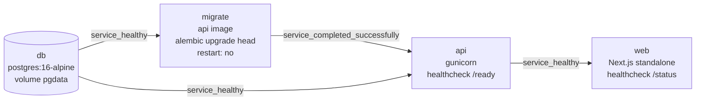

# NEXT_STEPS_PLAN.md — Approved plan to finish M0 (Foundation)

| Field | Value |
|---|---|
| Status | Approved by the developer on 1 Oct 2026 |
| Scope | Milestone 0 in full detail; M1–M6 as a roadmap only |
| Live status | `TASKS.md` is authoritative for what is active. This plan is updated in the same PR as any change to scope, order or approach |
| Workflow rules | `CLAUDE.md` → "Git Workflow"; `CONTRIBUTING.md`; ADR-0010 |

---

## 1. Problem statement

MediEase is fully planned (PRD, ADR-0001..0010, specs for M1–M5) but only M0-P1 is built: a
PostgreSQL-only `docker-compose.yml`, base `Makefile` targets and `.env.example`. `apps/api` and
`apps/web` are empty skeletons. M0 must be completed so every later feature has configuration,
logging, health/readiness, migrations, a web shell and CI to build on.

## 2. Requirements

- Follow `CLAUDE.md`: one milestone at a time, one phase at a time, design approved before code,
  `make lint typecheck test` green before a phase is done.
- **M0 exit:** on a fresh clone, one command (`make up`, which runs `docker compose up -d --wait`)
  starts the whole stack; `GET /health` → 200; `GET /ready` → 200 with the database up and 503 with
  it down; CI green on a PR. Covers NFR-12, NFR-15.
- Environment: Windows with WSL2 (or Git Bash), GNU Make, Docker Desktop with Compose v2.
- Logging uses **structlog**. Every dependency is pinned to the current stable version at the
  moment it is installed and tested, recorded in `pyproject.toml` / `package.json`.
- No code for M1+ until M0 is closed and the M1 spec is `Approved`.
- `docs/PRD.md` is the canonical PRD and stays in the repository. No PRD file is removed.

## 3. Delivery workflow (applies to every task)

```
Issue → task branch → implementation → logical commits → push (with permission) → PR
      → CI green → review + CODEOWNERS approval → merge by an authorised maintainer
```

- **One issue per logical task**, one branch per issue, one PR per branch. Unrelated changes are
  never combined.
- **Branch name:** `m<milestone>/p<phase>-<issue#>-<slug>`, e.g. `m0/p2-4-typed-settings`.
- **Commits:** one commit per logical change, imperative subject (≤ 72 chars, Conventional
  Commits prefix, requirement ID where applicable), a body explaining *what* and *why*, and a
  `Refs #<issue>` footer. Full rules in `CLAUDE.md` → "Commit Standards".
- **Never push to `origin/main`.** Agents push only to the task branch, and **only after the
  developer explicitly permits the push for that task**.
- **Never merge.** PRs follow the normal review process; CODEOWNERS approval is required where the
  repository enforces it. Merge is done by an authorised maintainer using **rebase and merge**, so
  logical commits survive on `main` with a linear history (ADR-0010).

### 3.1 Prerequisites before the first issue is created

| # | Needed | Who | How to confirm |
|---|---|---|---|
| W-1 | GitHub repository URL and `origin` remote configured | Developer | `git remote -v` |
| W-2 | `gh` CLI installed in WSL and authenticated with `repo` scope (issues, branches, PRs) | Developer | `gh auth status` |
| W-3 | Agent shell permission for `git` (add/commit/push), `gh`, `docker compose` and `make` — currently blocked in this environment | Developer | Agent can run `git status` |
| W-4 | `git config user.name` / `user.email` set for commits | Developer | `git config --get user.email` |
| W-5 | Branch protection on `main`: PR required, CI checks required, CODEOWNERS review required, linear history, rebase merge allowed, no force pushes, no direct pushes | Developer (repo admin) | Settings → Branches |
| W-6 | GitHub handles for `.github/CODEOWNERS` (file does not exist yet) | Developer | Provide handles; created in Task 1 |
| W-7 | Issue labels: `milestone:m0`, `type:feature`, `type:chore`, `type:docs` | Agent (once W-2 is done) | `gh label list` |

## 4. Findings that shaped this plan

- `TASKS.md` showed M0-P1 as active while `CHANGELOG.md` already listed it as added. Task 1
  confirms it on a real machine and closes it.
- `ci.yml` only enables the api/web jobs once `apps/api/pyproject.toml` / `apps/web/package.json`
  exist, so they switch on in P2 and P4 without workflow edits.
- The `migrate` service runs on the API image, so a **minimal API Dockerfile is added in P3**
  (approved). P5 hardens it.
- All specs are `Draft`. `docs/specs/identity-and-tenancy.md` must be `Approved` before M1 starts.
- `SECURITY.md` has a placeholder contact (`security@mediease.example`). Replace it before launch.
- On Windows, clone the repo inside the WSL filesystem (e.g. `~/mediease`) rather than `/mnt/d`,
  for speed and to avoid CRLF breaking the Makefile and shell scripts. `.gitattributes` with
  `* text=auto eol=lf` is added in Task 1.

## 5. Target service topology (end of M0)



Compose rules:

- One command starts everything: `make up` → `docker compose up -d --wait`. No manual
  `make migrate` is required for start-up; `make migrate` remains for re-running migrations.
- `api.depends_on`: `db: {condition: service_healthy}` and
  `migrate: {condition: service_completed_successfully}`. `web.depends_on`:
  `api: {condition: service_healthy}`.
- `migrate` uses the API image with `command: alembic upgrade head`, `restart: "no"`, and the same
  `env_file`/`DATABASE_URL` as `api`. Migration files are baked into the image, so no bind mount is
  needed in compose. The only persistent volume is `pgdata` (database).
- Object storage volume is not added until M4 needs it (CLAUDE.md "Each running service must have
  a current purpose").
- **Risk to verify in P3 — closed (2 Oct 2026, #10):** Compose v5.5.0 `up -d --wait` waits for
  `migrate` to exit 0 and `api` to be healthy, then exits 0; no fallback form was needed.
  Original note: `docker compose up --wait` must exit 0 when `migrate` has exited 0.
  If the installed Compose version reports a one-off container exit as failure, `make up` will
  wait on the long-running services explicitly (`docker compose up -d --wait db api web`, which
  still starts `migrate` through `depends_on`). The chosen form is recorded in `AGENTS.md` §4.

## 6. Task breakdown

Each task = one issue, one branch, one PR, with one or more logical commits. Each phase starts with
`/plan-phase` (design + approval) and ends with `/verify-phase` and `/close-phase`.

### Task 0 — Record the workflow and this plan (docs only)

- **Issue:** "Adopt issue-driven workflow, commit standards and approved M0 plan".
- **Changes:** `NEXT_STEPS_PLAN.md`, `CLAUDE.md`, `AGENTS.md`, `CONTRIBUTING.md`, `README.md`,
  `TASKS.md`, `CHANGELOG.md`, `docs/milestones/M0-foundation.md`, ADR-0010, ADR index, ADR-0001
  status, `.github/pull_request_template.md`, `.claude/settings.json` (deny pushes to `main` and
  `gh pr merge`), `.claude/commands/close-phase.md`.
- **Commits** (one PR, issue #4, branch `m0/p0-4-adopt-workflow`):
  1. `docs(adr): record issue-driven workflow and logical commits (ADR-0010)`
  2. `docs(plan): add approved M0 implementation plan`
  3. `docs(claude): add commit standards and issue-to-PR workflow`
  4. `docs: align AGENTS, CONTRIBUTING and PR template with ADR-0010`
  5. `chore(claude): deny agent pushes to main and PR merges`
  6. `docs(changelog): record M0 plan and workflow adoption`
- **Status:** merged in PR #5 (issue #4).

### Task 1 — Environment check and close M0-P1

- **Objective:** confirm the database stack works on the developer's machine; add repository
  hygiene files that the workflow depends on.
- **Guidance:** check `wsl --version`, `docker compose version` (v2), `make --version`, `git`,
  Python 3.12 and Node LTS in WSL. `cp .env.example .env && make up && make ps && make psql`
  (`select 1;` → 1) `&& make down`. Add `.gitattributes` (LF) and `.github/CODEOWNERS` (handles
  from W-6). Mark M0-P1 ✅ and M0-P2 ▶ in `TASKS.md`.
- **Failure path:** empty `POSTGRES_PASSWORD` → `make up` refuses with
  "set POSTGRES_PASSWORD in .env".
- **Demo:** healthy db reachable via `make psql`; TASKS and CHANGELOG agree.
- **Status:** issue #6, branch `m0/p1-6-close-db-stack`. Verified on Windows 11 + Docker Desktop
  (Compose v5.5.0, PowerShell): GNU `make` is not installed on the Windows host and there is no
  Ubuntu WSL distro, so the stack was exercised with the exact `docker compose` commands the
  targets run, and the Makefile itself was checked with GNU make in an Alpine container
  (`make help`, `make -n up psql down`). Installing an Ubuntu WSL distro (§4) is recommended
  before M0-P2 adds `make test-api`/`lint`/`typecheck`.

### Task 2 — M0-P2 step 1: API package and typed settings

- **Objective:** create the `mediease_api` package with typed settings that fail fast.
- **Guidance:** `apps/api/pyproject.toml` pins flask, gunicorn, pydantic, pydantic-settings,
  structlog, python-ulid; dev: pytest, ruff, mypy (strict for `domain/`, `application/`).
  `config/settings.py` with `AppSettings` and `load_settings()`. Rules: `APP_ENV ∈ {local, test,
  staging, production}`; in staging/production `COOKIE_SECURE` must be true, `LOG_LEVEL` ≠ `DEBUG`,
  `change-me` values rejected; `DB_ECHO_PARAMS` false everywhere. Invalid config → log
  `config.invalid` naming the field, exit non-zero (`CFG_INVALID`). Add `make test-api`,
  `make lint`, `make typecheck` (run in a WSL venv until P5).
- **Tests first:** `tests/unit/config/test_settings.py` — valid local config; missing
  `DATABASE_URL`; `DEBUG` in production; insecure cookies in staging; `DB_ECHO_PARAMS=true`.
- **Demo:** `make test-api lint typecheck` green; CI api job switches on.

### Task 3 — M0-P2 step 2: logging, request ID, error envelope, `/health`

- **Objective:** a Flask app built by the composition root with traceable JSON logs.
- **Guidance:** `config/logging.py` (structlog JSON, contextvars for `request_id`, `clinic_id`,
  `user_id`); `delivery/middleware.py` (accept `X-Request-ID` ≤ 64 chars or generate a ULID; echo;
  access log with `duration_ms`); `delivery/errors.py` (envelope; `SYS_UNEXPECTED` without stack
  traces in the body); `delivery/http/platform.py` (`/health`); `bootstrap.py`
  (`create_app(settings)`, no import-time side effects); `wsgi.py`. Update `docs/ERRORS.md`.
- **Tests:** `tests/integration/test_health.py` (200, `{"status":"ok"}`, generated ID present,
  `test-123` echoed); unit tests for the 500 envelope with `request_id` and JSON log lines with
  `request_id`.
- **Demo:** `curl -i localhost:8000/health` → 200 + `X-Request-ID`.

### Task 4 — M0-P3: database readiness, migrations, minimal API Dockerfile

- **Objective:** truthful `/ready`; migrations as a discrete one-off service that the API waits for.
- **Guidance:**
  - `adapters/db/engine.py` (SQLAlchemy 2 + psycopg 3, from settings).
  - `/ready`: `SELECT 1` with a 2-second statement timeout → 200
    `{"status":"ready","checks":{"database":"ok"}}` or 503 `READY_DB_UNAVAILABLE` /
    `READY_DB_TIMEOUT`.
  - `alembic.ini`, `migrations/env.py` reading the settings object, empty baseline revision.
  - **Minimal `apps/api/Dockerfile`** (python:3.12-slim, non-root user, installs the package,
    default command gunicorn).
  - `docker-compose.yml`: add `migrate` and `api` per §5, with `depends_on` conditions and the
    `pgdata` volume preserved. `make migrate` runs `docker compose run --rm migrate`.
  - Update `docs/DATA_MODEL.md` (baseline), `docs/ERRORS.md`, `AGENTS.md` §4, `.env.example` if
    a setting is added.
- **Tests:** integration `/ready` against real PostgreSQL (200); unit test with a failing/timeout
  engine → 503 with the right code; contract test (`tests/contract/`) validating `/health` and
  `/ready` against `contracts/openapi.yaml`.
- **Demo:** `make up` alone brings up db → migrate (exits 0) → api (healthy);
  `docker compose ps -a` shows `migrate` exited 0; `alembic current` shows the baseline;
  `docker compose stop db` → `/ready` 503 in ~2 s while `/health` stays 200.
- **Status:** issue #10, branch `m0/p3-10-db-readiness-migrations`. Implemented as planned, plus
  `DATABASE_URL` scheme validation, gunicorn `--preload` (invalid config stops the container
  instead of a worker restart loop) and `dns_opt` on `api` (stopped-`db` lookups took 4 s).

### Task 5 — M0-P4: web shell and generated client

- **Objective:** Next.js app calling the API through the same-origin proxy with generated types.
- **Guidance:** App Router project in `apps/web` (TS strict, ESLint, Tailwind); scripts `dev`,
  `build` (standalone), `lint`, `typecheck`, `test` (Vitest), `gen:api` (openapi-typescript →
  `src/lib/api/schema.d.ts`). `next.config` rewrites `/api/:path*`, `/health`, `/ready` to
  `API_INTERNAL_URL`; security headers. `src/lib/api/` fetch wrapper adds `X-Request-ID` and maps
  the envelope to a typed error. `src/app/status/page.tsx` with healthy, degraded and API-down
  states and "Ref: <request_id>". Add `make test-web`, `make contract`.
- **Tests:** Vitest for the wrapper (request ID attached, envelope parsed) and the status page
  (three states).
- **Demo:** `localhost:3000/status` → "API: healthy · DB: ready · Ref: …"; API stopped → clear
  error state. CI web job switches on.

### Task 6 — M0-P5: hardened images, full compose, CI gates, close M0

- **Objective:** a fresh clone runs the full stack with one command; every PR is gated.
- **Guidance:** harden `apps/api/Dockerfile` (multi-stage, non-root, minimal); add
  `apps/web/Dockerfile` (multi-stage, standalone, non-root); add `web` to compose per §5. CI:
  image builds, import-linter boundary check (`domain` → stdlib only; `application` → `domain` +
  `ports`), pip-audit, npm audit, gitleaks, coverage gate on `domain/` + `application/`. Update
  `AGENTS.md` §4, `README.md`, `TASKS.md` (M0 ✅, M1-P1 ▶), `CHANGELOG.md`, this plan.
- **Tests:** import-linter contract fails if `domain` imports flask; full
  `make lint typecheck test`.
- **Demo:** fresh clone → `cp .env.example .env && make up` → `db`, `api`, `web` healthy and
  `migrate` exited 0; PR shows all checks green → **M0 exit criteria met**.

## 7. Parallel non-code track (start now)

L-01 (Meta Business + WhatsApp number) and L-02 (template approval) are on the critical path for
M5. Start L-03 (SMS DLT), L-05 (India hosting) and L-07 (pilot clinic formats) now; L-04 (legal)
and L-06 (pilot bookings) before M6. Details in `TASKS.md`.

## 8. Roadmap after M0 (one line each)

- **M1 Identity, tenancy, audit** — clinics, roles, auth with refresh rotation, scoped
  repositories, audit log, ops onboarding. Needs `identity-and-tenancy.md` `Approved`.
- **M2 Patients** — registration, duplicate-phone flow, consent, CSV import, search
  (p95 < 500 ms at 10k patients).
- **M3 Appointments and queue** — schedules, concurrency-safe booking, queue state machine,
  ETag polling.
- **M4 Visits and prescriptions** — immutable versioned Rx, PDF, signed patient links, bilingual
  360-px page.
- **M5 Messaging and reminders** — job table + worker, WhatsApp adapter + webhooks, reminder rules,
  STOP opt-out.
- **M6 Pilot hardening** — India-region deployment, backups + restore drill, security review,
  two pilot clinics.

## 9. Progress log

| Date | Task | Issue / PR | State |
|---|---|---|---|
| 1 Oct 2026 | Plan approved; Task 0 docs written locally | — | Done |
| 1 Oct 2026 | Prerequisites: W-1 remote, W-2 `gh` auth (Mehtab404, `repo` scope, WRITE access), W-3 agent shell, W-4 git identity, W-6 CODEOWNERS handles, W-7 labels | — | Done |
| 1 Oct 2026 | W-5 branch protection on `main` | — | **Open:** not configured; private repo on GitHub Free cannot enforce protection or rulesets (HTTP 403). Needs GitHub Pro/Team or a public repo, and admin access |
| 1 Oct 2026 | Task 0 | #4 / PR #5 | Merged |
| 1 Oct 2026 | Task 1 — M0-P1 verified; `.gitattributes`, `CODEOWNERS` (4 owners; `@akhtarjamal10` needs write access) | #6 | Committed on `m0/p1-6-close-db-stack`; PR opened |
| 1–2 Oct 2026 | Tasks 2+3 — M0-P2 implemented: API package, typed settings (fail-fast, field-named errors), structlog JSON logging, `X-Request-ID` middleware, error envelope, `/health`; 31 tests; `make lint typecheck test` green; gunicorn verified (200 + `X-Request-ID`, `test-123` echoed, 405 `REQ_METHOD_NOT_ALLOWED` with `Allow`, JSON logs carry `request_id`, missing `DATABASE_URL` → exit 1 with `CFG_INVALID`) | #8 / PR #9 | Merged 2 Oct 2026 (rebase and merge) |
| 2 Oct 2026 | Task 4 — M0-P3: engine + `DatabaseCheck` port, `/ready` (200 / 503 `READY_DB_*`), Alembic empty baseline `0001`, minimal non-root Dockerfile, compose `migrate` + `api`; 55 tests incl. real-PostgreSQL and contract tests. Verified: `make up` → db healthy, migrate exited 0, api healthy (Compose v5.5.0 `--wait` handles the one-off service — §5 risk closed, no fallback needed); db stopped → 503 `READY_DB_UNAVAILABLE` in 2.0 s with `/health` 200 (after `dns_opt`, see DEBUG_JOURNAL); `make migrate` exit 0, `alembic current` = `0001 (head)` | #10 | PR opened from `m0/p3-10-db-readiness-migrations`; awaiting review and maintainer merge |
