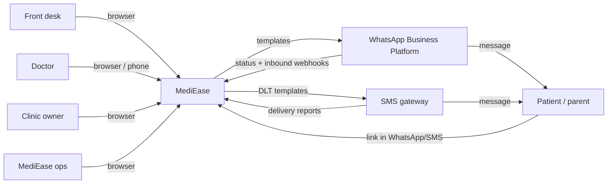
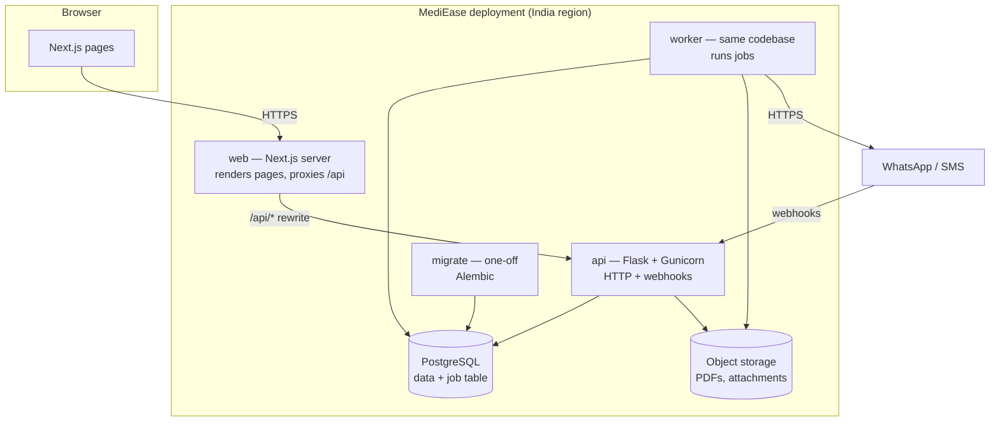
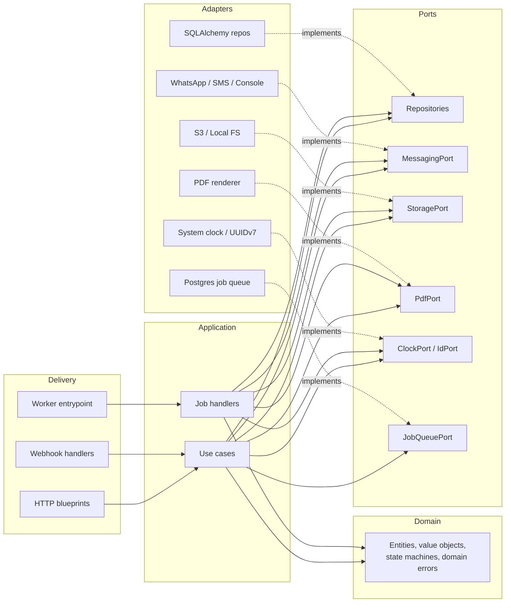
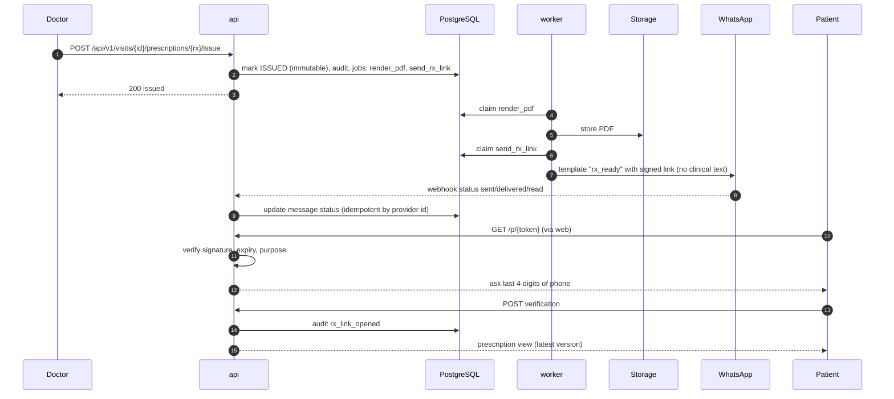
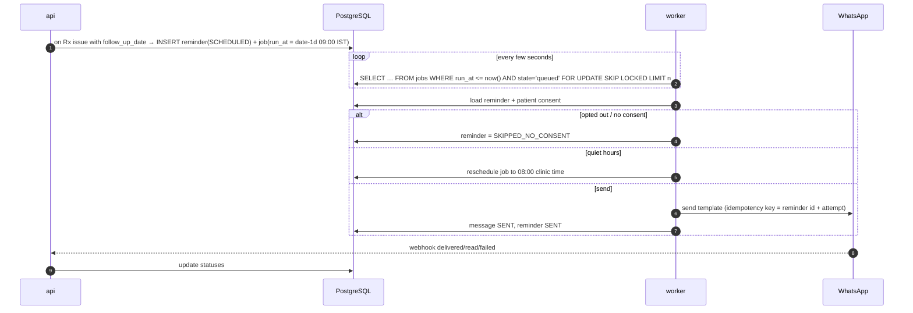
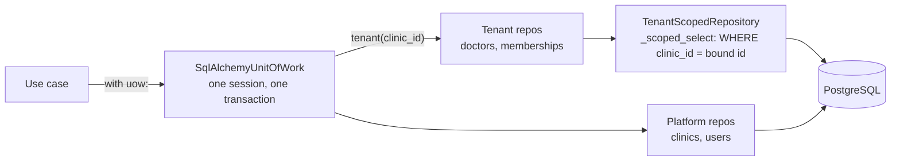
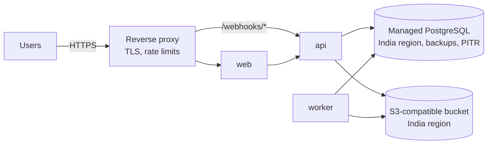

# MediEase — Architecture

This document describes **how the system is built**. It changes as milestones land; the durable
principles behind it are in `CLAUDE.md`, and the reasons behind each choice are in `docs/adr/`.

| Section | Contents |
|---|---|
| 1 | System context |
| 2 | Containers (runtime services) |
| 3 | Backend layers (hexagonal) |
| 4 | Frontend structure |
| 5 | Key request flows |
| 6 | Multi-tenancy |
| 7 | Background jobs |
| 8 | Messaging |
| 9 | Security architecture |
| 10 | Observability |
| 11 | Deployment |
| 12 | Target local stack (end of M0) |
| 13 | Scaling path |

---

## 1. System context



MediEase has no dependency on any other clinical system in the MVP. ABDM integration is an open
question (PRD §14.3).

## 2. Containers



| Container | Responsibility | Introduced |
|---|---|---|
| `web` | Server-rendered UI; proxies `/api/*` to the API so auth cookies are same-origin | M0 |
| `api` | HTTP API, webhook receivers, readiness | M0 |
| `db` | PostgreSQL: all data, including the job table | M0 |
| `migrate` | Runs Alembic migrations once, then exits | M0 |
| `worker` | Claims and runs jobs (reminders, message sends, PDF rendering) | M5 |
| object storage | Local volume in dev; S3-compatible bucket in production | M4 |

The API and worker share one Python package; only the entrypoint differs.

## 3. Backend layers (hexagonal)



**Dependency rule:** arrows point inward. `domain/` imports nothing outside the standard library.
`application/` imports `domain/` and `ports/` only. `adapters/` and `delivery/` may import anything
inward. An import-linter check in CI enforces this (added in M0-P5).

**Package layout (per feature inside each layer):**

```
src/mediease_api/
├── domain/        appointments/ patients/ prescriptions/ reminders/ clinics/ shared/
├── application/   appointments/book_appointment.py … jobs/send_reminder.py
├── ports/         repositories.py messaging.py storage.py pdf.py clock.py jobs.py
├── adapters/      db/ (engine, models, repos, tenancy) messaging/ storage/ pdf/
├── delivery/      http/ webhooks/ worker/ errors.py middleware.py
├── config/        settings.py logging.py
└── bootstrap.py   builds settings → logging → engine → adapters → use cases → app
```

**Use case shape:**

```python
class BookAppointment:
    """FR-APT-03, FR-APT-04 — book a slot or token for a patient."""
    def __init__(self, uow: UnitOfWork, clock: ClockPort, jobs: JobQueuePort) -> None: ...
    def execute(self, ctx: RequestContext, cmd: BookAppointmentCommand) -> AppointmentView: ...
```

`RequestContext` carries `request_id`, `clinic_id`, `user_id` and `role`. The unit of work opens a
transaction, exposes tenancy-scoped repositories for `ctx.clinic_id`, and commits the change, its
audit entry and any enqueued jobs **atomically**.

## 4. Frontend structure

```
apps/web/src/
├── app/
│   ├── (clinic)/          layout with auth guard + clinic context
│   │   ├── queue/         today's queue (default landing page)
│   │   ├── patients/      search, profile
│   │   ├── visits/[id]/   consultation screen
│   │   ├── follow-ups/    pending follow-ups
│   │   └── settings/      clinic, doctors, schedules, staff
│   ├── (patient)/
│   │   ├── p/[token]/     prescription view (mobile-first, bilingual)
│   │   └── c/[slug]/      public clinic page and booking request (M6b-P4)
│   ├── (ops)/ops/         clinic onboarding, import, health
│   └── (auth)/sign-in/
├── features/              appointments/ queue/ patients/ prescriptions/ reminders/
├── components/            ui primitives (buttons, dialogs, tables, forms)
└── lib/
    ├── api/               generated types + thin fetch wrapper (adds X-Request-ID)
    ├── auth/              session helpers
    ├── i18n/              en, hi dictionaries for patient pages
    └── format/            dates in clinic timezone, phone masking, currency
```

- Server Components fetch data server-side through the API; Client Components handle interaction.
- The patient pages ship minimal JavaScript (target < 200 KB total transfer, NFR-02).
- The browser never talks to the Flask API directly; all calls go to `/api/*` on the web origin and
  are rewritten to the API (ADR-0006).

## 5. Key request flows

### 5.1 Booking an appointment (FR-APT-03/04)

```mermaid
sequenceDiagram
    autonumber
    participant B as Browser (front desk)
    participant W as web (Next.js)
    participant A as api (Flask)
    participant D as PostgreSQL
    B->>W: POST /api/v1/appointments (X-Request-ID: r-123)
    W->>A: proxy, cookies + X-Request-ID
    A->>A: middleware: auth → RequestContext(clinic, role)
    A->>D: BEGIN; SELECT session … FOR UPDATE
    A->>D: count booked in session / check slot free
    alt capacity available
        A->>D: INSERT appointment, audit_event, job(send_booking_confirmation)
        A->>D: COMMIT
        A-->>B: 201 + appointment (X-Request-ID: r-123)
    else slot taken
        A->>D: ROLLBACK
        A-->>B: 409 {code: APT_SLOT_TAKEN, request_id: r-123}
    end
```

Locking the **session row** serialises bookings for that doctor-session, which makes FR-APT-04 hold
under concurrency without application-level locks. A partial unique index on
`(session_id, slot_start) WHERE status NOT IN ('CANCELLED')` is the second line of defence.

### 5.1a The live queue (FR-QUE-03, M3-P4)
Every open queue screen polls `GET /api/v1/queue` every 5 seconds through the web origin with
`If-None-Match: <last ETag>` (`lib/api/poll.ts`). The API builds the queue as usual, hashes the
JSON body into a strong `ETag` and answers `304` with no body when it matches, so a change made on
one screen reaches the others within one interval while an idle queue costs no payload. The
response is `no-store` (it holds names); the client keeps the last body in memory. Push
(websockets, server-sent events) waits until polling is measured to be too slow or too costly
(§13).

### 5.2 Issuing a prescription and delivering the link (FR-RX-06/07/08)



### 5.3 Follow-up reminder (FR-REM-01/04/05)



## 6. Multi-tenancy

Details and rationale: ADR-0003.

- One database, one schema. Every tenant-owned table has `clinic_id uuid not null` with a foreign
  key and an index leading with `clinic_id`.
- Repositories are constructed **with** a `clinic_id` by the unit of work; their methods cannot
  take a different one. There is no unscoped repository for tenant tables in application code.
- Cross-tenant operations (ops console, job claiming) use dedicated, explicitly named platform
  repositories that never return clinical content.
- A permanent `tests/tenancy/` suite creates two clinics and asserts every endpoint refuses
  cross-clinic access with `404` (not `403`, to avoid confirming existence).
- PostgreSQL Row-Level Security is a planned defence-in-depth step (ADR-0003, "Consequences").

**Implementation (M1-P1).**



- `adapters/db/tenancy.py::TenantScopedRepository` is the only place tenant queries start. It is
  built with one `clinic_id`; `_scoped_select()` already filters by it, and `_check_owned()`
  rejects writing another clinic's entity (`TenancyViolation`). `session.get()` is not used for
  tenant rows because it bypasses the filter through the identity map.
- `UnitOfWork.tenant(clinic_id)` is the only way application code reaches tenant repositories. In
  M1-P3 the `clinic_id` comes from the request's resolved membership (`RequestContext`), never
  from the request body.
- `tests/tenancy/test_repository_scoping.py` proves isolation at the repository layer and fails if
  a table with `clinic_id` has no scoped repository. `tests/tenancy/test_http_isolation.py`
  (M1-P3) proves the same over HTTP and fails if a clinic route that takes a resource ID has no
  cross-clinic case.
- **The patient portal (M6b-P1, NFR-18).** A portal caller names no clinic. `PortalScope`
  (`application/portal/scope.py`) starts from the account's active `patient_account_links`,
  read through `uow.portal_lookup` (a reviewed platform read: IDs, method and dates only), and
  reaches every record through `uow.tenant(link.clinic_id)` filtered by that link's patient.
  `tests/tenancy/test_portal_scope.py` is the portal's guard: every `@patient` route with an ID
  has a cross-account case.

## 7. Background jobs

Details and rationale: ADR-0005.

| Column | Purpose |
|---|---|
| `id`, `clinic_id`, `kind`, `payload` (jsonb, IDs only) | What to do |
| `state` (`queued`, `running`, `succeeded`, `failed`, `dead`) | Lifecycle |
| `run_at`, `attempts`, `max_attempts`, `last_error_code` | Scheduling and retries |
| `locked_by`, `locked_at` | Which worker holds it; stale locks are reclaimed after 5 minutes |
| `request_id`, `dedupe_key` (unique) | Traceability and idempotent enqueueing |

- Jobs are inserted in the same transaction as the change that caused them (transactional outbox):
  `uow.jobs.enqueue(NewJob)`. A live job with the same `dedupe_key` makes the call a no-op.
- **Claiming is its own short transaction, committed before the handler runs** (spec R9a): one
  statement moves up to a batch of due jobs `queued -> running` with `FOR UPDATE SKIP LOCKED`, adds
  one to `attempts` and sets the lock. No row lock is held across a handler or a network call, and
  a worker that dies mid-job has already used an attempt. The handler works in its own units of
  work; the outcome (`succeeded`, back to `queued`, `dead`, `cancelled`) is another short
  transaction that applies only while this worker still holds the job.
- Retries wait 1, 5, 15, then 60 minutes (plus up to 10% jitter); after `max_attempts`, or on a
  permanent failure, a job becomes `dead` (`job.dead` in the logs, `v_job_health.dead`).
- The reaper (once a minute) recovers `running` jobs whose lock is older than 5 minutes: back to
  `queued` while attempts remain, otherwise `dead`, so a crash loop ends. A long handler renews
  its lock every 60 seconds.
- Recurring jobs (the retention purge) are enqueued by a scheduler step in the worker with
  `dedupe_key = <kind>:<period start>`, so any number of workers still make one job per period.
- A job with no clinic is allowed only for the system kinds a CHECK lists. Jobs of a suspended
  clinic are `cancelled`, not run.
- Handlers are idempotent: re-running a handler for the same job must not send a second message.
- The worker is `python -m mediease_api.delivery.worker` on the API image. It rewrites a heartbeat
  file in its `/tmp` tmpfs after every poll that reached the database; the container's health check
  (`...delivery.worker.health`) fails when the file is older than 90 seconds.

## 8. Messaging

Details and rationale: ADR-0007.

```python
class MessagingPort(Protocol):
    def send_template(self, msg: OutboundTemplateMessage) -> ProviderAccepted: ...
```

- Adapters: `ConsoleMessagingAdapter` (dev/test — one log line with variable *names*, never values;
  the `messages` row is the record; refused by the worker when `APP_ENV=production`),
  `WhatsAppCloudAdapter` (P3), `SmsAdapter` (P5). Selected by settings, wired in `bootstrap.py`.
- Sending (M5-P2, `application/messaging/sender.py`): three short transactions, no lock held over
  the call. (1) Find the row by idempotency key; settled ends the job; a row still marked started
  means an earlier attempt died mid-call, so it is `FAILED` with `MSG_OUTCOME_UNKNOWN` and never
  sent again (at most once). Else re-read consent and the facts (R5), check the values against the
  template (R8), encrypt the phone, write the row as started and commit. (2) Call the provider.
  (3) Accepted → `SENT` (and the prescription's `link_delivery` → `SENT` in the same
  transaction); refused and retryable → not started, the job retries; refused for good, out of
  attempts, timed out or unknown → `FAILED`.
- Jobs enqueued in the change's own transaction (from M6a-P7 by the notification service):
  `send_booking_confirmation` (booking and reschedule, when the patient allows WhatsApp) and `send_rx_link` (issue with `link_delivery =
  PENDING`; sent only within `RX_LINK_SEND_WINDOW_HOURS`, else `EXPIRED` audited as SYSTEM).
- Templates are declared in `apps/api/src/mediease_api/adapters/messaging/templates.yaml` with the
  provider template name, language, category (utility) and variable schema. Adding a template is a
  data change plus provider approval — no code branching.
- Business-initiated WhatsApp messages must use approved templates. Utility templates sent inside
  an open customer-service window are free under Meta's per-message pricing; everything else is
  costed into the per-clinic ledger (FR-MSG-07).
- Message variables contain only clinic name, date/time and a signed link. Never clinical text.
- Webhooks (M5-P3, `delivery/webhooks/whatsapp.py`, `application/messaging/webhooks.py`): `GET`
  answers Meta's challenge only for our verify token; `POST` reads the raw body (1 MB max), rate
  limits by caller (600 a minute), verifies `X-Hub-Signature-256` *before* parsing (401
  `WH_SIGNATURE_INVALID`, nothing stored), stores the redacted body once in `webhook_events`
  (keyed by its SHA-256) and enqueues `process_webhook_event` in the same transaction, then
  answers 200. The job matches each status by our ID (sent as `biz_opaque_callback_data`) or
  Meta's, through a reviewed cross-clinic lookup that returns only the clinic and message IDs,
  then updates the message through that clinic's repository; statuses only move forward. The
  hourly `reconcile_messages` re-enqueues stuck events and reports unconfirmed messages (the Cloud
  API has no status lookup, R15).
- Reminders (M5-P4, `application/reminders/`): issuing a prescription keeps the chain's one
  follow-up reminder in step (create, move, cancel); staff schedule, move and cancel manual ones.
  Every change enqueues a `send_reminder` job for the reminder's new revision; an older job does
  nothing. At send time the job defers out of the quiet hours (a fresh job at 08:00), re-reads
  consent, and hands the reminder to the sender with `follow_up_due`. The automatic no-show is a
  5-minute system sweep (`schedule_no_shows`) that enqueues one `mark_no_shows` job per clinic.
- The WhatsApp provider (`adapters/messaging/whatsapp_cloud.py`) uses the standard library's HTTP
  client with a 10 s timeout. Meta's error codes map to `MSG_*` (`whatsapp_errors.py`): throttling
  and outages are retried; everything else Meta refused is permanent; a timeout or a lost answer is
  an unknown outcome and is never resent.
- Webhooks: verify the signature header before parsing, respond `200` fast, and process
  idempotently keyed on the provider message ID.
- Opt-out by reply (M5-P5): the webhook parser recognises a STOP before redaction and keeps only
  its sender's number, encrypted; the processing job applies STOPs before statuses
  (`application/messaging/opt_out.py`) through a reviewed cross-clinic lookup of IDs, then each
  clinic's own repositories, and enqueues one `send_opt_out_confirmation` per clinic.
- SMS fallback (M5-P5, off by default): a second `MessageSender` over the SMS port
  (`adapters/messaging/console_sms.py` until L-03). The reminder sender's `after_failed` hook and
  the webhook processor enqueue `send_sms_fallback` in the failure's transaction
  (`application/reminders/fallback.py`).
- Costs (M5-P5): `prices.yaml` is loaded once into a domain `PriceTable`; the sender prices at
  acceptance or failure and the webhook processor at delivery, once per message, in millipaise.
- Notifications (M6a-P7, ADR-0017, `application/notifications/`): a use case calls
  `publish(uow, event, …)` in its own transaction with a frozen event of IDs
  (`domain/notifications/events.py`). `NotificationService.dispatch` resolves recipients (the
  appointment's doctor, or the owners and front desk), drops the member who made the change and
  anyone who turned the kind off, and writes `notifications` rows (unique per recipient and event
  key, so a replay adds nothing), one query per lookup. For a booking, reschedule or issued
  prescription it also enqueues the M5 WhatsApp job with its M5 key; this is now the only path
  from a feature to WhatsApp. The sender's final failure and the webhook's `FAILED` transition
  publish `MessageFailed`. Reminders keep their scheduler. The web bell polls
  `GET /notifications/summary` every 15 s with its ETag.
- Appointment reminders and cancellation notices (M6a-P8, FR-APT-08, FR-APT-09): the notification
  service schedules appointment reminders on `AppointmentBooked`, replaces them on
  `AppointmentRescheduled` and cancels them on `AppointmentCancelled`, in the booking's
  transaction (`application/reminders/appointment.py`; times from
  `domain/reminders/rules.py::appointment_reminder_times`: 19:00 the day before and N hours before
  the visit, per clinic). They are rows in `reminders` and send through the same `send_reminder`
  job, which also checks the appointment is still `BOOKED` in an `OPEN` session
  (`REM_APPOINTMENT_CHANGED`) and that it can still go before the visit outside the quiet hours (`REM_TOO_LATE`),
  then sends `appointment_reminder`; the SMS fallback covers them. A cancellation by the clinic
  (`DOCTOR_UNAVAILABLE`, `CLINIC_REQUEST`) is also delivered on the WhatsApp channel: the service
  enqueues `send_cancellation_notice` (`application/messaging/cancellation.py`, template
  `appointment_cancelled`). Schedule changes that keep booked sessions publish `BookingsToMove`,
  which tells the owners and front desk in the app.

## 9. Security architecture

Full controls list: [SECURITY_AND_COMPLIANCE.md](SECURITY_AND_COMPLIANCE.md).

- **Authentication:** Argon2id password hashes; JWT access token (15 min) and rotating refresh token
  (14 days, stored hashed, reuse detection revokes the family). Cookies: `HttpOnly`, `Secure`,
  `SameSite=Lax`, path-scoped. CSRF: double-submit token on state-changing requests.
- **Patient portal sessions (M6a-P3, ADR-0015):** patients are `patient_accounts`, apart from
  `users`, with their own cookies (`me_pt_access` on `/api/v1/portal`, `me_pt_refresh`,
  `me_pt_csrf`) and JWT audience `mediease-portal`. `@patient` routes read only the portal cookie;
  every other route only `me_access`, whose verifier refuses the portal audience. Google sign-in
  for both is an OpenID Connect code flow with PKCE run by the API behind `OidcPort` (Google, or a
  local-only fake); staff are matched by Google `sub` after one verified-email link and are never
  created by it.
- **Account emails (M6a-P4, ADR-0016):** verification and reset emails go through an `EmailPort`
  with one standard-library SMTP adapter (Brevo, Resend or SES in production; the `mailpit`
  container locally). Requests only enqueue `send_auth_email`; the worker makes the single-use
  token, stores its digest in `email_tokens` and sends, so no usable secret is stored. A
  completed reset revokes every session of the account.
- **Authorisation:** every route declares an access policy (`public`, `authenticated`,
  `clinic(permission)`, `ops`, `patient`) and one `before_request` hook enforces it: it authenticates the
  `me_access` cookie, re-reads the session, user and membership, resolves the request's clinic and
  checks the permission before the view runs. `create_app` refuses to start if any route has no
  policy (default deny). The permission matrix is domain data (PRD §8.1); use cases re-check
  invariants. Implementation (M1-P3): `delivery/http/access.py`,
  `application/auth/authenticate.py`, `application/context.py`,
  `domain/identity/permissions.py`.
- **Patient links:** HMAC-signed tokens containing `purpose`, `resource_id`, `clinic_id`, `exp`;
  server-side revocation list; last-4-digit phone challenge with attempt limits.
- **Audit trail:** every audited action writes one `audit_events` row through the same unit of
  work as the change, so a committed change always has its record (spec R11). The table is
  append-only in the database: triggers refuse `UPDATE`, `DELETE` and `TRUNCATE` for every
  non-superuser role (FR-AUD-02); lifting the guard is an approved, recorded procedure
  (RUNBOOK §18). Rows carry IDs, enums, the `request_id` and an HMAC of the caller's IP — never
  names, phone numbers or clinical content. Implementation (M1-P4): `domain/audit/`,
  `application/audit.py`, `adapters/db/audit.py`, migration `0004`. **The owner's audit log
  (M6a-P8, FR-AUD-03):** the only reader is `SqlAlchemyAuditReader` (`adapters/db/audit.py`),
  reached only as `uow.tenant(clinic).audit_log` and held to `AUDIT_VIEW` (owners). It filters the
  events, memberships and patients it joins by the one clinic: a reviewed tenancy exception,
  because `audit_events.clinic_id` is nullable and the table is append-only, so it stays outside
  `TenantScopedRepository`. IP fingerprints are never returned; exports are audited
  (`audit.exported`).
- **Transport and storage:** TLS termination at the edge; database and bucket encryption at rest;
  pre-signed, short-lived URLs for PDFs.
- **Data minimisation:** analytics and logs use IDs and enums only.

## 10. Observability

See [DEBUGGING.md](DEBUGGING.md) for how to use it.

- JSON logs to stdout, collected by the platform.
- `request_id` propagated web → api → job row → worker logs → provider metadata.
- Metrics (M6): request rate/latency/errors per route, job queue depth and age, messages by status,
  webhook failures, sign-in failures.
- Alerts (M6): API 5xx rate, `/ready` failing, oldest queued job > 10 minutes, dead jobs > 0,
  WhatsApp failure rate > 5% in 15 minutes, backup job failure.

## 11. Deployment (pilot)

Details and rationale: ADR-0009.



- Single India region. Containers built in CI, tagged with the commit SHA, pushed to a registry.
- Release: `migrate` runs first as a one-off job; then `api`, `worker`, `web` roll.
- Environments: `local`, `staging` (synthetic data only), `production`.

## 12. Local stack (M0)

`docker-compose.yml` defines the whole local stack; `make up` starts it with one command:

```yaml
services:
  db:        # postgres:16-alpine, healthcheck pg_isready, named volume pgdata, 127.0.0.1 only
  migrate:   # api image, alembic upgrade head, depends_on db (healthy), restart: "no"
  api:       # api image, gunicorn, depends_on db (healthy) + migrate (completed), healthcheck /ready
  web:       # web image, depends_on api (healthy), API_INTERNAL_URL=http://api:8000, healthcheck /livez
```

`migrate`, `api` and `web` run as non-root users with a read-only root filesystem, no Linux
capabilities and `no-new-privileges`; writable space is an explicit `tmpfs`. Base images are
pinned by tag and digest. `make smoke` (also a CI job) checks all of this on the running stack.

`worker` is added in M5; object storage uses a bind-mounted volume until M4 decides otherwise.

## 13. Scaling path (only when measured need appears)

| Signal | Next step | Requires |
|---|---|---|
| Job table contention or > 50 jobs/s | Move jobs to Redis + RQ/Celery behind `JobQueuePort` | ADR |
| Queue polling load too high | Server-Sent Events for queue updates | ADR |
| Read latency on history screens | Read replicas; query tuning first | ADR |
| Many clinics, noisy neighbours | RLS enforcement, connection pooling (PgBouncer), per-tenant rate limits | ADR |
| Clinic-owned WhatsApp numbers | Multi-sender support in the messaging adapter | PRD update |
