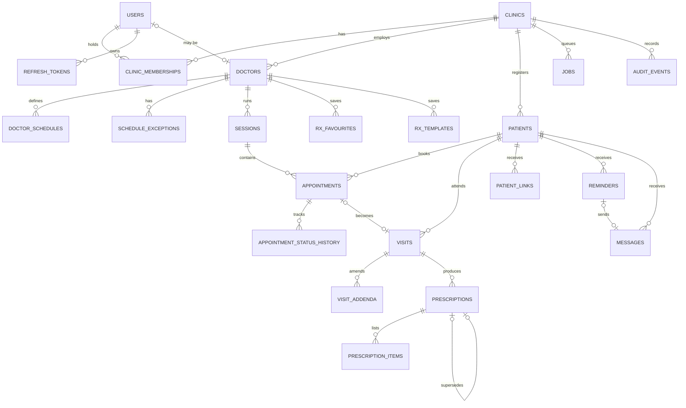

# MediEase — Data Model

Target schema for the MVP (M1–M5). Tables are created milestone by milestone through Alembic;
the **Milestone** column says when each table appears. Update this file in the same change as
any migration.

## Conventions

| Rule | Detail |
|---|---|
| Primary keys | `id uuid` (UUIDv7, time-ordered) |
| Tenancy | Every tenant-owned table has `clinic_id uuid not null references clinics(id)`; composite indexes lead with `clinic_id` |
| Timestamps | `created_at`, `updated_at` as `timestamptz` (UTC) on every table |
| Soft state | Status enums instead of deletes for clinical and appointment data; hard deletes only via the erasure procedure |
| Enums | PostgreSQL `text` + `CHECK` constraint (easier migrations than native enums) |
| Money | `bigint` paise |
| Phones | `text` E.164, validated at the boundary |
| JSON | `jsonb` only for genuinely variable shapes (vitals, advice, payloads); never for data we query by |
| Names | `snake_case`, plural table names |

## Migration history

Alembic revisions in `apps/api/migrations/versions/` (how to add one: `apps/api/migrations/README.md`).

| Revision | Change | Milestone |
|---|---|---|
| `0001` | Empty baseline. Creates no tables; only `alembic_version` exists after `upgrade head` | M0-P3 |
| `0002` | `clinics`, `users`, `clinic_memberships`, `doctors` (columns marked *P1* below; the rest arrive with the phase or milestone that uses them) | M1-P1 |
| `0003` | `users` credentials and lockout columns; `refresh_tokens` (marked *P2*) | M1-P2 |
| `0004` | `audit_events` with the two triggers that make it append-only; the `v_clinic_activity` support view | M1-P4 |
| `0005` | `clinic_memberships` invitation columns (marked *P5*); `onboarding_checklists` | M1-P5 |
| `0006` | `clinics.patient_code_prefix` (backfilled from each clinic's name) and `next_patient_seq`; the `patients` table with its lookup indexes | M2-P1 |
| `0007` | `clinics.booking_mode` (`TOKENS` for existing clinics); `doctor_schedules`, `schedule_exceptions`, `sessions` | M3-P1 |
| `0008` | `appointments` and `appointment_status_history` | M3-P2 |
| `0009` | `visits` and append-only `visit_addenda` (trigger `VIS_ADDENDUM_APPEND_ONLY`) | M4-P1 |
| `0010` | `prescriptions` and `prescription_items`, immutable once issued (triggers, `RX_NOT_DRAFT`) | M4-P2 |
| `0011` | `rx_favourites`, `rx_templates`; `prescription_items.favourite_id`, `prescriptions.template_id`; the medicine-name prefix index | M4-P3 |
| `0012` | `clinics.rx_paper_size` (`A5` for existing clinics; `A5` \| `A4`) | M4-P4 |
| `0013` | `patient_links`, `public_rate_limits`; `prescriptions.layout_version` (1 for existing rows) | M4-P5 |
| `0032` | `clinic_applications`, `clinic_application_doctors`, the reference sequence; actor `APPLICANT`; two system job kinds | M6c-P1 |

Constraint names follow one convention (`adapters/db/models/base.py`): `pk_<table>`,
`fk_<table>_<column>_<referred table>`, `uq_<table>_<columns>`, `ck_<table>_<name>`,
`ix_<table>_<columns>`. An `IntegrityError` therefore names the rule that was broken.
`tests/integration/db/test_migrations.py::test_models_match_migrations` fails if the models and
the migrations drift apart.

## Entity-relationship overview

---

## M1 — Identity, tenancy, audit

Every table has `id uuid` (UUIDv7 from `IdPort`), `created_at` and `updated_at` (`timestamptz`,
set by the application). *P1* = created by migration `0002`.

### `clinics`
| Column | Type | Notes |
|---|---|---|
| id | uuid PK | *P1* |
| name | text not null | *P1* Shown in messages and letterhead |
| slug | text unique not null | *P1* `uq_clinics_slug`; lower-case words and hyphens, 3–63 chars; public page URL (M7) |
| timezone | text not null default `Asia/Kolkata` | *P1* IANA name, validated by the domain |
| status | text not null | *P1* `ONBOARDING` \| `ACTIVE` \| `SUSPENDED` (`ck_clinics_status`) |
| phone_e164 | text | *P1* |
| address_line, city, state, pincode | text | *P1* PIN code: 6 digits |
| specialties | text[] not null default `{}` | *P1* |
| patient_code_prefix | text not null | *M2-P1* 2–4 upper-case letters (`ck_clinics_patient_code_prefix_format`), e.g. `ME` → `ME-0142`. Derived from the name at creation unless ops sets it; fixed once the clinic has patients |
| next_patient_seq | integer not null default 1 | *M2-P1* Incremented under a row lock on the clinic (`ck_clinics_next_patient_seq_positive`); a code is never reused |
| booking_mode | text not null default `'TOKENS'` | `SLOTS` \| `TOKENS` (M3-P1, migration `0007`); changing it is refused while a current block lacks the new mode's value (R19) |
| rx_paper_size | text not null default `'A5'` | `A5` \| `A4` (M4-P4, migration `0012`): prescription paper, read when a version is first rendered |
| reminder_evening_before | boolean not null default true | M6a-P8, migration `0024`: an appointment reminder at 19:00 clinic time the day before (FR-APT-08). Read when a booking is made or moved; reminders already scheduled stay |
| reminder_hours_before | smallint not null default 2 | M6a-P8, migration `0024`: an appointment reminder this many hours before the visit; 0 is off. 0–6 (`ck_clinics_reminder_hours_before_range`) |
| plan | text not null default `PILOT` | Billing (post-pilot) — `PILOT` \| `STARTER` \| `CLINIC` |

### `users`
Not tenant-owned: one user can hold memberships in several clinics.

| Column | Type | Notes |
|---|---|---|
| id | uuid PK | *P1* |
| full_name | text not null | *P1* |
| email | text unique null | *P1* `uq_users_email`; stored lower-case (`ck_users_email_lower_case`) instead of `citext`, so no extension is needed |
| phone_e164 | text unique null | *P1* `uq_users_phone_e164`; `ck_users_email_or_phone`: `email IS NOT NULL OR phone_e164 IS NOT NULL` |
| is_platform_ops | boolean not null default false | *P1* MediEase staff (R10) |
| status | text not null | *P1* `ACTIVE` \| `DISABLED` (`ck_users_status`) |
| password_hash | text null | *P2* Argon2id hash string; null until a password is set (invited users), and a null hash never signs in |
| failed_login_count | integer not null default 0 | *P2* consecutive failures; `ck_users_failed_login_count_non_negative` (FR-AUTH-04) |
| locked_until | timestamptz null | *P2* set to failure time + 15 min on the 5th failure |
| last_login_at | timestamptz null | *P2* last successful sign-in |

### `clinic_memberships`
| Column | Type | Notes |
|---|---|---|
| id | uuid PK | *P1* |
| clinic_id | uuid FK not null | *P1* |
| user_id | uuid FK not null | *P1* index `ix_clinic_memberships_user_id` (a user's clinics) |
| role | text not null | *P1* `OWNER` \| `DOCTOR` \| `FRONT_DESK` (`ck_clinic_memberships_role`) |
| status | text not null | *P1* `INVITED` \| `ACTIVE` \| `DEACTIVATED` (`ck_clinic_memberships_status`); from M6a-P5 `DEACTIVATED → INVITED` when an owner invites the person back (domain rule, no schema change) |
| | | *P1* `uq_clinic_memberships_clinic_id_user_id` — invariant I2 |
| invite_token_hash | text null | *P5* SHA-256 of the single-use invitation secret, `uq_clinic_memberships_invite_token_hash`. The secret is never stored; the digest is kept after acceptance so a replay answers "already used" instead of "unknown". From M6a-P5 an emailed invitation has none until the worker sends it (`send_staff_invite`) |
| invite_expires_at | timestamptz null | *P5* 7 days after the invitation was issued (`INVITE_TTL`, a domain constant) |
| invite_accepted_at | timestamptz null | *P5* when the invitee set a password and the membership activated |

An `INVITED` membership **is** the pending invitation: one row, so there is no second state to
keep in step, invariant I2 keeps duplicates out, and re-inviting replaces the digest — which
retires the previous link. Deactivating a member clears a pending invitation. The lookup by
digest is a platform read (`StaffInviteRepository`), because the invitee has no clinic context
yet: the same sanctioned pattern as refresh tokens (ADR-0003).

### `doctors`
| Column | Type | Notes |
|---|---|---|
| id | uuid PK | *P1* |
| clinic_id | uuid FK not null | *P1* index `ix_doctors_clinic_id` |
| user_id | uuid FK null | *P1* Null for a doctor who never signs in; `uq_doctors_clinic_id_user_id` (partial, `WHERE user_id IS NOT NULL`): one profile per user per clinic |
| display_name | text not null | *P1* "Dr. A. Sample" |
| qualification | text not null | *P1* Printed on Rx (I3) |
| registration_number | text not null | *P1* Printed on Rx (FR-ORG-02, I3) |
| registration_council | text not null | *P1* e.g. state medical council (I3) |
| specialty | text | *P1* |
| is_active | boolean not null default true | *P1* |

### `refresh_tokens`
Owned by a user, not a clinic. *P2* = created by migration `0003`.

| Column | Type | Notes |
|---|---|---|
| id | uuid PK | *P2* |
| user_id | uuid FK not null | *P2* index `ix_refresh_tokens_user_id` |
| family_id | uuid not null | *P2* one family per sign-in; reuse of a rotated token revokes the whole family (R5); index `ix_refresh_tokens_family_id` |
| token_hash | text unique not null | *P2* SHA-256 hex of the token (`uq_refresh_tokens_token_hash`); the token itself is never stored |
| expires_at | timestamptz not null | *P2* issue time + `REFRESH_TOKEN_TTL_SECONDS` |
| revoked_at | timestamptz null | *P2* set by rotation, sign-out or family revocation |
| replaced_by_id | uuid FK `refresh_tokens` null | *P2* set by rotation; a token with it set is "rotated", and presenting it again is reuse |

### `audit_events` (append-only)
| Column | Type | Notes |
|---|---|---|
| id | uuid PK | |
| clinic_id | uuid FK `clinics` null | Null for platform-level events (a sign-in belongs to a user) |
| actor_user_id | uuid FK `users` null | Null for patient/system actors |
| actor_type | text not null | `STAFF` \| `OPS` \| `PATIENT_LINK` \| `SYSTEM` \| `PATIENT` (CHECK; `PATIENT` from migration `0020`, M6a-P3) |
| action | text not null | `area.past_tense`, from `domain/audit/actions.py`: `auth.signed_in`, `auth.sign_in_failed`, `auth.signed_out`, `auth.refresh_reused`, `staff.role_changed` (M1-P4), `clinic.*`, `doctor.*` and `staff.*` (M1-P5), `patient.created` and `patient.updated` (M2-P2: the code, or the changed field names - never a name or phone), `patient.consent_changed`, `patient.opted_out` and `patient.opted_in` (M2-P3: the two consent flags, `given_by` guardian or patient, and the opt-out `source`), `patient.imported` (M2-P4: the code and the `import_id` shared by one import, actor `OPS`), `schedule.changed` (M3-P1: the block count and how many booked sessions were kept, entity the doctor), `schedule.exception_added` / `schedule.exception_removed` (the doctor ID, kind, date and kept count; never the note), `appointment.booked` / `appointment.cancelled` / `appointment.rescheduled` (M3-P2: session, doctor and patient IDs, mode, token or slot, source, cancel reason; never a name, the reason or the note), `appointment.status_changed` (M3-P3: from, to, session and doctor IDs); more per milestone |
| entity_type, entity_id | text, uuid | Given together or not at all |
| request_id | text | Ties the row to the API log and to the client's "Ref" |
| ip_hash | text | HMAC-SHA256 of the caller's IP under `AUDIT_IP_SALT`, 32 hex chars; never a raw address |
| metadata | jsonb not null default `{}` | IDs and enums only: at most 20 keys, values at most 200 characters (enforced by the domain) |
| occurred_at | timestamptz not null | No `updated_at`: the row never changes |

Indexes: `(clinic_id, occurred_at)` and `(actor_user_id, occurred_at)`. Stored ascending —
PostgreSQL scans a btree backwards, so these serve "newest first" without a `DESC` index.

**Immutability (FR-AUD-02, AC6).** Two triggers created by migration `0004` refuse `UPDATE`,
`DELETE` and `TRUNCATE` with `AUD_APPEND_ONLY`, for every non-superuser role including the
application's. A `REVOKE` would not be a boundary today, because the application connects as the
role that owns the schema and an owner can grant its own privileges back; a dedicated
least-privilege role is defence in depth in M6-P1. A deliberate correction (a data migration, or
emptying the table in tests) has to disable the triggers explicitly — see RUNBOOK §18.

### `v_clinic_activity` (support view, FR-OPS-04)
`clinic_id, clinic_name, status, active_owners, active_doctors, active_front_desk,
last_sign_in_at, audit_events_7d, audit_events_30d, last_event_at` — "is this clinic being used,
and by whom?" during a support call, with no clinical column and no patient data. Created by
migration `0004`; read by the ops console from M6-P4.

### `onboarding_checklists`
| Column | Type | Notes |
|---|---|---|
| id | uuid PK | |
| clinic_id | uuid FK not null | `uq_onboarding_checklists_clinic_id` — one row per clinic |
| started_at | timestamptz not null | When the clinic was created, i.e. the clock for goal G4 |
| clinic_created_at, doctors_added_at, staff_invited_at | timestamptz null | Written by M1-P5 |
| patients_imported_at, first_appointment_at, first_prescription_at | timestamptz null | Written by M2, M3 and M4 |

Each column records the **first** time that step happened and is never overwritten (spec R12), so
"clinic created 14:02, owner accepted 14:31" is a fact rather than a recollection. No
`updated_at`: every column is itself a timestamp. The checklist is tenant-scoped like any other
clinic-owned table, so ops writes it through the clinic it named in the path.

---

## M2 — Patients

### `patients`
Tenant-owned (`clinic_id`), reached only through `SqlAlchemyPatientRepository`. Migration `0006`.

| Column | Type | Notes |
|---|---|---|
| id | uuid PK | |
| clinic_id | uuid FK | |
| code | text not null | `ME-0142`; `uq_patients_clinic_id_code` (also serves code lookup); never edited |
| full_name | text not null | 1–200 characters |
| phone_e164 | text not null | The contact of record; **the guardian's number for a patient under 18** (spec D1). Not unique: families share phones |
| sex | text not null | `FEMALE` \| `MALE` \| `OTHER` \| `UNDISCLOSED` (`ck_patients_sex`) |
| date_of_birth | date null | |
| age_years_at_registration | smallint→integer null | Set when the date of birth is unknown; 0–120 (`ck_patients_age_years_at_registration_range`) |
| registered_on | date not null | Clinic-local date the age was recorded; the base for computing the age later |
| guardian_name | text null | Required when under 18 (domain rule, R3) |
| language | text not null default `en` | `en` \| `hi` (`ck_patients_language`) |
| whatsapp_consent, sms_consent | boolean not null default false | FR-PAT-05 |
| consent_recorded_at | timestamptz null | `ck_patients_consent_recorded`: a flag can only be true if this is set |
| consent_recorded_by | uuid null FK users | |
| opted_out_at | timestamptz null | FR-MSG-05; overrides consent until cleared by an explicit opt-in |
| created_by | uuid FK users | |
| created_at, updated_at | timestamptz | |

`ck_patients_age_known`: exactly one of `date_of_birth` and `age_years_at_registration` is set.

Indexes: `uq_patients_clinic_id_code`, `ix_patients_clinic_id_phone_e164` (exact phone lookup and
the duplicate check) and `ix_patients_clinic_id_lower_full_name` on
`(clinic_id, lower(full_name) text_pattern_ops)` (case-insensitive name prefix). The 10,000-patient
test (`tests/integration/db/test_patients.py`) times the three lookups and plans the repository's own
SQL with sequential scans disabled, so a query no index can serve fails the build. Target: FR-PAT-04
p95 < 500 ms at 10,000 patients per clinic (measured in milliseconds, not hundreds of them).

The `tags` column planned for advanced search (FR-PAT-07, P1) is not created: it joins the table
when something reads it.

---

## M3 — Schedules, appointments, queue

### `doctor_schedules`
Tenant-owned, reached only through `SqlAlchemyScheduleRepository`. Migration `0007`. One row per
weekly block (spec appointments R14–R16).

| Column | Type | Notes |
|---|---|---|
| id | uuid PK | |
| clinic_id, doctor_id | uuid FK | Index `(clinic_id, doctor_id)` |
| weekday | smallint not null | 0 = Monday … 6 = Sunday (`date.weekday()`) |
| start_time, end_time | time not null | Clinic wall clock; an end at or before the start means the next day (D2). `CHECK start_time <> end_time` |
| slot_minutes | smallint null | 5–120; needed in SLOTS mode, divides the block |
| capacity | smallint null | 1–500; needed in TOKENS mode |
| valid_from, valid_to | date, date null | Clinic-local, inclusive. A replaced schedule closes its blocks at yesterday (`valid_to`) instead of deleting them, so past dates keep their rules |
| created_at, updated_at | timestamptz | |

The 15-minute to 12-hour length, the slot divisibility and overlap across midnight and the week
(R14, R15) are domain rules (`domain/scheduling/blocks.py`): they depend on each other and on the
clinic's mode, so the database holds only the ranges.

### `schedule_exceptions`
Tenant-owned (`SqlAlchemyScheduleExceptionRepository`). Migration `0007`.

| Column | Type | Notes |
|---|---|---|
| id | uuid PK | |
| clinic_id, doctor_id | uuid FK | Index `(clinic_id, doctor_id, on_date)` |
| on_date | date not null | Clinic-local |
| kind | text not null | `LEAVE` (whole day, D8) \| `EXTRA` (one block) |
| start_time, end_time, slot_minutes, capacity | time, time, smallint, smallint | Set for `EXTRA`, all null for `LEAVE` (`ck_schedule_exceptions_shape_by_kind`) |
| note | text null | Free text for staff; never in audit metadata |
| created_at, updated_at | timestamptz | |
| | | One leave per doctor and date: partial unique index `uq_schedule_exceptions_doctor_id_on_date_leave` (R17) |

### `sessions` (materialised per doctor per day)
Tenant-owned (`SqlAlchemySessionRepository`). Migration `0007`.

| Column | Type | Notes |
|---|---|---|
| id | uuid PK | |
| clinic_id, doctor_id | uuid FK | Index `(clinic_id, on_date, doctor_id)` |
| on_date | date not null | The clinic-local date the session *starts* on, also when it runs past midnight (R2) |
| starts_at, ends_at | timestamptz | UTC; `CHECK ends_at > starts_at` |
| mode | text | `SLOTS` \| `TOKENS`, fixed when generated |
| slot_minutes | smallint null | Set exactly in SLOTS mode (`ck_sessions_slot_minutes_by_mode`) |
| capacity | smallint not null | Derived in SLOTS mode (length ÷ slot), stated in TOKENS mode (D3); 1–500 |
| booked_count | smallint not null default 0 | Changed under `FOR UPDATE` with the appointment (M3-P2). `CHECK booked_count BETWEEN 0 AND capacity`: no overbooking (D6) |
| next_token | smallint not null default 1 | TOKENS mode |
| status | text | `OPEN` \| `CLOSED` (booked, no longer planned: no new bookings, D10) \| `CANCELLED` (retired: unbooked, kept for cancelled appointments; hidden from listing) |
| | | `UNIQUE (doctor_id, starts_at)` |

Sessions are generated lazily, the first time a date from the clinic's today up to 180 days ahead
is read, with `INSERT … ON CONFLICT (doctor_id, starts_at) DO NOTHING`, so concurrent reads create
one set (R1, D1). After a schedule or exception change, sessions that no longer match the rules are
deleted if `booked_count = 0` and kept otherwise (D4); the next read fills in the rest. Changes lock
the doctor row `FOR UPDATE` and generation takes `FOR SHARE` (R20).

### `appointments`
Tenant-owned (`SqlAlchemyAppointmentRepository`). Migration `0008`. One patient's place in one
session (spec appointments R3–R8).

| Column | Type | Notes |
|---|---|---|
| id | uuid PK | |
| clinic_id, session_id, doctor_id, patient_id | uuid FK | |
| slot_start | timestamptz null | SLOTS mode: one of the session's slot starts |
| token_number | smallint null | TOKENS mode; exactly one of the two is set (`ck_appointments_one_place`) |
| status | text not null | `BOOKED` \| `ARRIVED` \| `IN_CONSULTATION` \| `COMPLETED` \| `NO_SHOW` \| `CANCELLED` |
| source | text not null | `FRONT_DESK` \| `PHONE` \| `WHATSAPP` \| `PUBLIC_PAGE` \| `WALK_IN` (FR-APT-07) |
| reason | text null | ≤ 120 characters, non-clinical; never logged, audited or messaged |
| cancel_reason, cancel_note, cancelled_at | text, text, timestamptz | Set together with `CANCELLED` (`ck_appointments_cancelled_has_reason`); note ≤ 200 |
| rescheduled_from_id | uuid FK appointments null | The cancelled appointment a reschedule replaced (R8) |
| arrived_at, started_at, completed_at | timestamptz null | Set on entering `ARRIVED` / `IN_CONSULTATION` / `COMPLETED` (M3-P3); the queue's wait time |
| created_by | uuid FK users null | Null for public-page requests |
| created_at, updated_at | timestamptz | |

The database backs the booking rules whatever the code does (FR-APT-04):
- `uq_appointments_session_id_slot_start_active`: partial unique `(session_id, slot_start) WHERE status <> 'CANCELLED' AND slot_start IS NOT NULL` (R3).
- `uq_appointments_session_id_patient_id_active`: partial unique `(session_id, patient_id) WHERE status <> 'CANCELLED'` (D13).
- `uq_appointments_session_id_token_number`: a token is never handed out twice, cancelled or not (R4).
- Indexes `(clinic_id, doctor_id, status)` and `(clinic_id, patient_id, created_at desc)`.

Booking, cancel and reschedule lock the doctor `FOR SHARE`, then the session `FOR UPDATE`, and
change `sessions.booked_count` / `next_token` in the same transaction as the appointment row. A
session that no longer matches the rules but has bookings becomes `CLOSED` (D10); one whose
capacity alone changed is resized (D11); an unbooked one that cancelled appointments still point
at is retired (`CANCELLED`) instead of deleted, and revived if the rules plan it again.

### `appointment_status_history` (append-only)
Tenant-owned (`SqlAlchemyAppointmentHistoryRepository`). Migration `0008`.
`id, clinic_id, appointment_id, from_status null, to_status, changed_by, changed_at, request_id`;
index `(appointment_id, changed_at)`. One row per status change, including the booking
(`from_status` null) and a reschedule's cancellation (FR-APT-05).

---|---|---|
| id | uuid PK | |
| clinic_id, session_id, doctor_id, patient_id | uuid FK | |
| slot_start | timestamptz null | SLOTS mode |
| token_number | smallint null | TOKENS mode |
| status | text not null | `BOOKED` \| `ARRIVED` \| `IN_CONSULTATION` \| `COMPLETED` \| `NO_SHOW` \| `CANCELLED` |
| source | text not null | FR-APT-07 |
| reason | text null | Non-clinical short reason |
| cancel_reason | text null | |
| arrived_at, started_at, completed_at | timestamptz null | Wait-time metrics |
| created_by | uuid FK users null | Null for public-page requests |

Constraints: partial unique `(session_id, slot_start) WHERE status <> 'CANCELLED' AND slot_start IS NOT NULL`;
partial unique `(session_id, token_number) WHERE token_number IS NOT NULL`.
Index: `(clinic_id, doctor_id, status)`, `(clinic_id, patient_id, created_at desc)`.

### `appointment_status_history`
`id, clinic_id, appointment_id, from_status, to_status, changed_by, changed_at, request_id`

---

## M4 — Visits and prescriptions

### `visits` (migration `0009`, M4-P1)
The clinical record of one appointment (spec prescriptions R1-R3; M4-P1 decisions 1A-6A).

| Column | Type | Notes |
|---|---|---|
| id | uuid PK | |
| clinic_id, patient_id, doctor_id | uuid FK | `doctor_id` is the session's doctor, the only writer |
| appointment_id | uuid FK not null, unique | One visit per appointment; walk-ins come through the queue first (5A) |
| status | text | `OPEN` \| `COMPLETED` (CHECK) |
| chief_complaint (≤ 500), findings (≤ 5,000), diagnosis (≤ 1,000), notes (≤ 5,000) | text null | **Clinical** — never logged or audited; length CHECKs |
| vitals | jsonb not null default `{}` | Recorded keys only: `bp_systolic`, `bp_diastolic` (mmHg), `pulse` (/min), `temp_c`, `weight_kg`, `height_cm`, `spo2` (%), `resp_rate` (/min); bounds catch typing errors only |
| revision | integer not null default 1 | +1 per change; a `PATCH` must send the one it saw (`VIS_STALE`, 4A) |
| started_at | timestamptz | |
| completed_at | timestamptz null | Set ⇔ `COMPLETED` (CHECK) |
| locked_at | timestamptz null | Exactly `completed_at + 24 h` (CHECK). Locked is decided by the application's clock (6A) |
| created_by | uuid FK users | |
| created_at, updated_at | timestamptz | |

Index `ix_visits_clinic_id_patient_id_started_at (clinic_id, patient_id, started_at DESC, id DESC)`
serves the history (newest first, keyset pages). Migration `0022` (M6a-P6) adds
`ix_visits_clinic_id_doctor_id_started_at (clinic_id, doctor_id, started_at DESC)` for *My
Patients* (`GET /my-patients`: one doctor's visits grouped by patient). An index only.

### `visit_addenda` (migration `0009`, M4-P1)
`id, clinic_id, visit_id, author_user_id, body text (1–5,000), created_at`; index
`(visit_id, created_at)`. **Append-only:** triggers refuse `UPDATE`, `DELETE` and `TRUNCATE`
(`VIS_ADDENDUM_APPEND_ONLY`), like `audit_events`. Tests reset it the same deliberate way.
### `prescriptions` (migration `0010`, M4-P2)
One version of a visit's prescription chain (spec R4-R6, R14; decisions 1A-6A).

| Column | Type | Notes |
|---|---|---|
| id | uuid PK | |
| clinic_id, visit_id, patient_id, doctor_id | uuid FK | `doctor_id` is the visit's doctor, the only writer |
| version | smallint not null | `UNIQUE (visit_id, version)`; 1 ⇔ `supersedes_id` null (CHECK) |
| supersedes_id | uuid FK prescriptions null | The version this one replaces (FR-RX-09) |
| status | text | `DRAFT` \| `ISSUED` \| `SUPERSEDED`; at most one draft per visit (`uq_prescriptions_visit_id_draft`, partial) |
| revision | integer not null default 1 | +1 per save; `PUT`/issue must send it (`RX_STALE`) |
| advice | jsonb not null | `{diet[], activity[], return_if[], notes}` — **clinical**, as written |
| follow_up_date | date null | After the issue date, within a year; for M5's reminders |
| starts_on | date null | M6b-P3 (migration `0027`, prescriptions R24): the course's first day, within 30 days of the issue day; **null = the issue day** on the clinic's calendar (not backfilled: issued rows are immutable) |
| language | text null | `en` \| `hi`: the patient's preference at issue; the PDF uses it (R20) |
| issued_at | timestamptz null | |
| doctor_snapshot | jsonb null | Name, qualification, registration number and council, specialty **as printed** |
| clinic_snapshot | jsonb null | Name, address, city, state, pincode, phone **as printed** (5A) |
| pdf_object_key | text null | `rx/{clinic_id}/{id}/v{version}.pdf`, set once at the first download (M4-P4, ADR-0012); the file is in blob storage |
| link_delivery | text null | `PENDING` \| `NOT_CONSENTED` \| `SUPERSEDED` \| `SENT` \| `EXPIRED` (R14, R15; the last two are M5's) |
| link_delivery_requested_at | timestamptz null | = `issued_at` when `PENDING`; M5 sends only within 24 h of it |
| created_by | uuid FK users | |
| created_at, updated_at | timestamptz | |

CHECKs: an issued or superseded version has `issued_at`, `language`, both snapshots and
`link_delivery`; a draft has none of them and no PDF. **Immutable once issued** (trigger
`prescriptions_immutable`, `RX_NOT_DRAFT`): only `status` ISSUED → SUPERSEDED, `pdf_object_key`
once, `link_delivery` PENDING → SUPERSEDED/SENT/EXPIRED and `updated_at` may change; a non-draft
cannot be deleted; `TRUNCATE` is refused. Index `(clinic_id, patient_id, issued_at DESC)`, which
also serves front desk's list of a patient's printable versions (M4-P4).

**Blob storage (M4-P4, ADR-0012).** Rendered PDFs are not in the database: they are objects in
the blob store (`BLOB_STORAGE=local`: the compose volume `blobs` at `/var/lib/mediease/blobs`;
`s3` from M6), written once under the key above and never replaced. A version's PDF uses the
clinic's `rx_paper_size` at its first render; changing the setting never alters a stored file.
Backups must include the blob store (RUNBOOK); a missing file is rendered again from the frozen
row under the same key.

### `prescription_items` (migration `0010`, M4-P2)
`id, clinic_id, prescription_id, position (UNIQUE per prescription, from 1), medicine_name
(1–200), form, strength, dose, quantity (≤ 100 each), frequency (CHECK `ck_prescription_items_frequency`:
from M6b-P3 / migration `0027` a 0/1 pattern of 3 or 4 slots with at least one 1, or SOS, ONCE,
CUSTOM; `domain/prescriptions/schedule.py`), frequency_text (≤ 100; set ⇔ frequency CUSTOM),
timing (BEFORE_FOOD | AFTER_FOOD | WITH_FOOD | EMPTY_STOMACH | BEDTIME | ANY), duration_days
(1–365), duration_kind (M6b-P3: DAYS | UNTIL_REVIEW | ONGOING | null = not stated; DAYS ⇔
duration_days, `ck_prescription_items_duration_days_with_kind`; rows from before 0027 keep a
null kind and read as DAYS when they have days), preparation jsonb [{code, text}] (M6b-P3 adds
WITH_WATER, WITH_WARM_WATER, WITH_MILK),
storage jsonb [{code, days}], warnings (≤ 500), notes (≤ 1,000)` — all clinical, never logged.
Trigger `prescription_items_frozen` allows `INSERT`/`UPDATE`/`DELETE` only while the parent is a
draft; `TRUNCATE` refused.
### `rx_favourites` / `rx_templates` (migration `0011`, M4-P3)
A doctor's own working tools (decision 1A), not clinical records about a patient.
`id, clinic_id, doctor_id, name (1–100, unique per doctor ignoring case:
uq_<table>_doctor_id_name on lower(name)), revision, use_count (≥ 0), last_used_at, created_at,
updated_at`; `rx_favourites.item jsonb` (one line's body); `rx_templates.items jsonb`,
`advice jsonb`, `follow_up_days` (1–365). Bodies are validated by the prescription rules when
saved. At most 200 favourites and 50 templates per doctor (application limit).

M4-P3 also adds `prescription_items.favourite_id` and `prescriptions.template_id` (plain IDs,
no foreign key: a deleted favourite must not touch an issued prescription; the P2 trigger covers
them), counted into `use_count` when the prescription is issued (3A), and
`ix_prescription_items_clinic_id_medicine_name (clinic_id, lower(medicine_name)
text_pattern_ops)` for start-of-name suggestions (5A).

### `patient_links` (migration `0013`, M4-P5)
| Column | Type | Notes |
|---|---|---|
| id | uuid PK | Also the token's `jti` |
| clinic_id, patient_id | uuid FK | |
| prescription_id | uuid FK | Version 1 of the chain (decision 1A); the page resolves the latest issued version |
| purpose | text | `RX_VIEW` (later: `QUEUE_STATUS`, `BOOKING_MANAGE`) |
| key_id | text | The signing key the token uses (`PATIENT_LINK_SIGNING_KEYS`); the token is computed from the row and this key, so nothing secret is stored |
| expires_at | timestamptz | Issue + `PATIENT_LINK_TTL_DAYS` (90), whole seconds (FR-RX-08) |
| revoked_at | timestamptz null | Set by *Replace link* |
| failed_challenges | smallint default 0 | 0–5; the fifth sets `locked_at` (CHECK keeps them in step) |
| locked_at | timestamptz null | Until staff reset it (`LINK_LOCKED`) |
| open_count | integer default 0 | Successful last-4 checks (R13) |
| last_opened_at | timestamptz null | |
| created_by | uuid FK users | The doctor who issued version 1, or the staff member who made or replaced it |

One active link per chain: partial unique index `uq_patient_links_prescription_id_active`
(`revoked_at IS NULL`). Index `(clinic_id, patient_id)`. Created in the issuing transaction of
version 1, or by `GET /prescriptions/{id}/link` for chains issued before M4-P5.

### `public_rate_limits` (migration `0013`, M4-P5) — not tenant data
`bucket text, window_start timestamptz, hits integer ≥ 1`, primary key `(bucket, window_start)`.
One row per bucket (`link:<jti>`, `caller:<ip fingerprint>`) and minute, upserted per public
request; rows older than an hour are deleted on write. Holds no patient data.

### `prescriptions.layout_version` (migration `0013`, M4-P5)
`smallint not null default 1`: the printed layout fixed when the version is issued
(`CURRENT_LAYOUT`). The PDF renderer picks that layout's template, so a later layout change never
alters a prescription issued before it; existing rows are 1, the only layout so far.

---

## M5 — Reminders, messages, jobs

### `reminders` (migration `0017`, M5-P4)
Tenant-scoped (`SqlAlchemyReminderRepository`).

| Column | Type | Notes |
|---|---|---|
| id | uuid PK | |
| clinic_id, patient_id, doctor_id | uuid FK | |
| kind | text | `FOLLOW_UP` \| `APPOINTMENT` (M6a-P8). `ck_reminders_kind_source`: `APPOINTMENT` exactly when the source is `APPOINTMENT` |
| source, source_id | text, uuid null FK prescriptions | `PRESCRIPTION` with the chain's version 1, `MANUAL` with none, or (M6a-P8) `APPOINTMENT` with none (CHECK) |
| appointment_id | uuid null FK appointments | M6a-P8: set exactly when the source is `APPOINTMENT` (`ck_reminders_appointment_id`); index `ix_reminders_appointment_id` |
| follow_up_date | date | The follow-up date; for an appointment reminder, the visit date |
| due_at | timestamptz | Follow-up: 09:00 clinic time the day before (now if past). Appointment: 19:00 the day before, or N hours before the visit (`clinics.reminder_*`). Never 21:00–08:00 |
| status | text | `SCHEDULED` \| `SENT` \| `CANCELLED` \| `SKIPPED_NO_CONSENT` \| `FAILED`; once `SENT`, the visible status is the message's (decision 3A) |
| revision | smallint | Bumped by every move, deferral or cancel; each `send_reminder` job carries the revision it was made for (decision 1A) |
| error_code | text null | `REM_CLINIC_PHONE_MISSING` on `FAILED`; from M6a-P8 `REM_APPOINTMENT_CHANGED` or `REM_TOO_LATE` on an appointment reminder the system cancelled at send time |
| created_by, cancelled_by | uuid null FK users | `created_by` null (from `0024`) when the system scheduled it (every appointment reminder); `cancelled_by` null when the system cancelled it |
| cancelled_at | timestamptz null | Set exactly when `CANCELLED` (CHECK) |

`uq_reminders_source_id_scheduled`: one `SCHEDULED` reminder per prescription chain. The message
of a reminder has `source_type = REMINDER` and `source_id` = the reminder.

Migration `0024` (M6a-P8, expand-only) adds the `APPOINTMENT` kind and source, `appointment_id`,
its CHECK and index, and makes `created_by` nullable. Appointment reminders are scheduled and
cancelled by the notification service on the booking's events, in its transaction (ADR-0017);
walk-ins and patients without WhatsApp consent at booking get none, and earlier bookings were not
backfilled. The send job cancels one whose appointment is no longer `BOOKED` in an `OPEN` session.

### `messages` (migration `0015`, M5-P2)
One row per message, written before the provider is called (spec R6). Tenant-scoped
(`SqlAlchemyMessageRepository`).

| Column | Type | Notes |
|---|---|---|
| id | uuid PK | |
| clinic_id, patient_id | uuid FK | |
| source_type, source_id | text, uuid | `APPOINTMENT` (the booking confirmation and, from M6a-P8, the cancellation notice) \| `PRESCRIPTION` \| `REMINDER` (P4) \| `OPT_OUT` (P5: the STOP reply; `source_id` is the patient) and its ID. A reminder may have two rows, WhatsApp and its SMS fallback (P5); it shows the latest |
| channel | text | `WHATSAPP` \| `SMS` \| `CONSOLE` |
| provider | text | `console`, `whatsapp_cloud` (P3); an SMS row from the console SMS adapter is `SMS`/`console` (P5) |
| template_key, template_version | text, smallint | From `templates.yaml` |
| language | text | `en` \| `hi` |
| variables | jsonb | Non-clinical only (R8); the signed link stored as `[link]` (decision 5A) |
| to_phone_encrypted | text | Fernet ciphertext (decision 1A); keys in `MESSAGING_PHONE_KEYS`, never in the database |
| idempotency_key | text unique not null | `booking_confirmed:<appointment>`, `rx_link:<prescription version>`, `follow_up_due:<reminder>` (P4), `sms:<reminder>` and `opt_out_confirmed:<clinic>:<inbound message>` (P5); the job's `dedupe_key` except for the SMS fallback, whose jobs are `sms_fallback:<reminder>:<deferrals>` |
| status | text | `QUEUED` \| `SENT` \| `DELIVERED` \| `READ` \| `FAILED` |
| error_code | text null | `MSG_*`; set on `FAILED`, and on a refused `QUEUED` row awaiting its retry |
| provider_message_id | text unique null | Webhook idempotency (P3); set exactly when accepted |
| cost_millipaise | bigint null | R18 (migration `0019`, renamed from the never-written `cost_paise`): integer millipaise, 1 paisa = 1,000, excluding GST, from `prices.yaml`. Set once: WhatsApp when delivery is reported (0 if Meta says not billable), SMS at acceptance per segment, console and failures 0; null while unknown (an unknown outcome stays null). `ck_messages_cost_not_negative` |
| request_id, job_id | text, uuid null | Correlation; `job_id` has no FK (jobs are purged) |
| sending_started_at | timestamptz null | Set while a provider call may be under way; a retry that finds it set fails the row as `MSG_OUTCOME_UNKNOWN` (decision 4A) |
| sent_at, delivered_at, read_at, failed_at | timestamptz null | |

CHECKs: accepted ⇒ `sent_at` and `provider_message_id` (one-way from `0016`); `FAILED` ⇔ `failed_at` and `error_code`;
`sending_started_at` only while `QUEUED`. `v_message_health`: counts by channel, template and
status, the last 24 hours, `outcome_unknown` and the oldest queued age; no clinic or patient data.
`ix_messages_clinic_id_sent_at` (`0019`) serves the ops monthly total
(`GET /ops/messaging-costs`).

### `inbound_messages` (not built)
Planned before M5; replaced in M5-P5 (decision 1A) by the redacted `webhook_events` payload: only a
STOP reply keeps anything about its sender, and only until it is processed (below). No other
inbound text, phone hash or table is kept.

### `webhook_events` (migration `0016`, M5-P3)
Platform data, no `clinic_id`. One row per webhook body; processed by a `process_webhook_event`
job; purged 7 days after `received_at` by the retention purge.

| Column | Type | Notes |
|---|---|---|
| id | uuid PK | |
| provider | text | `whatsapp_cloud` |
| event_key | text unique | SHA-256 of the raw body, so a redelivery is stored once |
| payload | jsonb | Redacted (decision 3A): statuses (ID, status, time, our echoed message ID, error codes, pricing category and, from P5, `billable`) and inbound message IDs and types; no text, profile names or phone numbers. P5 (decision 1A): a STOP reply also keeps `stop: true`, `context_id` (our message it answered) and `from_encrypted` (the sender's number, Fernet under `MESSAGING_PHONE_KEYS`), which the processing job removes when the event is processed |
| received_at | timestamptz | Partial index on unprocessed rows for the hourly reconciliation |
| processed_at | timestamptz null | |
| error_code | text null | `WH_UNMATCHED` when a status never found its message; `WH_STOP_UNMATCHED` (P5) when a STOP matched no patient a clinic had messaged |

`messages` gains `pricing_category` (from the status webhook, for P5's ledger), and
`ck_messages_sent_has_provider_id` became one-way in `0016`: an accepted message keeps its
provider ID and `sent_at` when Meta later reports it `failed`.

### `jobs` (migration `0014`, M5-P1)
See ARCHITECTURE.md §7. Deliberately not a tenant table: `clinic_id` is null for the system kinds a
CHECK lists, so it is a reviewed exception in the tenancy guard.

| Column | Type | Notes |
|---|---|---|
| id | uuid PK | UUIDv7 |
| clinic_id | uuid null FK clinics | Null exactly when `kind` is a system kind (`ck_jobs_system_kind`; adding a kind is a migration) |
| kind | text | `^[a-z][a-z0-9_]{2,63}$`; `purge_expired_auth_and_links` is the only system kind so far |
| payload | jsonb | IDs, counts and flags only; never names, phone numbers or clinical text |
| state | text | `queued` \| `running` \| `succeeded` \| `dead` \| `cancelled` |
| run_at | timestamptz | When it may next run |
| attempts, max_attempts | smallint | `attempts` is incremented **at claim time**, so a crash still counts; `0 <= attempts <= max_attempts`, `max_attempts` 1-20, default 5 |
| last_error_code | text null | `JOB_*`, later `MSG_*` |
| locked_by, locked_at | text, timestamptz null | Both set exactly when `running` (`ck_jobs_lock_when_running`) |
| request_id | text null | The request that caused the job |
| dedupe_key | text null | Unique only while the job is `queued`, `running` or `succeeded` (`uq_jobs_dedupe_key`), so a cancelled or dead job never blocks the same key |
| finished_at | timestamptz null | Set on `succeeded`, `dead`, `cancelled` |
| created_at, updated_at | timestamptz | |

Indexes: `ix_jobs_claim (run_at) WHERE state = 'queued'`, `ix_jobs_running (locked_at) WHERE state = 'running'`, `ix_jobs_clinic_id`.

`v_job_health` (support view, no clinic or patient data): per `kind`, `due`, `scheduled`, `running`,
`stale` (running with a lock older than 5 minutes), `dead`, `dead_24h` and `oldest_due_age_seconds`.

---

## M6a — Patient accounts and Google identities

Migration `0020` (M6a-P3, ADR-0015). Platform tables, **not tenant data**, apart from `users` and
`refresh_tokens` on purpose: a patient account has no memberships, so it can never resolve a
clinic. It holds no clinic data until a clinic links it (M6b, FR-PRT-06).

### `patient_accounts`
| Column | Type | Notes |
|---|---|---|
| id | uuid PK | UUIDv7 |
| full_name | text not null | From sign-up, or Google's `name` (else the email's local part) |
| email | text not null | Lower case (`ck_patient_accounts_email_lower_case`). Unique among `PASSWORD` accounts only (`uq_patient_accounts_password_email`, partial): a Google account may share it and is never merged (decision 5) |
| email_verified_at | timestamptz null | Set at creation for Google; for password accounts from M6a-P4 (FR-AUTH-08) |
| sign_in_method | text not null | `PASSWORD` \| `GOOGLE`; a hash exactly when `PASSWORD` (`ck_patient_accounts_password_matches_method`) |
| status | text not null | `ACTIVE` \| `DISABLED` |
| password_hash | text null | Argon2id, the staff policy |
| failed_login_count, locked_until, last_login_at | | The staff lockout (FR-AUTH-04) |
| language | text not null default `'en'` | M6b-P2 (migration `0026`): the portal's language, `en` \| `hi` (`ck_patient_accounts_language`); set at sign-up from the page, changed by `PATCH /portal/me` |
| morning_time, afternoon_time, evening_time, night_time | time not null, defaults 08:00, 14:00, 18:00, 21:00 | M6b-P3 (migration `0027`, portal R34): the person's times of day for the medicine plan; 05:00–23:30 and increasing (`ck_patient_accounts_slot_times_in_order`). They never change a prescription |
| created_at, updated_at | timestamptz | |

### `patient_refresh_tokens`
The `refresh_tokens` lifecycle (rotation, family revocation on reuse) for portal sessions, with
`account_id` FK `patient_accounts` instead of `user_id`. Indexes `ix_patient_refresh_tokens_family_id`,
`ix_patient_refresh_tokens_account_id`; `token_hash` unique. Purged with the staff tokens.

### `external_identities`
| Column | Type | Notes |
|---|---|---|
| id | uuid PK | |
| provider | text not null | `GOOGLE` |
| subject | text not null | The provider's stable `sub`; matched after the first sign-in instead of the email (decision 4) |
| user_id | uuid null FK users | A staff link: only ever created for an existing active staff user whose email equals Google's verified email |
| patient_account_id | uuid null FK patient_accounts | A patient link |
| created_at, last_used_at | timestamptz | |

Exactly one of `user_id` and `patient_account_id` (`ck_external_identities_exactly_one_owner`).
At most one staff link and one patient link per `(provider, subject)`
(`uq_external_identities_staff_subject`, `uq_external_identities_patient_subject`, partial): the
same person may be staff and a patient.

### `email_tokens`
Migration `0021` (M6a-P4, ADR-0016). Single-use verification and reset tokens; platform data.

| Column | Type | Notes |
|---|---|---|
| id | uuid PK | |
| purpose | text not null | `VERIFY_EMAIL` (24 h) \| `RESET_PASSWORD` (30 min) |
| user_id / patient_account_id | uuid null FK | Exactly one (`ck_email_tokens_exactly_one_owner`) |
| email | text not null | The address it was sent to; a token is refused once the account's email differs |
| token_hash | text unique | SHA-256 of the value; the value is only in the email (made by the worker at send time) |
| expires_at, created_at | timestamptz | Index on `expires_at` for the purge |
| used_at, superseded_at | timestamptz null | Used once; superseded when a newer token of the same purpose is sent |

Purged 30 days after expiry with the refresh tokens. `jobs` gains the system kind
`send_auth_email` (payload: which email, `staff` or `patient`, the account ID; never an address
or a token).

M6a-P5 adds the clinic job kind `send_staff_invite` (payload: the membership ID only). No
migration: only system kinds are listed in `ck_jobs_system_kind`, so a clinic kind needs no
schema change. Invitation rate limits use `public_rate_limits` with hour windows
(`staff-invite:<clinic>` and `staff-invite-resend:<membership>`).

## M6a — Notifications (migration `0023`, M6a-P7, ADR-0017)

### `notifications`
Tenant-scoped (`SqlAlchemyNotificationRepository`); each query is also filtered by recipient, so
another member's notification is "not found".

| Column | Type | Notes |
|---|---|---|
| id | uuid PK | |
| clinic_id | uuid FK not null | |
| recipient_user_id | uuid FK users not null | The staff member told |
| kind | text not null | `appointment.booked` \| `appointment.rescheduled` \| `appointment.cancelled` \| `appointment.arrived` \| `message.failed` \| `staff.joined` \| `schedule.bookings_to_move` (M6a-P8, migration `0024`) (CHECK) |
| event_key | text not null | `<kind>:<entity id>` (a staff join adds the acceptance time) |
| title | text not null | ≤ 160 chars, from the typed catalogue: "Asha · SC-0004 booked for 23 Oct, token 4"; never clinical |
| link | text not null | An in-app path (`/queue?date=…`, `/patients/{id}`, `/team`, `/bookings-to-move`) |
| entity_type, entity_id | text, uuid not null | `appointment`, `message` or `clinic_membership` |
| created_at | timestamptz not null | Index for the purge |
| read_at | timestamptz null | Set once; reading again keeps the first time |

Unique `(clinic_id, recipient_user_id, event_key)`: a replayed event inserts nothing
(`ON CONFLICT DO NOTHING`). Index `(clinic_id, recipient_user_id, created_at DESC)` for the list
and the unread count. Purged 90 days after creation.

### `notification_preferences`
Tenant-scoped (`SqlAlchemyPreferenceRepository`). A row only once a member changes a kind from its
default (on).

| Column | Type | Notes |
|---|---|---|
| id | uuid PK | |
| clinic_id | uuid FK not null | |
| user_id | uuid FK users not null | |
| kind | text not null | As `notifications.kind` (CHECK; `schedule.bookings_to_move` from `0024`) |
| channel | text not null | `IN_APP` \| `WHATSAPP` \| `EMAIL` \| `SMS` (CHECK); only `IN_APP` is offered (decision 5A) |
| enabled | boolean not null | |
| created_at, updated_at | timestamptz not null | |

Unique `(clinic_id, user_id, kind, channel)` (an upsert). Kept while the membership exists. A
patient's WhatsApp preference is their consent (`patients`), not a row here. Changing a choice is
audited as `notification.preferences_changed` (metadata: the kinds turned on and off).

M6a-P8 adds no table for *Bookings to move* (FR-APT-09): the list is derived from `appointments`
(`BOOKED` or `ARRIVED`, from today) whose `sessions` row is `CLOSED`. The clinic job kind
`send_cancellation_notice` (key `appointment_cancelled:<appointment>`) needs no migration either.

## M6b — Patient account links (migration `0025`, M6b-P1)

Patient portal spec R1-R9. Both tables are **tenant data** with scoped repositories
(`SqlAlchemyPortalLinkRepository`, `SqlAlchemyPortalInviteRepository`). The portal's one
cross-clinic start, `SqlAlchemyPortalLookup` (`uow.portal_lookup`), is a reviewed tenancy
exception: an account's active links (IDs, method, dates) and an invite digest's clinic ID only.

### `patient_account_links`
| Column | Type | Notes |
|---|---|---|
| id | uuid PK | |
| clinic_id | uuid FK not null | |
| patient_id | uuid FK patients not null | The clinic's record |
| account_id | uuid FK patient_accounts not null | The patient's account |
| method | text not null | `INVITE` \| `RX_LINK` (CHECK); `BOOKING` arrives in P5 |
| created_at | timestamptz not null | |
| created_by_user_id | uuid FK users null | The staff member behind an invite; null for a prescription link |
| revoked_at, revoked_by | timestamptz, text null | Both or neither (`ck_patient_account_links_revoked_together`); `PATIENT` \| `STAFF` |

One **active** link per record (`uq_patient_account_links_patient_active` on
`(clinic_id, patient_id) WHERE revoked_at IS NULL`) and per account in a clinic
(`uq_patient_account_links_account_active`); `ix_patient_account_links_account_id_active` serves
the portal scope. Revoked rows are kept as history and never deleted.

### `patient_portal_invites`
| Column | Type | Notes |
|---|---|---|
| id | uuid PK | |
| clinic_id | uuid FK not null | |
| patient_id | uuid FK patients not null | |
| token_hash | text unique | SHA-256 of a 256-bit secret; the secret is returned once and never stored |
| expires_at, created_at | timestamptz not null | Seven days |
| used_at, used_by_account_id | timestamptz, uuid FK patient_accounts null | Both or neither (`ck_patient_portal_invites_used_together`) |
| superseded_at | timestamptz null | A newer invite replaced it; never both used and superseded |
| created_by | uuid FK users not null | |

One pending invite per record (`uq_patient_portal_invites_patient_pending`, partial on
`used_at IS NULL AND superseded_at IS NULL`). Expired invites are kept (a few rows per patient);
a purge can be added with the retention job if they ever matter.

## M6b — Medicine reminder choices (migration `0027`, M6b-P3)

Patient portal spec R38–R40, decision D6. **Tenant data** (`SqlAlchemyReminderPrefRepository`,
`tenant.reminder_prefs`), reached only through `PortalScope`. Delivered in the app by M6b-P6's medicine-due sweep.

### `medicine_reminder_prefs`
| Column | Type | Notes |
|---|---|---|
| id | uuid PK | |
| clinic_id | uuid FK not null | |
| patient_id | uuid FK patients not null | The linked record |
| account_id | uuid FK patient_accounts not null | Whose choice it is |
| prescription_id | uuid FK prescriptions not null | The **version**; a revision starts with none |
| item_id | uuid not null | The line. No foreign key: an issued version's items can never be deleted, and a key would stand in front of the `prescription_items_frozen` TRUNCATE refusal |
| slot | text not null | `MORNING` \| `AFTERNOON` \| `EVENING` \| `NIGHT` (CHECK); only a slot the line's pattern marks (use case) |
| enabled | boolean not null | Default off when no row exists |
| remind_at | time null | 05:00–23:30 (`ck_medicine_reminder_prefs_remind_at_range`); null = the account's time for the slot |
| created_at, updated_at | timestamptz | |

Unique `uq_medicine_reminder_prefs_line_slot (account_id, prescription_id, item_id, slot)`; index
`(clinic_id, patient_id)`. Deleted when the link ends (patient or staff unlink). Holds no
medicine name, dose or instruction.

## M6b — Dose records (migration `0028`, M6b-P3b)

Patient portal spec R45–R54, decisions D4, D5. **Tenant data and health data (C3)**
(`SqlAlchemyDoseRecordRepository`, `tenant.dose_records`), reached only from the patient's own
routes through `PortalScope`. The one cross-clinic reader is `SqlAlchemyDoseLifecycle`
(`uow.dose_lifecycle`), a reviewed exception used only by the support command for the patient's
export or deletion on request.

### `dose_records`
| Column | Type | Notes |
|---|---|---|
| id | uuid PK | |
| clinic_id | uuid FK not null | |
| patient_id | uuid FK patients not null | The linked record |
| account_id | uuid FK patient_accounts not null | Whose mark it is |
| prescription_id | uuid FK prescriptions not null | The **version**; a revision starts with none (R49) |
| item_id | uuid not null | The line; no foreign key (issued items are never deleted) |
| on_date | date not null | The dose's day on the clinic's calendar |
| slot | text not null | `MORNING` \| `AFTERNOON` \| `EVENING` \| `NIGHT` (CHECK) |
| state | text not null | `TAKEN` \| `SKIPPED` (CHECK). "Not recorded" is never stored |
| marked_at | timestamptz not null | When the patient marked it (moves with a change) |
| keep_until | date not null | Course end (or the dose's day when open-ended) + 365 days; the purge deletes after it (R53, **subject to privacy and legal review**) |
| created_at, updated_at | timestamptz | |

Unique `uq_dose_records_dose (account_id, prescription_id, item_id, on_date, slot)`; indexes
`(account_id, prescription_id)` and `keep_until`. No reason, no free text, no medicine name.
Kept on unlink (hidden by the scope; a relink of the same record shows them again).

---

## M6b - Booking requests (migration `0029`, M6b-P4, ADR-0018)

Spec `docs/specs/booking-requests.md`. **Tenant data**; the `reason` is clinical text (C3) and is
never logged, audited or put in a notification (`SqlAlchemyBookingRequestRepository`,
`tenant.booking_requests`; the cross-clinic reads for one account's own requests and the per-phone
count go through `uow.booking_request_lookup`, a reviewed exception like `dose_lifecycle`).

### `booking_requests`
| Column | Type | Notes |
|---|---|---|
| id | uuid PK | |
| clinic_id | uuid FK not null | |
| doctor_id | uuid FK doctors not null | |
| session_id | uuid FK sessions not null | The session row is created (and locked) by the request if it did not exist |
| slot_start | timestamptz null | Slot mode only |
| account_id | uuid FK patient_accounts not null | Who asked; a verified account |
| contact_phone | text not null | E.164; masked in logs; the clinic's only way to reach them until accepted |
| age_years | smallint null | 0-120 (CHECK); required only if the clinic asks |
| sex | text null | `FEMALE` \| `MALE` \| `OTHER` \| `UNDISCLOSED` (CHECK) |
| reason | text null | 1-200 characters (CHECK); clinical text |
| status | text not null | `PENDING` (CHECK; P5 adds the outcomes) |
| hold_expires_at | timestamptz not null | The soft hold: `min(now + request_hold_minutes, respond_by)`; <= `respond_by` (CHECK) |
| respond_by | timestamptz not null | `min(now + 4 h, slot - 1 h)` |
| hold_overridden_at, hold_overridden_by | timestamptz, uuid FK users null | Set together (CHECK) when staff book over the hold |
| created_at, updated_at | timestamptz | |

Unique partial index `uq_booking_requests_account_session_pending (account_id, session_id) WHERE
status = 'PENDING'`; indexes on `session_id`, `(clinic_id, status, created_at)` and `account_id`.
There is **no unique index per slot**: the hold is counted under the session's row lock (ADR-0018).
A session with a `PENDING` request is never deleted or retired by a schedule change.

### `clinics` (additions)
| Column | Type | Notes |
|---|---|---|
| request_hold_minutes | smallint not null default 120 | 30-480 (CHECK `request_hold_minutes_range`) |
| request_requires_age_sex | boolean not null default false | Whether the public form must ask age and sex |

`notifications.kind` and `notification_preferences.kind` CHECKs now include `booking.requested`.

### `booking_requests` (migration `0030`, M6b-P5)

| Column | Type | Notes |
|---|---|---|
| status | text not null | `PENDING` \| `PROPOSED` (open) \| `ACCEPTED` \| `DECLINED` \| `EXPIRED`; an open row past `respond_by` reads as expired before the sweep writes it |
| patient_id | uuid FK patients null | The record chosen at accept or propose |
| appointment_id | uuid FK appointments null | Set exactly when `ACCEPTED` (CHECK) |
| answered_at, answered_by | timestamptz, uuid FK users null | The staff member's first answer (accept, decline, propose): the response rate |
| decided_at, decided_by_type | timestamptz, text null | When it became final and by whom (`STAFF` \| `PATIENT` \| `SYSTEM`); null exactly while open (CHECK) |
| decline_reason | text null | `TIME_UNAVAILABLE` \| `DOCTOR_UNAVAILABLE` \| `PLEASE_CALL` \| `NOT_ONLINE` \| `DUPLICATE` \| `OTHER` \| `PATIENT_DECLINED`; set exactly when `DECLINED` |
| decline_note | text null | 1-200 characters, staff only; never shown to the patient, logged or notified |
| original_session_id, original_slot_start | uuid FK sessions, timestamptz null | A proposal's first-asked time; `session_id`/`slot_start` then hold the proposed time |

The unique open-request index now covers `PENDING` and `PROPOSED`. A proposal's `respond_by` is
its hold's end. `patient_account_links.method` gains `BOOKING`; `jobs` gains the system kind
`schedule_request_expiry` (and the clinic kind `expire_booking_requests`).

---

## M6b - Patient notifications (migration `0031`, M6b-P6)

Patient portal spec R55-R66. **Tenant data** (`SqlAlchemyPatientNotificationRepository`,
`tenant.patient_notifications`); one account's notices across its clinics are read through
`uow.patient_notification_lookup`, a reviewed cross-clinic exception filtered by the portal scope
(an unlinked or suspended clinic's appointment and prescription notices disappear).

### `patient_notifications`
| Column | Type | Notes |
|---|---|---|
| id | uuid PK | One row per notification |
| clinic_id | uuid FK not null | |
| account_id | uuid FK patient_accounts not null | The one recipient |
| kind | text not null | `booking.accepted` \| `booking.declined` \| `booking.proposed` \| `booking.expired` \| `appointment.confirmed` \| `appointment.moved` \| `appointment.cancelled` \| `prescription.ready` \| `medicine.due` (CHECK) |
| event_key | text not null | What happened, e.g. `booking.accepted:{request}` or `medicine.due:{clinic}:{date}:{slot}` |
| entity_type, entity_id | text, uuid not null | The request, appointment or prescription |
| link | text not null | A portal path (starts with `/portal`) |
| params | jsonb not null | Only `at`, `token`, `doctor_id`, `reason` (a code), `slot`, `time`; never text |
| created_at | timestamptz not null | |
| read_at | timestamptz null | |

Unique `uq_patient_notifications_account_id_event_key (account_id, event_key)`: inserts are
`ON CONFLICT DO NOTHING`, so a replayed or concurrent event writes nothing (R58). Indexes
`(account_id, created_at DESC)` and `created_at`. The title is rendered on read in the account's
language; nothing clinical is stored.

### `patient_notification_preferences`
| Column | Type | Notes |
|---|---|---|
| id | uuid PK | |
| account_id | uuid FK patient_accounts not null | The account's own (no clinic) |
| kind | text not null | As above (CHECK) |
| channel | text not null | `IN_APP` \| `EMAIL` (CHECK); `EMAIL` only for the four `booking.*` kinds (use case, 422) |
| enabled | boolean not null | No row means on |
| created_at, updated_at | timestamptz | |

Unique `(account_id, kind, channel)`. `jobs` gains the system kind `schedule_medicine_due` (and
the clinic kinds `notify_medicine_due` and `send_patient_email`). The live token link is a
stateless signed token (`Kind.QUEUE`) and has no table.

---

## M6c - Clinic applications (migration `0032`, M6c-P1, ADR-0020)

Spec `docs/specs/clinic-onboarding.md`. **Platform data**, not tenant data: an application belongs
to no clinic until a reviewer approves it (FR-ONB-02). Reached only through
`SqlAlchemyApplicationRepository` (`uow.applications`), used by the public application routes,
the application jobs and the ops routes. Personal data (C2): the owner's contact details and each
doctor's registration; certificates are private blobs.

### `clinic_applications`
| Column | Type | Notes |
|---|---|---|
| id | uuid PK | |
| reference | text unique | `MA-<year>-NNNN` from `clinic_application_reference_seq` |
| kind | text | `CLINIC` \| `SOLO_DOCTOR` (CHECK) |
| status | text | `PENDING` \| `UNDER_REVIEW` \| `APPROVED` \| `REJECTED` (CHECK); not `PENDING` only once confirmed (CHECK) |
| clinic_name, address_line, city, state | text | |
| pincode | text | Six digits, not starting with 0 (CHECK) |
| clinic_phone_e164, owner_phone_e164 | text | E.164; the owner's is an Indian mobile |
| specialties | text[] | From the published list |
| owner_name, owner_email | text | Email lower-case |
| owner_practises | boolean | The owner is one of the doctors |
| email_verified_at | timestamptz null | Set when the emailed link is used; then in the reviewer queue |
| confirm_digest | text null unique | SHA-256 of the link's secret; cleared when used (CHECK) |
| duplicate_of | text[] | References or `clinic:<id>` with the same registration (R17) |
| ip_hash | text null | HMAC of the caller's address (the per-address limit) |
| submitted_at, updated_at | timestamptz | The link expires 48 hours after `submitted_at` |

Indexes on `owner_email`, `owner_phone_e164`, `ip_hash` and `submitted_at` (the limits and the
purge).

### `clinic_application_doctors`
| Column | Type | Notes |
|---|---|---|
| id | uuid PK | |
| application_id | uuid FK clinic_applications, cascade | |
| position | smallint | 1-10 (CHECK), unique per application |
| name, qualification | text | |
| registration_council | text | The National Medical Commission or a state medical council |
| registration_number | text | Normalised: spaces removed, upper case; unique per application and council |
| is_owner | boolean | |
| certificate_key | text | `applications/{application_id}/doctor-{position}` in private blob storage |
| certificate_content_type | text | `application/pdf` \| `image/jpeg` \| `image/png` (CHECK), from the first bytes |
| certificate_size | integer | 1 to 5 242 880 (CHECK) |
| certificate_sha256 | text | |

Index `(registration_council, registration_number)` for the duplicate check.
`audit_events.actor_type` gains `APPLICANT`; `jobs` gains the system kinds
`send_application_email` and `purge_applications`.

---

## Retention and erasure

| Data | Retention | Mechanism |
|---|---|---|
| Clinical records (visits, prescriptions) | As required of the clinic by law; clinic-configurable, default indefinite while the clinic is active | Export + delete on contract end |
| Messages | 18 months | Scheduled purge job |
| Dose records (M6b-P3b) | One year after the course ends, or after the dose's day when open-ended (`keep_until`); a product period subject to privacy and legal review | The daily purge (`PurgeExpired`); export or delete on the patient's request with `make dose-data` (RUNBOOK) until FR-PRT-10 |
| Audit events | 3 years minimum | Partitioned by month (post-pilot) |
| Refresh tokens | 30 days after expiry | Purge job (staff and, from M6a-P3, portal sessions) |
| Email tokens | 30 days after expiry | Purge job (M6a-P4) |
| Patient notifications (M6b-P6) | 90 days, as staff notifications | The daily purge (`PurgeExpired`, count in its audit row) |
| Clinic applications, unconfirmed (M6c-P1) | 72 hours after submission, with their certificates | The hourly `purge_applications` job |
| Clinic applications, rejected or approved (M6c-P2) | Rejected 180 days; approved while the clinic exists (the verification evidence) | Designed with P2 |
| Patient links | 30 days after expiry | Purge job |
| Notifications | 90 days after creation | Purge job (M6a-P7) |

Erasure requests are executed by a reviewed, audited procedure (`scripts/erase_patient.py`, M6)
that respects legally required clinical retention — confirm with counsel (L-04).
