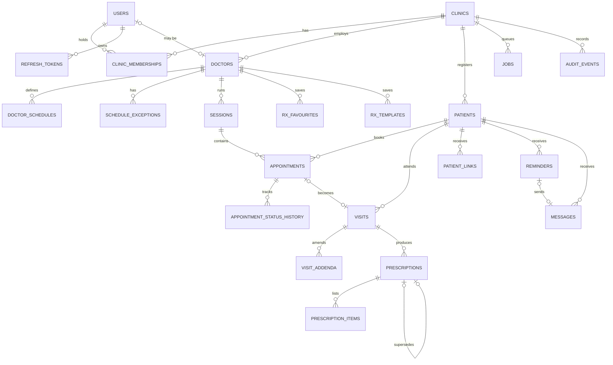

# MediEase — Data Model

Target schema for the MVP (M1–M5). Tables are created milestone by milestone through Alembic;
the **Milestone** column says when each table appears. Update this file in the same change as
any migration.

## Conventions

| Rule | Detail |
|---|---|
| Primary keys | `id uuid` (UUIDv7, time-ordered) |
| Tenancy | Every tenant-owned table has `clinic_id uuid not null references clinics(id)`; composite indexes lead with `clinic_id` |
| Timestamps | `created_at`, `updated_at` as `timestamptz` (UTC) on every table |
| Soft state | Status enums instead of deletes for clinical and appointment data; hard deletes only via the erasure procedure |
| Enums | PostgreSQL `text` + `CHECK` constraint (easier migrations than native enums) |
| Money | `bigint` paise |
| Phones | `text` E.164, validated at the boundary |
| JSON | `jsonb` only for genuinely variable shapes (vitals, advice, payloads); never for data we query by |
| Names | `snake_case`, plural table names |

## Migration history

Alembic revisions in `apps/api/migrations/versions/` (how to add one: `apps/api/migrations/README.md`).

| Revision | Change | Milestone |
|---|---|---|
| `0001` | Empty baseline. Creates no tables; only `alembic_version` exists after `upgrade head` | M0-P3 |
| `0002` | `clinics`, `users`, `clinic_memberships`, `doctors` (columns marked *P1* below; the rest arrive with the phase or milestone that uses them) | M1-P1 |
| `0003` | `users` credentials and lockout columns; `refresh_tokens` (marked *P2*) | M1-P2 |
| `0004` | `audit_events` with the two triggers that make it append-only; the `v_clinic_activity` support view | M1-P4 |
| `0005` | `clinic_memberships` invitation columns (marked *P5*); `onboarding_checklists` | M1-P5 |
| `0006` | `clinics.patient_code_prefix` (backfilled from each clinic's name) and `next_patient_seq`; the `patients` table with its lookup indexes | M2-P1 |

Constraint names follow one convention (`adapters/db/models/base.py`): `pk_<table>`,
`fk_<table>_<column>_<referred table>`, `uq_<table>_<columns>`, `ck_<table>_<name>`,
`ix_<table>_<columns>`. An `IntegrityError` therefore names the rule that was broken.
`tests/integration/db/test_migrations.py::test_models_match_migrations` fails if the models and
the migrations drift apart.

## Entity-relationship overview

---

## M1 — Identity, tenancy, audit

Every table has `id uuid` (UUIDv7 from `IdPort`), `created_at` and `updated_at` (`timestamptz`,
set by the application). *P1* = created by migration `0002`.

### `clinics`
| Column | Type | Notes |
|---|---|---|
| id | uuid PK | *P1* |
| name | text not null | *P1* Shown in messages and letterhead |
| slug | text unique not null | *P1* `uq_clinics_slug`; lower-case words and hyphens, 3–63 chars; public page URL (M7) |
| timezone | text not null default `Asia/Kolkata` | *P1* IANA name, validated by the domain |
| status | text not null | *P1* `ONBOARDING` \| `ACTIVE` \| `SUSPENDED` (`ck_clinics_status`) |
| phone_e164 | text | *P1* |
| address_line, city, state, pincode | text | *P1* PIN code: 6 digits |
| specialties | text[] not null default `{}` | *P1* |
| patient_code_prefix | text not null | *M2-P1* 2–4 upper-case letters (`ck_clinics_patient_code_prefix_format`), e.g. `ME` → `ME-0142`. Derived from the name at creation unless ops sets it; fixed once the clinic has patients |
| next_patient_seq | integer not null default 1 | *M2-P1* Incremented under a row lock on the clinic (`ck_clinics_next_patient_seq_positive`); a code is never reused |
| booking_mode | text not null | M3 — `SLOTS` \| `TOKENS` |
| plan | text not null default `PILOT` | Billing (post-pilot) — `PILOT` \| `STARTER` \| `CLINIC` |

### `users`
Not tenant-owned: one user can hold memberships in several clinics.

| Column | Type | Notes |
|---|---|---|
| id | uuid PK | *P1* |
| full_name | text not null | *P1* |
| email | text unique null | *P1* `uq_users_email`; stored lower-case (`ck_users_email_lower_case`) instead of `citext`, so no extension is needed |
| phone_e164 | text unique null | *P1* `uq_users_phone_e164`; `ck_users_email_or_phone`: `email IS NOT NULL OR phone_e164 IS NOT NULL` |
| is_platform_ops | boolean not null default false | *P1* MediEase staff (R10) |
| status | text not null | *P1* `ACTIVE` \| `DISABLED` (`ck_users_status`) |
| password_hash | text null | *P2* Argon2id hash string; null until a password is set (invited users), and a null hash never signs in |
| failed_login_count | integer not null default 0 | *P2* consecutive failures; `ck_users_failed_login_count_non_negative` (FR-AUTH-04) |
| locked_until | timestamptz null | *P2* set to failure time + 15 min on the 5th failure |
| last_login_at | timestamptz null | *P2* last successful sign-in |

### `clinic_memberships`
| Column | Type | Notes |
|---|---|---|
| id | uuid PK | *P1* |
| clinic_id | uuid FK not null | *P1* |
| user_id | uuid FK not null | *P1* index `ix_clinic_memberships_user_id` (a user's clinics) |
| role | text not null | *P1* `OWNER` \| `DOCTOR` \| `FRONT_DESK` (`ck_clinic_memberships_role`) |
| status | text not null | *P1* `INVITED` \| `ACTIVE` \| `DEACTIVATED` (`ck_clinic_memberships_status`); no transition back from `DEACTIVATED` in M1 |
| | | *P1* `uq_clinic_memberships_clinic_id_user_id` — invariant I2 |
| invite_token_hash | text null | *P5* SHA-256 of the single-use invitation secret, `uq_clinic_memberships_invite_token_hash`. The secret is never stored; the digest is kept after acceptance so a replay answers "already used" instead of "unknown" |
| invite_expires_at | timestamptz null | *P5* 7 days after the invitation was issued (`INVITE_TTL`, a domain constant) |
| invite_accepted_at | timestamptz null | *P5* when the invitee set a password and the membership activated |

An `INVITED` membership **is** the pending invitation: one row, so there is no second state to
keep in step, invariant I2 keeps duplicates out, and re-inviting replaces the digest — which
retires the previous link. Deactivating a member clears a pending invitation. The lookup by
digest is a platform read (`StaffInviteRepository`), because the invitee has no clinic context
yet: the same sanctioned pattern as refresh tokens (ADR-0003).

### `doctors`
| Column | Type | Notes |
|---|---|---|
| id | uuid PK | *P1* |
| clinic_id | uuid FK not null | *P1* index `ix_doctors_clinic_id` |
| user_id | uuid FK null | *P1* Null for a doctor who never signs in; `uq_doctors_clinic_id_user_id` (partial, `WHERE user_id IS NOT NULL`): one profile per user per clinic |
| display_name | text not null | *P1* "Dr. A. Sample" |
| qualification | text not null | *P1* Printed on Rx (I3) |
| registration_number | text not null | *P1* Printed on Rx (FR-ORG-02, I3) |
| registration_council | text not null | *P1* e.g. state medical council (I3) |
| specialty | text | *P1* |
| is_active | boolean not null default true | *P1* |

### `refresh_tokens`
Owned by a user, not a clinic. *P2* = created by migration `0003`.

| Column | Type | Notes |
|---|---|---|
| id | uuid PK | *P2* |
| user_id | uuid FK not null | *P2* index `ix_refresh_tokens_user_id` |
| family_id | uuid not null | *P2* one family per sign-in; reuse of a rotated token revokes the whole family (R5); index `ix_refresh_tokens_family_id` |
| token_hash | text unique not null | *P2* SHA-256 hex of the token (`uq_refresh_tokens_token_hash`); the token itself is never stored |
| expires_at | timestamptz not null | *P2* issue time + `REFRESH_TOKEN_TTL_SECONDS` |
| revoked_at | timestamptz null | *P2* set by rotation, sign-out or family revocation |
| replaced_by_id | uuid FK `refresh_tokens` null | *P2* set by rotation; a token with it set is "rotated", and presenting it again is reuse |

### `audit_events` (append-only)
| Column | Type | Notes |
|---|---|---|
| id | uuid PK | |
| clinic_id | uuid FK `clinics` null | Null for platform-level events (a sign-in belongs to a user) |
| actor_user_id | uuid FK `users` null | Null for patient/system actors |
| actor_type | text not null | `STAFF` \| `OPS` \| `PATIENT_LINK` \| `SYSTEM` (CHECK) |
| action | text not null | `area.past_tense`, from `domain/audit/actions.py`: `auth.signed_in`, `auth.sign_in_failed`, `auth.signed_out`, `auth.refresh_reused`, `staff.role_changed` (M1-P4); more per milestone |
| entity_type, entity_id | text, uuid | Given together or not at all |
| request_id | text | Ties the row to the API log and to the client's "Ref" |
| ip_hash | text | HMAC-SHA256 of the caller's IP under `AUDIT_IP_SALT`, 32 hex chars; never a raw address |
| metadata | jsonb not null default `{}` | IDs and enums only: at most 20 keys, values at most 200 characters (enforced by the domain) |
| occurred_at | timestamptz not null | No `updated_at`: the row never changes |

Indexes: `(clinic_id, occurred_at)` and `(actor_user_id, occurred_at)`. Stored ascending —
PostgreSQL scans a btree backwards, so these serve "newest first" without a `DESC` index.

**Immutability (FR-AUD-02, AC6).** Two triggers created by migration `0004` refuse `UPDATE`,
`DELETE` and `TRUNCATE` with `AUD_APPEND_ONLY`, for every non-superuser role including the
application's. A `REVOKE` would not be a boundary today, because the application connects as the
role that owns the schema and an owner can grant its own privileges back; a dedicated
least-privilege role is defence in depth in M6-P1. A deliberate correction (a data migration, or
emptying the table in tests) has to disable the triggers explicitly — see RUNBOOK §18.

### `v_clinic_activity` (support view, FR-OPS-04)
`clinic_id, clinic_name, status, active_owners, active_doctors, active_front_desk,
last_sign_in_at, audit_events_7d, audit_events_30d, last_event_at` — "is this clinic being used,
and by whom?" during a support call, with no clinical column and no patient data. Created by
migration `0004`; read by the ops console from M6-P4.

### `onboarding_checklists`
| Column | Type | Notes |
|---|---|---|
| id | uuid PK | |
| clinic_id | uuid FK not null | `uq_onboarding_checklists_clinic_id` — one row per clinic |
| started_at | timestamptz not null | When the clinic was created, i.e. the clock for goal G4 |
| clinic_created_at, doctors_added_at, staff_invited_at | timestamptz null | Written by M1-P5 |
| patients_imported_at, first_appointment_at, first_prescription_at | timestamptz null | Written by M2, M3 and M4 |

Each column records the **first** time that step happened and is never overwritten (spec R12), so
"clinic created 14:02, owner accepted 14:31" is a fact rather than a recollection. No
`updated_at`: every column is itself a timestamp. The checklist is tenant-scoped like any other
clinic-owned table, so ops writes it through the clinic it named in the path.

---

## M2 — Patients

### `patients`
Tenant-owned (`clinic_id`), reached only through `SqlAlchemyPatientRepository`. Migration `0006`.

| Column | Type | Notes |
|---|---|---|
| id | uuid PK | |
| clinic_id | uuid FK | |
| code | text not null | `ME-0142`; `uq_patients_clinic_id_code` (also serves code lookup); never edited |
| full_name | text not null | 1–200 characters |
| phone_e164 | text not null | The contact of record; **the guardian's number for a patient under 18** (spec D1). Not unique: families share phones |
| sex | text not null | `FEMALE` \| `MALE` \| `OTHER` \| `UNDISCLOSED` (`ck_patients_sex`) |
| date_of_birth | date null | |
| age_years_at_registration | smallint→integer null | Set when the date of birth is unknown; 0–120 (`ck_patients_age_years_at_registration_range`) |
| registered_on | date not null | Clinic-local date the age was recorded; the base for computing the age later |
| guardian_name | text null | Required when under 18 (domain rule, R3) |
| language | text not null default `en` | `en` \| `hi` (`ck_patients_language`) |
| whatsapp_consent, sms_consent | boolean not null default false | FR-PAT-05 |
| consent_recorded_at | timestamptz null | `ck_patients_consent_recorded`: a flag can only be true if this is set |
| consent_recorded_by | uuid null FK users | |
| opted_out_at | timestamptz null | FR-MSG-05; overrides consent until cleared by an explicit opt-in |
| created_by | uuid FK users | |
| created_at, updated_at | timestamptz | |

`ck_patients_age_known`: exactly one of `date_of_birth` and `age_years_at_registration` is set.

Indexes: `uq_patients_clinic_id_code`, `ix_patients_clinic_id_phone_e164` (exact phone lookup and
the duplicate check) and `ix_patients_clinic_id_lower_full_name` on
`(clinic_id, lower(full_name) text_pattern_ops)` (case-insensitive name prefix). The 10,000-patient
test (`tests/integration/db/test_patients.py`) times the three lookups and plans the repository's own
SQL with sequential scans disabled, so a query no index can serve fails the build. Target: FR-PAT-04
p95 < 500 ms at 10,000 patients per clinic (measured in milliseconds, not hundreds of them).

The `tags` column planned for advanced search (FR-PAT-07, P1) is not created: it joins the table
when something reads it.

---

## M3 — Schedules, appointments, queue

### `doctor_schedules`
`id, clinic_id, doctor_id, weekday (0–6), start_time time, end_time time, slot_minutes smallint
null (SLOTS mode), capacity smallint not null, valid_from date, valid_to date null`

### `schedule_exceptions`
`id, clinic_id, doctor_id, on_date date, kind (LEAVE | EXTRA), start_time, end_time, capacity null, note`

### `sessions` (materialised per doctor per day)
| Column | Type | Notes |
|---|---|---|
| id | uuid PK | |
| clinic_id, doctor_id | uuid FK | |
| on_date | date not null | Clinic-local date |
| starts_at, ends_at | timestamptz | UTC |
| mode | text | `SLOTS` \| `TOKENS` |
| capacity | smallint not null | |
| booked_count | smallint not null default 0 | Maintained under `FOR UPDATE` |
| next_token | smallint not null default 1 | TOKENS mode |
| status | text | `OPEN` \| `CLOSED` \| `CANCELLED` |
| | | `UNIQUE (doctor_id, starts_at)` |

Sessions are generated lazily for a date range when first requested, from schedules + exceptions.

### `appointments`
| Column | Type | Notes |
|---|---|---|
| id | uuid PK | |
| clinic_id, session_id, doctor_id, patient_id | uuid FK | |
| slot_start | timestamptz null | SLOTS mode |
| token_number | smallint null | TOKENS mode |
| status | text not null | `BOOKED` \| `ARRIVED` \| `IN_CONSULTATION` \| `COMPLETED` \| `NO_SHOW` \| `CANCELLED` |
| source | text not null | FR-APT-07 |
| reason | text null | Non-clinical short reason |
| cancel_reason | text null | |
| arrived_at, started_at, completed_at | timestamptz null | Wait-time metrics |
| created_by | uuid FK users null | Null for public-page requests |

Constraints: partial unique `(session_id, slot_start) WHERE status <> 'CANCELLED' AND slot_start IS NOT NULL`;
partial unique `(session_id, token_number) WHERE token_number IS NOT NULL`.
Index: `(clinic_id, doctor_id, status)`, `(clinic_id, patient_id, created_at desc)`.

### `appointment_status_history`
`id, clinic_id, appointment_id, from_status, to_status, changed_by, changed_at, request_id`

---

## M4 — Visits and prescriptions

### `visits`
| Column | Type | Notes |
|---|---|---|
| id | uuid PK | |
| clinic_id, patient_id, doctor_id | uuid FK | |
| appointment_id | uuid FK null unique | |
| chief_complaint, findings, diagnosis, notes | text | **Clinical** — never logged |
| vitals | jsonb | `{bp_systolic, bp_diastolic, pulse, temp_c, weight_kg, height_cm, spo2}` |
| status | text | `OPEN` \| `COMPLETED` |
| completed_at | timestamptz null | |
| locked_at | timestamptz null | completed_at + 24 h (FR-VIS-05) |

### `visit_addenda`
`id, clinic_id, visit_id, author_user_id, body text, created_at`

### `prescriptions`
| Column | Type | Notes |
|---|---|---|
| id | uuid PK | |
| clinic_id, visit_id, patient_id, doctor_id | uuid FK | |
| version | smallint not null default 1 | |
| supersedes_id | uuid FK prescriptions null | FR-RX-09 |
| status | text | `DRAFT` \| `ISSUED` \| `SUPERSEDED` |
| advice | jsonb | `{diet[], activity[], return_if[], free_text}` — clinical |
| follow_up_date | date null | Triggers FR-REM-01 |
| language | text | Patient page language at issue time |
| issued_at | timestamptz null | |
| pdf_object_key | text null | |
| doctor_snapshot | jsonb | Name, qualification, registration number **as printed** |

A database trigger rejects `UPDATE` of clinical columns when `status <> 'DRAFT'`.

### `prescription_items`
`id, clinic_id, prescription_id, position, medicine_name, form, strength, dose, frequency,
timing (BEFORE_FOOD | AFTER_FOOD | WITH_FOOD | EMPTY_STOMACH | BEDTIME | ANY), duration_days,
quantity, preparation, storage, warnings, free_text` — all clinical.

### `rx_favourites` / `rx_templates`
`id, clinic_id, doctor_id, name, body jsonb, use_count, last_used_at`

### `patient_links`
| Column | Type | Notes |
|---|---|---|
| id | uuid PK | Also the token's `jti` |
| clinic_id, patient_id | uuid FK | |
| purpose | text | `RX_VIEW` (later: `QUEUE_STATUS`, `BOOKING_MANAGE`) |
| resource_id | uuid | e.g. prescription id (resolves to latest version) |
| expires_at | timestamptz | 90 days (FR-RX-08) |
| revoked_at | timestamptz null | |
| failed_challenges | smallint default 0 | Locks after 5 |
| open_count | integer default 0 | |
| last_opened_at | timestamptz null | |

---

## M5 — Reminders, messages, jobs

### `reminders`
`id, clinic_id, patient_id, kind (FOLLOW_UP | MEDICINE_COURSE | APPOINTMENT | VACCINATION),
due_at, source_type, source_id, status (FR-REM-05 values), message_id null, job_id null,
cancelled_by null, created_by`

### `messages`
| Column | Type | Notes |
|---|---|---|
| id | uuid PK | |
| clinic_id, patient_id | uuid FK | |
| channel | text | `WHATSAPP` \| `SMS` \| `CONSOLE` |
| template_key, template_version | text | From `templates.yaml` |
| variables | jsonb | Non-clinical only (clinic name, date, link) |
| to_phone_e164 | text | Encrypted column (application-level) |
| provider | text | |
| provider_message_id | text unique null | Webhook idempotency |
| idempotency_key | text unique not null | |
| status | text | `QUEUED` \| `SENT` \| `DELIVERED` \| `READ` \| `FAILED` |
| error_code | text null | Provider error mapped to `MSG_*` |
| cost_paise | bigint null | FR-MSG-07 |
| request_id | text | |
| sent_at, delivered_at, read_at, failed_at | timestamptz null | |

### `inbound_messages`
`id, clinic_id null, from_phone_hash, provider_message_id unique, kind (OPT_OUT | OTHER),
received_at` — body is not stored except for the matched keyword.

### `webhook_events`
`id, provider, event_id unique, received_at, processed_at, error_code` — dedupe and replay.

### `jobs`
See ARCHITECTURE.md §7. Index for claiming:
`CREATE INDEX jobs_claim_idx ON jobs (run_at) WHERE state = 'queued';`

---

## Retention and erasure

| Data | Retention | Mechanism |
|---|---|---|
| Clinical records (visits, prescriptions) | As required of the clinic by law; clinic-configurable, default indefinite while the clinic is active | Export + delete on contract end |
| Messages | 18 months | Scheduled purge job |
| Audit events | 3 years minimum | Partitioned by month (post-pilot) |
| Refresh tokens | 30 days after expiry | Purge job |
| Patient links | 30 days after expiry | Purge job |

Erasure requests are executed by a reviewed, audited procedure (`scripts/erase_patient.py`, M6)
that respects legally required clinical retention — confirm with counsel (L-04).
