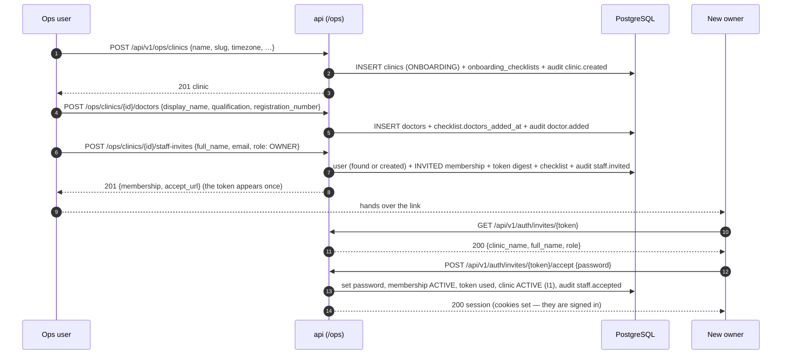
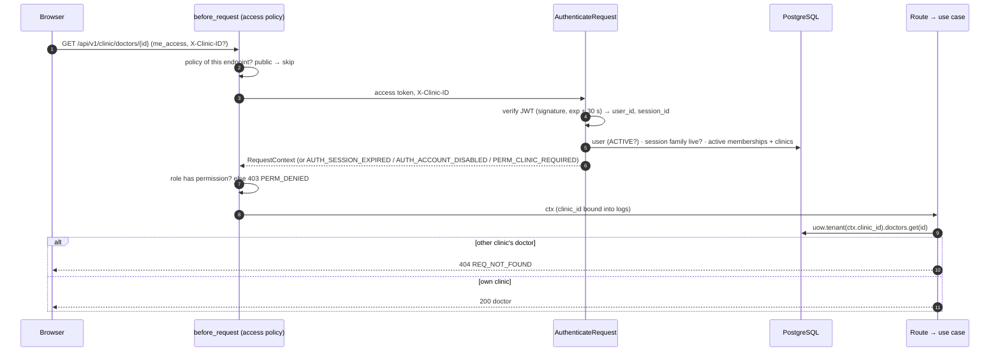

# M1 — Identity, tenancy and audit: design notes

| Field | Value |
|---|---|
| Status | In progress — M1-P1 to M1-P5 implemented (P1 and P2 confirmed 3 Oct 2026; P3, P4 and P5 awaiting confirmation) |
| Spec | `docs/specs/identity-and-tenancy.md` (Approved 2026-10-02) |
| Covers | FR-ORG-01..04, FR-AUTH-01..04, FR-AUD-01..02, FR-OPS-01, FR-OPS-04, NFR-08, NFR-14 |
| Issue / branch / PR | #19 · `m1/19-identity-tenancy-audit` · one draft PR for the whole milestone (ADR-0011) |
| Exit criterion | An ops user onboards a clinic with an owner, doctor and front desk; each signs in and sees only their clinic; the tenancy suite proves isolation |

## Concepts to teach before code (CLAUDE.md "Teaching Expectations")

1. **Entities and value objects.** An entity has an identity that survives change (a clinic is the
   same clinic after it is renamed); a value object is defined by its value and validated once
   when created (`PhoneNumber("+919000000001")` is always E.164). Rules live on them, not in
   handlers.
2. **State machines.** Status fields change only through named methods that refuse illegal moves
   (`DEACTIVATED → ACTIVE` raises `CLN_INVALID_TRANSITION`).
3. **Repository pattern.** Application code asks a repository for domain objects; it never sees
   SQL or ORM rows. The SQLAlchemy adapter maps rows ↔ entities.
4. **Tenancy scoping by construction (ADR-0003).** A tenant repository is *built with* one
   `clinic_id`; none of its methods accept a clinic ID, so "forgot the `WHERE clinic_id`" cannot be
   written. Another clinic's row is simply not found (→ 404, R8).
5. **Unit of work.** One object owns the transaction: every repository used in a command shares one
   session, and the change commits or rolls back as a whole. P4 adds the audit writer to it, which
   is how R11 ("audit in the same transaction") holds.
6. **Time-ordered IDs (UUIDv7).** IDs are created by the application through `IdPort` (so entities
   have identity before they are saved) and sort by creation time (index-friendly).

## Phase plan

| Phase | Builds | Key decisions |
|---|---|---|
| P1 | Domain model, migration `0002`, tenancy-scoped repository base, unit of work, coverage gate | Below |
| P2 | Argon2id hashing, sign-in, refresh rotation with reuse detection, sign-out, lockout | Below (M1-P2 section) |
| P3 | Auth middleware → `RequestContext`; role + membership check on every route; permission matrix tests; `GET /api/v1/me` and read-only clinic endpoints | Below (M1-P3 section) |
| P4 | Append-only `audit_events` written through the unit of work; database-enforced immutability; `v_clinic_activity`; the audited staff role change | Below (M1-P4 section) |
| P5 | Ops onboarding API (clinic → doctors → owner invite), single-use staff invites and acceptance, owner staff and doctor management, onboarding checklist | Below (M1-P5 section) |
| P6 | Web: sign-in, clinic switcher, empty dashboard shell | Spec §6 |

Each phase starts with its design (`/plan-phase`), is approved, implemented, verified by the
developer and confirmed before the next phase starts. All phases are committed to the milestone
branch and appear in the one milestone PR.

---

## M1-P5 — Ops onboarding and staff management

**Status: approved 3 Oct 2026 (one phase, five commits; reactivation out of scope); implemented
3 Oct 2026, awaiting the developer's confirmation.** Covers FR-OPS-01, FR-OPS-04, FR-ORG-01,
FR-ORG-02, FR-ORG-04; spec R9, R12; and the M1 exit criterion ("an ops user onboards a clinic
with an owner, doctor and front desk; each signs in").

### Concepts

1. **An invite is a membership, not a message.** P1 already models `ClinicMembership` with an
   `INVITED → ACTIVE` lifecycle, so an invitation *is* that row plus a single-use secret the
   invitee presents to activate it. No invite table, no duplicate state: invariant I2 (one
   membership per user per clinic) already prevents double invites, and re-inviting replaces the
   secret on the same row.
2. **The secret is handled like a refresh token.** 32 random bytes, stored only as a SHA-256
   digest (the adapter from P2), single use, 7-day expiry. The API returns the acceptance URL
   once, at invite time; whoever invited passes it on. Messaging (WhatsApp/SMS) arrives in M5,
   and password reset by code is FR-AUTH-05 (P1), so M1 hands the link over by hand — which is
   what an ops-assisted onboarding does anyway (RUNBOOK §10).
3. **Accepting is a public endpoint.** The invitee has no session yet: they present the token,
   set a password, and the API activates the membership and signs them in. That closes M1's
   exit criterion, which otherwise needs seeded passwords.
4. **Ops names the clinic; staff never do.** Ops routes take the clinic in the path
   (`/api/v1/ops/clinics/{clinic_id}/…`) because an ops user has no membership to infer it from
   (R10). They still reach tenant rows only through `uow.tenant(clinic_id)`, so the scope is
   explicit and the same code path as clinic routes.
5. **The checklist measures goal G4, so it is written by the actions themselves.** Each step
   records the *first* time it happened and never overwrites (R12), so the elapsed time from
   "clinic created" to "first prescription" is a fact in the database rather than a stopwatch in
   someone's notes.

### Request flow — onboarding a clinic



### Endpoints

| Method | Path | Policy | Purpose |
|---|---|---|---|
| POST | `/api/v1/ops/clinics` | `ops` | Create a clinic in `ONBOARDING` (FR-ORG-01) |
| GET | `/api/v1/ops/clinics` | `ops` | List clinics with their onboarding state (FR-OPS-01/04) |
| GET | `/api/v1/ops/clinics/{clinic_id}` | `ops` | One clinic with its checklist |
| POST | `/api/v1/ops/clinics/{clinic_id}/doctors` | `ops` | Add a doctor during onboarding (FR-ORG-02) |
| POST | `/api/v1/ops/clinics/{clinic_id}/staff-invites` | `ops` | Invite the owner (or any role) |
| GET | `/api/v1/auth/invites/{token}` | `public` | What this invite is for (no session) |
| POST | `/api/v1/auth/invites/{token}/accept` | `public` | Set a password, activate, sign in |
| POST | `/api/v1/clinic/staff` | `clinic(STAFF_MANAGE)` | Owner invites staff (FR-ORG-04) |
| PATCH | `/api/v1/clinic/staff/{membership_id}` | `clinic(STAFF_MANAGE)` | Role change (P4) **+ deactivate** |
| POST | `/api/v1/clinic/doctors` | `clinic(CLINIC_MANAGE)` | Owner adds a doctor |
| PATCH | `/api/v1/clinic/doctors/{doctor_id}` | `clinic(CLINIC_MANAGE)` | Edit or deactivate a doctor |
| PATCH | `/api/v1/clinic` | `clinic(CLINIC_MANAGE)` | Clinic settings (name, timezone, address, specialties) |

### Rules

| Check | Outcome |
|---|---|
| Clinic slug already used | 409 `CLN_SLUG_TAKEN` (the one cross-clinic uniqueness ops can hit) |
| Invite for an email/phone that is already a user | Reuse that user and add a membership — "one user, two memberships" (spec §8) |
| Invite for someone who already has a membership here | 409 `CLN_MEMBER_EXISTS` (I2), whatever its status |
| Re-inviting an `INVITED` membership | Allowed: a new token replaces the old digest, which stops working |
| Unknown invite token | 404 `CLN_INVITE_INVALID` — the same answer for a malformed one |
| Expired or already accepted token | 410 `CLN_INVITE_EXPIRED` / `CLN_INVITE_USED`, so the invitee knows to ask again |
| Accepting with a weak password | 422 `REQ_VALIDATION_FAILED` (minimum 12 characters, a domain rule) |
| Accepting an owner invite for an `ONBOARDING` clinic | The clinic becomes `ACTIVE` (I1 is satisfied at that moment) and `clinic.activated` is audited |
| Deactivating or demoting the last active owner | 409 `CLN_LAST_OWNER` (R9), nothing recorded |
| Deactivating a member | Their next request is refused (`AUTH_ACCOUNT_DISABLED`, AC4 — already true from P3) |
| Reactivating a deactivated member | Not in M1: the domain has no such transition. Re-invite them instead (409 `CLN_MEMBER_EXISTS` is the hint, so the owner deactivates and re-invites with a new identity) — see open choices |
| A doctor's `user_id` that is not an active member of the clinic | 422 `REQ_VALIDATION_FAILED` |
| Ops user on `/api/v1/ops/*` | Allowed; clinic staff get 403 `PERM_DENIED` (R10, already enforced) |
| Unknown `clinic_id` in an ops path | 404 `REQ_NOT_FOUND` |
| Any checklist step that already has a timestamp | Left untouched (R12) |

### Audit actions added

`clinic.created`, `clinic.activated`, `clinic.updated`, `doctor.added`, `doctor.updated`,
`staff.invited`, `staff.accepted`, `staff.deactivated`. Ops actions are recorded with
`actor_type=OPS` and the clinic they touched; staff actions with `actor_type=STAFF` and the
request's clinic. Every one is written in the same transaction as its change (R11, proved in P4).

### Decisions

| Decision | Reason |
|---|---|
| The invite lives on `clinic_memberships` (`invite_token_hash`, `invite_expires_at`, `invite_accepted_at`) instead of a new table | The `INVITED` membership already *is* the pending invitation. One row means no state to reconcile, I2 keeps duplicates out, and re-inviting is a new digest rather than a second record |
| Token lookup is a platform repository keyed by the digest, like refresh tokens | The invitee has no clinic context yet, so the read cannot be clinic-scoped. It is keyed by a 256-bit secret, which is exactly the sanctioned pattern from P2 (ADR-0003 "platform repositories") |
| 7-day expiry as a domain constant, not a setting | Nothing operational tunes it; a constant keeps `.env` smaller. It becomes a setting the day someone needs a different value |
| Accepting an owner invite activates an `ONBOARDING` clinic | I1 only becomes satisfiable at that moment, and it removes a step from the 60-minute onboarding. Ops never has to remember to "turn the clinic on" |
| `PATCH /clinic/staff/{id}` carries both `role` and `status` | One endpoint for "manage this membership", as `docs/API.md` planned. Each field writes its own audit action; sending neither is a 422 |
| No reactivation of a deactivated membership in M1 | The domain's lifecycle is `INVITED → ACTIVE → DEACTIVATED` (spec §3). Adding a transition is a spec change, not an implementation detail — see open choices |
| Ops endpoints return the accept URL built from `PUBLIC_BASE_URL` | The setting already exists for M4 patient links; the API returns a URL rather than a bare token so the console has nothing to assemble |
| The invite token is shown exactly once, in the response that creates it | Nothing stores it in clear, so a leaked database cannot be used to take over a pending invite |
| No per-IP rate limit on the public invite endpoints | A guess has to hit a 256-bit secret; the reverse proxy adds request limits in M6-P1 |

### Open choices for approval

**Decisions (developer, 3 Oct 2026): option A (one phase), and reactivation stays out of M1.**

1. **Size.** P5 is the largest phase in M1: three ops endpoints, two public invite endpoints, five
   owner endpoints, one migration and a checklist. Options:
   - **A (chosen)** — one phase, implemented in five commits (migration + domain → invite
     and acceptance → ops onboarding → owner management → docs), each green on its own.
   - **B** — split into **P5a** (ops onboarding + invite acceptance, which completes the M1 exit
     criterion) and **P5b** (owner staff and doctor management, clinic settings). P6 (web) then
     starts sooner against a working onboarding flow.
2. **Reactivation.** Should an owner be able to bring a deactivated member back (`DEACTIVATED →
   ACTIVE`)? It needs a new domain transition and a spec amendment. **Not in M1** (chosen) — a
   clinic that deactivates someone by mistake can re-invite them, and the audit trail shows both
   steps.

### Files

| Layer | Files |
|---|---|
| Domain | `identity/membership.py` (invite token fields, `accept`, `revoke_invite`), `identity/password.py` (`validate_password`, minimum length), `clinics/clinic.py` (`update_details`), `clinics/doctor.py` (`update_details`), `clinics/onboarding.py` (`OnboardingChecklist`, `OnboardingStep`, first-time-wins), `audit/actions.py` (+8 actions) |
| Application | `clinics/onboard_clinic.py` (`CreateClinic`, `AddDoctor`, `InviteStaff`), `clinics/manage_staff.py` (`DeactivateStaff`, extends P4's role change), `clinics/manage_doctors.py` (`UpdateDoctor`), `clinics/update_clinic.py`, `identity/accept_invite.py` (`DescribeInvite`, `AcceptInvite`), `ops/queries.py` (`ListClinics`, `GetClinicOnboarding`) |
| Ports | `repositories.py`: `MembershipRepository.get_by_invite_digest` (platform `StaffInviteRepository`), `ChecklistRepository` (tenant), `ClinicRepository.list_for_ops` |
| Adapters | `db/repositories.py` (the three above), migration `0005` (`clinic_memberships` invite columns + `onboarding_checklists`) |
| Delivery | `http/ops.py` (new blueprint), `http/invites.py` (public), `http/clinic.py` (staff invite/deactivate, doctors, settings), `errors.py` (invite codes), `bootstrap.py` |
| Contract / docs | `openapi.yaml` (12 operations, 0.5.0), `API.md`, `ERRORS.md`, `DATA_MODEL.md`, `SECURITY_AND_COMPLIANCE.md`, `RUNBOOK.md` §10 (the real commands), `specs/identity-and-tenancy.md` §7 (new actions) |

### Tests

- Domain: invite issue/accept/expiry on `ClinicMembership`; password rule; checklist records the
  first timestamp and ignores later ones (R12); clinic and doctor detail updates.
- Application (fakes): invite reuses an existing user, refuses a second membership (I2), a new
  token invalidates the old one, acceptance sets the password and activates, an owner acceptance
  activates the clinic (I1), deactivation refuses the last owner (R9).
- Integration (PostgreSQL): the invite digest is unique and never stored in clear; migration
  `0005` up and down; checklist row per clinic.
- HTTP: the full ops onboarding flow in one test (clinic → doctor → owner invite → accept →
  owner signs in and sees their clinic — the M1 exit criterion); owner invites a front desk who
  accepts and can read the queue-less clinic endpoints; deactivation then the member's next
  request is 403 (AC4); clinic staff refused on `/ops/*` and ops refused on clinic routes (R10);
  every new action appears exactly once in `audit_events`.
- Tenancy: the new clinic routes with IDs join `CROSS_TENANT_CASES`; an ops request for an
  unknown clinic is 404; a clinic's checklist and invites are never visible to another clinic.
- Contract: every new operation and its error shapes.

### Verify

```bash
make up   # 0005 applied
# as ops@mediease.example:
#   POST /api/v1/ops/clinics            → 201, clinic ONBOARDING
#   POST /ops/clinics/<id>/doctors      → 201
#   POST /ops/clinics/<id>/staff-invites {role: OWNER} → 201 + accept_url
# as the invitee (no session):
#   GET  /api/v1/auth/invites/<token>   → 200 clinic + role
#   POST /api/v1/auth/invites/<token>/accept {password} → 200 + cookies; clinic now ACTIVE
# as the new owner:
#   POST /api/v1/clinic/staff {role: FRONT_DESK} → 201 + accept_url; they accept and sign in
#   PATCH /api/v1/clinic/staff/<id> {"status":"DEACTIVATED"} → 200; their next request 403
# make psql: select * from onboarding_checklists;  → first timestamps only, never overwritten
#            select action, actor_type from audit_events order by occurred_at;
```

---

## M1-P4 — Append-only audit log

**Status: approved 3 Oct 2026 (option B below chosen); implemented 3 Oct 2026, awaiting the
developer's confirmation.** Covers FR-AUD-01, FR-AUD-02, FR-OPS-04 (support view); spec R11;
AC5, AC6.

### Concepts

1. **Audit events are not logs.** Logs answer "what was the system doing?" and are rotated away in
   weeks. An audit event answers "who did what, to which record, when?" and must still be
   answerable three years later, by an owner during a staff dispute or by us during a DPDP
   enquiry. That is a table with a retention policy, not a log line.
2. **Same transaction (R11).** The audit row is written through the same unit of work as the
   change it describes, so either both land or neither does. An unaudited change is worse than a
   refused one: it is a record nobody can account for.
3. **Append-only in the database (FR-AUD-02, AC6).** No endpoint can edit an audit event, and the
   database itself refuses `UPDATE` and `DELETE` on the table. Correctness that depends on every
   future developer remembering a rule is not correctness.
4. **Nothing sensitive inside.** `metadata` carries IDs and enums only — never names, phone
   numbers or clinical content. The caller's IP is stored as a salted HMAC, so "was this the same
   device?" can be answered without keeping an address.
5. **A closed set of actions.** Action names live in one `StrEnum`, so a typo cannot invent a new
   action, and "where is `staff.role_changed` written?" is one grep.

### Request flow

```mermaid
sequenceDiagram
    autonumber
    participant R as Route
    participant U as Use case
    participant W as uow.audit
    participant D as PostgreSQL
    R->>U: command + RequestInfo(request_id, ip_hash)
    U->>D: the change (UPDATE users / clinic_memberships …)
    U->>W: record(action, actor, entity, metadata)
    W->>D: INSERT INTO audit_events … (flushed at once)
    alt audit insert fails
        U-->>R: error; the whole transaction rolls back (R11)
    else both succeed
        U->>D: COMMIT
        U-->>R: view
    end
```

### What is audited in P4

| Trigger | Action | Actor | `clinic_id` | `metadata` |
|---|---|---|---|---|
| Sign-in succeeds | `auth.signed_in` | the user (`STAFF`, or `OPS` for platform ops) | null — a sign-in belongs to a user, not a clinic | `session_id`, `clinic_count` |
| Wrong password for a **known** user | `auth.sign_in_failed` | the user | null | `reason` (`wrong_password`, `locked`, `no_password`, `account_disabled`) |
| Sign-out | `auth.signed_out` | the user | null | `session_id`, `revoked_count` |
| A rotated refresh token is replayed | `auth.refresh_reused` | the user | null | `session_id`, `revoked_count` |
| Role changed (if the P4 scope option below is taken) | `staff.role_changed` | the acting owner | the clinic | `membership_id`, `from_role`, `to_role` |

Unknown identifiers are logged but **not** audited: that path has no lockout, so it is the one
place where an anonymous caller could grow the table without bound. Everything audited here is
already bounded by the per-account lockout.

### Rules

| Check | Outcome |
|---|---|
| A change commits | exactly one audit row per change, in the same transaction (R11, AC5) |
| The audit insert fails | the change fails; nothing is committed |
| `UPDATE audit_events` / `DELETE FROM audit_events` | refused by the database (`AUD_APPEND_ONLY` raised by a trigger), whatever role attempts it (AC6) |
| Any audit row | no name, phone number, email or clinical content; IP only as a 32-character HMAC |
| An event with no clinic (sign-in, ops action) | `clinic_id` null; clinic activity is derived by joining the actor's memberships |
| Reading audit events | not exposed by any endpoint in P4 (see decisions) |

### `v_clinic_activity` (FR-OPS-04 support view)

Per clinic, non-clinical only: `clinic_id`, `clinic_name`, `status`, `active_owners`,
`active_doctors`, `active_front_desk`, `last_sign_in_at` (max over active members'
`users.last_login_at`), `audit_events_7d`, `audit_events_30d`, `last_event_at`. It answers "is
this clinic actually being used, and by whom?" during a support call without opening a single
patient record. The ops console reads it in M6-P4; P4 creates and tests it.

### Decisions

| Decision | Reason |
|---|---|
| Immutability is enforced by a `BEFORE UPDATE OR DELETE` trigger that raises, created in migration `0004` | The application connects as the role that owns the schema, so `REVOKE UPDATE, DELETE` is not a real boundary (an owner can grant it back). A trigger refuses the statement for every non-superuser role, is version-controlled with the schema, and is provable in a test today. A dedicated least-privilege application role lands with production infrastructure (M6-P1) and is defence in depth, not the primary control |
| The audit writer is a port (`AuditWriter`) reached as `uow.audit`, and flushes each insert immediately | The unit of work already is the transaction boundary (R11 for free), and flushing means a constraint violation surfaces at the call that caused it, not at commit |
| Use cases receive `RequestInfo(request_id, ip_hash)` explicitly | apps/api/CLAUDE.md: application code never reads Flask globals. Delivery computes both once per request; `RequestContext` composes `RequestInfo` for clinic routes |
| The IP is hashed with HMAC-SHA256 under a new `AUDIT_IP_SALT` setting and truncated to 32 hex characters | A raw IP is personal data we have no reason to keep. A dedicated salt (not the JWT key) means rotating one does not break the other; truncation keeps the column small while staying collision-free at pilot volume |
| No audit-read endpoint in P4 | FR-AUD-03 ("owner can view and export the audit log") is priority P1 and absent from the PRD §8.1 P0 matrix, so it needs a permission the matrix does not define yet. `make psql` and `v_clinic_activity` cover support needs until then; `docs/API.md` is corrected to show the endpoint as P1 backlog rather than M1-P4 |
| No partitioning yet; indexes `(clinic_id, occurred_at desc)` and `(actor_user_id, occurred_at desc)` | Three years of pilot traffic is a small table; monthly partitioning is recorded in `docs/DATA_MODEL.md` as a post-pilot step |
| Four auth actions, not just the two the spec names | Sign-out and refresh reuse are security events an owner or we would want in the record of a disputed session; each is two lines on an existing path |

### Open choice for approval — how AC5 is proved

**Decision (developer, 3 Oct 2026): option B.**

**AC5** requires that a staff role change writes exactly one `staff.role_changed` event with
actor, target and `request_id`. P3 deliberately left every mutation to P5 so that mutations land
after the audit log, which leaves P4 with no role change to audit.

- **Option A — keep P4 mechanism-only.** P4 audits the auth events, proves R11 and AC6, and AC5 is
  proved in P5 when `PATCH /api/v1/clinic/staff/{membership_id}` is built. Smallest P4; AC5 stays
  open one phase longer.
- **Option B (chosen) — pull the role change into P4.** Add one use case
  (`ChangeStaffRole`, using the existing R9 last-owner rule) and one endpoint
  (`PATCH /api/v1/clinic/staff/{membership_id}` under `STAFF_MANAGE`). AC5 is then proved end to
  end in the phase that builds the audit log, and R11 is proved against a real clinic mutation
  rather than only against sign-in. P5 keeps invite, deactivate and the ops onboarding flow.

### Files

| Layer | Files |
|---|---|
| Domain | `domain/audit/{actions.py,event.py}` (`AuditAction`, `ActorType`, `AuditEvent.record()`) |
| Application | `context.py` (+`RequestInfo`), `auth/{sign_in,refresh_session,sign_out}.py` (record events), `clinics/change_staff_role.py` (option B) |
| Ports | `ports/audit.py` (`AuditWriter`), `ports/unit_of_work.py` (+`audit`), `ports/security.py` (+`IpHasher`) |
| Adapters | `adapters/db/models/audit.py`, `adapters/db/audit.py`, `adapters/security/ip_hash.py`, migration `0004` (table, indexes, trigger, `v_clinic_activity`) |
| Delivery | `delivery/http/{auth,clinic}.py` (build `RequestInfo`; `PATCH` staff under option B), `delivery/errors.py` (`CLN_LAST_OWNER` is already mapped) |
| Config | `config/settings.py` (`AUDIT_IP_SALT`), `.env.example`, `docker-compose.yml` |
| Contract / docs | `openapi.yaml` (option B only), `DATA_MODEL.md`, `ERRORS.md`, `ARCHITECTURE.md`, `SECURITY_AND_COMPLIANCE.md`, `RUNBOOK.md` (reading the audit log), `API.md` (audit endpoint → P1 backlog) |

### Tests

- Domain: an `AuditEvent` requires an action, an actor type and a timestamp; `metadata` accepts
  IDs and enums only; every `AuditAction` value matches the `area.past_tense` convention.
- Application (fakes): sign-in writes exactly one `auth.signed_in` with the session ID; a wrong
  password writes one `auth.sign_in_failed` with its reason and an unknown identifier writes none;
  an audit writer that raises makes the use case fail and commits nothing (R11); no audit row
  contains the identifier or the password.
- Integration (PostgreSQL): row round-trip including `ip_hash` (a hash, not an address) and
  `request_id`; **AC6** — `UPDATE audit_events` and `DELETE FROM audit_events` both raise;
  `v_clinic_activity` returns the expected counts and exposes no clinical column; migration
  `0004` up and down.
- HTTP (option B): **AC5** — an owner changes a doctor's role and exactly one
  `staff.role_changed` row exists with actor, target and the request's `X-Request-ID`; demoting
  the last owner is `409 CLN_LAST_OWNER` and writes nothing; a front desk attempting the change is
  `403 PERM_DENIED` and writes nothing.
- Tenancy: the role-change endpoint joins the HTTP cross-tenant guard (a membership of clinic B is
  `404` for clinic A).

### Verify

```bash
make up && make seed
# sign in as owner@ → select action, actor_user_id, clinic_id, request_id from audit_events;
# make psql → update audit_events set action='x';   → ERROR: audit_events is append-only
#             delete from audit_events;             → ERROR: audit_events is append-only
# select * from v_clinic_activity;                  → one row per clinic, no clinical columns
# option B: PATCH /api/v1/clinic/staff/<id> {"role":"FRONT_DESK"} → 200 + exactly one audit row
```

---

## M1-P3 — Authorisation on every route

**Status: implemented (3 Oct 2026), awaiting the developer's confirmation.** Covers FR-AUTH-03,
FR-ORG-04 ("effective on the next request"), NFR-08; spec R6, R7, R8, R10; AC3, AC4.

### Concepts

1. **Authentication vs authorisation.** P2 proved *who* you are once and gave you a token. P3
   decides, on every request, *whether you may do this here*: is the session still live, is the
   user still active, which clinic is this request for, and does your role there allow the action.
2. **Default deny.** Every route must declare an access policy (`public`, `authenticated`,
   `clinic(permission)`, `ops`). `create_app` refuses to start if any route has none, so a new
   endpoint cannot ship unprotected by accident.
3. **Stateless token, stateful checks.** The access JWT is checked without the database, but R7
   ("no cached permissions") means the user, the session and the membership are re-read on every
   request. That is what makes deactivation and sign-out take effect on the next request.
4. **Request context.** The result of those checks is a `RequestContext` (request, user, session,
   clinic, membership, role) passed explicitly into use cases — never read from Flask globals in
   application code (apps/api/CLAUDE.md).
5. **404, not 403, across clinics (R8).** A tenant lookup goes through repositories bound to the
   request's clinic; another clinic's row is "not found", so its existence is never confirmed.

### Request flow



### Rules

| Check | Outcome |
|---|---|
| No / invalid / expired `me_access` (30 s skew) | 401 `AUTH_SESSION_EXPIRED` (the web app refreshes, then retries once — P6) |
| Session family revoked (signed out, or reuse detected) | 401 `AUTH_SESSION_EXPIRED` — sign-out now ends access immediately, not after 15 min |
| User `DISABLED` | 403 `AUTH_ACCOUNT_DISABLED` (R7, AC4) |
| Non-ops user with no `ACTIVE` membership left | 403 `AUTH_ACCOUNT_DISABLED` (R7, AC4: a deactivated front desk is rejected on the next request) |
| Clinic route, one active membership, no header | that clinic (R6) |
| Clinic route, `X-Clinic-ID` names one of the user's active memberships | that clinic (R6) |
| Clinic route, several memberships and no header, or a header that is not a UUID or not one of the user's clinics | 400 `PERM_CLINIC_REQUIRED` — the same answer whether or not that clinic exists |
| Clinic route, resolved clinic is `SUSPENDED` | 403 `CLN_SUSPENDED` (new code) |
| Clinic route, role lacks the permission | 403 `PERM_DENIED`, log `perm.denied` with permission and role |
| Ops user (`is_platform_ops`) on a clinic route | 403 `PERM_DENIED` (R10) |
| Non-ops user on an ops route | 403 `PERM_DENIED` (R10) |
| Tenant resource not in the request's clinic | 404 `REQ_NOT_FOUND`, log `tenancy.not_found` (R8, AC3) |

### Permission matrix (domain data, PRD §8.1 is normative)

`domain/identity/permissions.py` encodes every P0 row as a `Permission` enum and a role → set
mapping, so later milestones add endpoints, not policy. P3 uses `CLINIC_VIEW`, `DOCTORS_VIEW`
and `STAFF_MANAGE`; the rest are tested as a table now and attached to routes in M2–M5.

| Permission | OWNER | DOCTOR | FRONT_DESK |
|---|---|---|---|
| `CLINIC_VIEW` (name, timezone, address) | ✅ | ✅ | ✅ |
| `DOCTORS_VIEW` | ✅ | ✅ | ✅ |
| `CLINIC_MANAGE`, `STAFF_MANAGE` | ✅ | — | — |
| `PATIENTS_MANAGE`, `APPOINTMENTS_MANAGE`, `QUEUE_MOVE`, `REMINDERS_SCHEDULE` | ✅ | ✅ | ✅ |
| `CLINICAL_VIEW` | ✅ | ✅ | — (only the "prescription issued" flag) |
| `CLINICAL_WRITE` | ✅ only with a linked doctor profile | ✅ | — |
| `USAGE_METRICS_VIEW` | ✅ | ✅ | — |

Ops permissions are not role-based: ops routes require `is_platform_ops` (P5 adds the first ones).

### Endpoints in P3

| Method | Path | Policy | Returns |
|---|---|---|---|
| GET | `/api/v1/me` | `authenticated` (no clinic needed) | user, `is_platform_ops`, active memberships with clinic status, role and permissions |
| GET | `/api/v1/clinic` | `clinic(CLINIC_VIEW)` | the request's clinic |
| GET | `/api/v1/clinic/doctors` | `clinic(DOCTORS_VIEW)` | the clinic's doctors |
| GET | `/api/v1/clinic/doctors/{doctor_id}` | `clinic(DOCTORS_VIEW)` | one doctor, 404 across clinics |
| GET | `/api/v1/clinic/staff` | `clinic(STAFF_MANAGE)` | memberships with each user's name, role and status |

Existing routes get explicit policies: `/health`, `/ready` and `/api/v1/auth/*` are `public`.

### Decisions

| Decision | Reason |
|---|---|
| P3 adds **read-only** clinic endpoints; staff and doctor changes (invite, role change, deactivate) move to P5 | Every mutation then lands after the audit log (P4), so AC5 holds from the first write. P3 still has real tenant endpoints to prove AC3 against |
| Session liveness is checked per request (one indexed query on `refresh_tokens.family_id`) | Sign-out and reuse revocation end access at once instead of up to 15 minutes later |
| Three queries per authenticated request (user, session, memberships) | R7 forbids caching permissions; fine at pilot scale, revisit with measurements |
| Unknown or foreign `X-Clinic-ID` → `PERM_CLINIC_REQUIRED`, never 404/403 | Does not reveal whether a clinic exists |
| `SUSPENDED` clinic → 403 `CLN_SUSPENDED` on clinic routes; `/me` still lists it with its status | The web app can explain why, instead of a generic denial |
| Ops users are refused on clinic routes even if they hold a membership | R10; support access to a clinic is the post-pilot owner-granted flow (FR-OPS-05). Use a separate account for clinic work |
| Default-deny registry check at start-up, plus a test that lists every route with its policy | "Every route" holds by construction, not by review |
| `tests/tenancy/` gains an HTTP suite and a guard: every clinic route with an ID in its path must have a cross-clinic case | Future endpoints cannot skip the tenancy suite (CLAUDE.md "Tenancy isolation is a permanent test suite") |
| No migration | Uses existing tables and indexes |

### Files

| Layer | Files |
|---|---|
| Domain | `identity/permissions.py` (`Permission`, `ROLE_PERMISSIONS`, `permissions_for(role, has_doctor_profile)`) |
| Application | `context.py` (`RequestContext`), `auth/authenticate.py` (`AuthenticateRequest`, clinic resolution), `auth/errors.py` (+ `PermissionDenied`, `ClinicRequired`, `ClinicSuspended`), `identity/get_me.py`, `clinics/queries.py` (`GetClinic`, `ListDoctors`, `GetDoctor`, `ListStaff`) |
| Ports | `repositories.py`: `RefreshTokenRepository.is_family_live`, `StaffDirectory` (tenant: memberships joined to user names) |
| Adapters | `db/repositories.py` (the two additions) |
| Delivery | `http/access.py` (policies, `before_request` hook, registry check), `http/me.py`, `http/clinic.py`, `errors.py` (new codes), `bootstrap.py` |
| Contract / docs | `openapi.yaml` (5 endpoints, `X-Clinic-ID`), `API.md`, `ERRORS.md` (`CLN_SUSPENDED`, `PERM_*`), `ARCHITECTURE.md` §9, `DEBUGGING.md` |

### Tests

- Domain: the full permission matrix as one table test; owner-without-doctor-profile cannot
  `CLINICAL_WRITE`.
- Application (fakes): token missing/expired/revoked session; disabled user; deactivated last
  membership (AC4); clinic resolution (single, header, missing header with two clinics, foreign or
  malformed header, suspended); ops vs clinic routes.
- HTTP on PostgreSQL: matrix of {owner, doctor, front desk, ops, signed out} × every P3 endpoint →
  expected status; AC4 end to end (deactivate the membership, same access token → 403); sign-out
  then the old access token → 401; `X-Clinic-ID` for a two-clinic user.
- Tenancy (HTTP, AC3): users of clinics A and B; A asks for B's doctor → 404; A's lists contain
  no B rows; the guard test above.
- Start-up: an app with an undeclared route fails to build; contract tests for every new response.

### Verify

```bash
make up && make seed
# sign in as desk@ → GET /api/v1/me 200; GET /api/v1/clinic/staff 403 PERM_DENIED
# sign in as owner@ → GET /api/v1/clinic/staff 200
# sign out → the old me_access on GET /api/v1/me → 401 AUTH_SESSION_EXPIRED
```

### Decisions taken while implementing (3 Oct 2026)

| Decision | Reason |
|---|---|
| The doctor-profile check rides along in the `ClinicAccess` query (left join on the user's active doctor row) | R7 re-reads access on every request; an extra query per request only to answer "is this owner also a doctor" would be wasted work |
| `/me`, sign-in and refresh share one `{user, memberships}` body, and `Membership` now carries `clinic_status` and `permissions` | P2 returned memberships without them, so the web app would have had two shapes for the same thing. The contract change is additive (0.3.0) |
| Doctor and staff lists return `{"items": [...]}` with no cursor | A clinic has one to four doctors and a handful of staff. A `next_cursor` that is always null would be a promise the endpoint does not keep; the paginated envelope starts with patients (M2) |
| The clinic queries return domain entities and delivery serialises them | Nothing is dropped or transformed, so an application-level view layer would only duplicate the fields. Views stay where they earn their place (`SessionResult` redacts tokens) |
| `AuthenticateRequest` converts the adapter's `InvalidAccessToken` into `SessionExpired` | Both are `AUTH_SESSION_EXPIRED`; one error type for "the session is over" keeps the hook and its tests honest |
| `Flask(static_folder=None)` | The API serves JSON only. Without this, Flask registers a `static` route that the policy check would have to special-case |
| A test-only `@ops` route proves R10 in both directions until P5 adds real ops endpoints | The policy is enforced now, so the first real ops endpoint inherits a tested rule |
| The application tests share one harness module (`tests/unit/application/harness.py`) instead of fixtures copied per file | Sign-in (P2) and authorisation (P3) exercise the same composition; one place to wire it means the tests cannot drift apart |

---

## M1-P2 — Sign-in, refresh rotation, sign-out, lockout

Approved by the developer on 3 Oct 2026. Covers FR-AUTH-01, FR-AUTH-02, FR-AUTH-04; spec R1–R5,
AC1, AC2.

### Concepts

1. **Argon2id.** A memory-hard password hash: each guess costs 64 MiB and ~50 ms, so a stolen
   table cannot be brute-forced cheaply. The hash string carries its own salt and parameters, so
   parameters can be raised later and old hashes are upgraded at the next sign-in.
2. **Access token vs refresh token.** The access token is a short-lived (15 min) signed JWT that
   P3 checks on every request without a database lookup. The refresh token is a long-lived
   (14 days) random value, stored only as a SHA-256 hash, used for one thing: getting a new pair.
3. **Rotation with reuse detection.** Every refresh replaces the token. A token family is the chain
   that starts at one sign-in. If an already-replaced token is presented, someone holds a copy
   (theft or replay), so the whole family is revoked and both holders must sign in again (R5).
4. **Cookies, not JavaScript storage (ADR-0006).** Tokens live in `HttpOnly` cookies the page's
   scripts cannot read. `SameSite=Lax` stops other sites' forms sending them; a double-submit CSRF
   token (`me_csrf` cookie echoed in `X-CSRF-Token`) protects state-changing requests that carry
   session cookies. Sign-in only accepts JSON, which a cross-site form cannot send.
5. **Constant-time failure (R2).** An unknown identifier still runs one Argon2 verification against
   a dummy hash, so response time does not reveal whether an account exists.

### Request flow

```mermaid
sequenceDiagram
    autonumber
    participant B as Browser
    participant A as api (auth blueprint)
    participant U as SignIn / RefreshSession
    participant D as PostgreSQL
    B->>A: POST /api/v1/auth/sign-in {identifier, password}
    A->>U: SignInCommand
    U->>D: SELECT user … FOR UPDATE (by email or E.164 phone)
    U->>U: locked? → AUTH_LOCKED · verify Argon2id
    alt wrong password
        U->>D: failed_login_count + 1 (5th → locked_until = now + 15 min); COMMIT
        A-->>B: 401 AUTH_INVALID_CREDENTIALS
    else correct
        U->>D: reset counter, last_login_at, INSERT refresh_tokens (new family); COMMIT
        A-->>B: 200 user + memberships; Set-Cookie me_access, me_refresh, me_csrf
    end
    B->>A: POST /api/v1/auth/refresh (me_refresh, X-CSRF-Token)
    A->>U: refresh token
    U->>D: SELECT refresh_tokens WHERE token_hash … FOR UPDATE
    alt already rotated (reuse)
        U->>D: revoke whole family; COMMIT
        A-->>B: 401 AUTH_REFRESH_REUSED, cookies cleared
    else active
        U->>D: mark replaced, INSERT successor; COMMIT
        A-->>B: 200 + new cookies
    end
```

### Decisions

| Decision | Reason |
|---|---|
| `users.password_hash` is nullable | An invited user has no password until onboarding sets one (P5); a null hash can never sign in and takes the same dummy-hash path |
| Lockout: 5 consecutive failures → `locked_until = now + 15 min`, counter reset to 0; attempts while locked return `AUTH_LOCKED` without checking the password | Spec R3/AC1; after the lock expires the user has five fresh attempts |
| The 5th failure itself returns `AUTH_INVALID_CREDENTIALS`; the 6th returns `AUTH_LOCKED` | Exactly AC1 |
| Disabled user with the right password, or a non-ops user with no `ACTIVE` membership → `AUTH_ACCOUNT_DISABLED` (403); with a wrong password → `AUTH_INVALID_CREDENTIALS` | Never confirms a password for an account that cannot be used; never reveals status to someone without the password |
| User row locked (`FOR UPDATE`) during sign-in; refresh row locked during refresh | Parallel attempts cannot undercount failures or rotate one token twice |
| Strict reuse detection: no grace window for parallel refreshes | Spec R5. The web client (P6) must serialise refreshes |
| Sliding refresh expiry: each rotation gets a fresh 14 days | Spec R4; an absolute family lifetime can be added with an ADR if needed |
| Access JWT: HS256, `iss=mediease-api`, `aud=mediease`, `sub`, `sid` (family), `jti`, `iat`, `exp`; verified with 30 s leeway | Spec §8 clock skew; `sid` lets P3 and sign-out tie an access token to its session |
| Cookies: `me_access` path `/api`, `me_refresh` path `/api/v1/auth`, `me_csrf` path `/` (readable by scripts); all `SameSite=Lax`, `Secure=COOKIE_SECURE` | The refresh token is only ever sent to the auth endpoints |
| CSRF enforced by one `before_request` hook on every unsafe `/api/*` request that carries a session cookie, except sign-in | P3 routes are protected without per-route code |
| `JWT_SIGNING_KEY` ≥ 32 characters in every environment; `change-me` placeholder only in `local` | Fail fast; HS256 needs a key at least as long as its output |
| Per-IP rate limiting is **not** in P2 | Needs shared state across gunicorn workers; covered by the reverse proxy limits in M6-P1 (ARCHITECTURE §11). Account lockout is the P2 control |
| Audit rows for `auth.signed_in` / `auth.sign_in_failed` arrive with the audit log in P4 | P2 emits the log events; P4 adds rows in the same transaction |
| Cross-clinic "which clinics can this user use" read goes through a platform `ClinicAccessRepository` (memberships joined to clinic name), not a tenant repository | ADR-0003 platform repositories; returns IDs, names and roles only |
| `make seed` loads synthetic demo data (one clinic, owner, doctor, front desk, ops user) and refuses to run unless `APP_ENV=local` | Needed to try sign-in by hand; AGENTS.md lists it for M1 |

### Files

| Layer | Files |
|---|---|
| Domain | `identity/user.py` (credentials, lockout), `identity/session.py` (`RefreshToken` states), `identity/access.py` (`ClinicAccess` read model) |
| Application | `auth/errors.py`, `auth/views.py`, `auth/sign_in.py`, `auth/refresh_session.py`, `auth/sign_out.py`, `auth/_session.py` |
| Ports | `clock.py`, `security.py` (`PasswordHasher`, `AccessTokenIssuer`, `RefreshTokenSecrets`), repository + unit-of-work additions |
| Adapters | `clock/system.py`, `security/argon2_hasher.py`, `security/jwt_tokens.py`, `security/refresh_secrets.py`, `db/models/identity.py`, `db/repositories.py`, migration `0003` |
| Delivery | `http/auth.py`, `http/session_cookies.py`, `http/csrf.py`, `http/validation.py`, `errors.py` (domain error → status), `cli/seed.py` |
| Config | `JWT_SIGNING_KEY`, `ACCESS_TOKEN_TTL_SECONDS`, `REFRESH_TOKEN_TTL_SECONDS` |
| Contract | `/api/v1/auth/sign-in`, `/refresh`, `/sign-out` in `contracts/openapi.yaml`; regenerated web types |

New dependencies: `argon2-cffi` (Argon2id, the reference binding) and `PyJWT` (JWT encode and
verify with algorithm pinning).

### Verify

```bash
make up && make seed
curl -si -c /tmp/jar -H 'Content-Type: application/json' \
  -d '{"identifier":"owner@sample-clinic.example","password":"<demo password>"}' \
  localhost:8000/api/v1/auth/sign-in        # 200, three Set-Cookie headers, no token in body
```

Failure paths: wrong password five times then the right one → 423 `AUTH_LOCKED`; replaying an
old `me_refresh` → 401 `AUTH_REFRESH_REUSED` and the newer one stops working; refresh without
`X-CSRF-Token` → 403 `AUTH_CSRF_INVALID`.

---

## M1-P1 — Domain, tables, tenancy-scoped repositories

### What and why

The rest of M1 needs clinics, users, memberships and doctors to exist with their rules enforced,
and a persistence layer in which a cross-clinic query cannot be written. P1 builds exactly that,
with no HTTP endpoints and no auth (those are P2/P3).

### Domain (`domain/`, standard library only)

| Module | Contents |
|---|---|
| `shared/errors.py` | `DomainError` (stable `code`), `InvalidValue` (`REQ_VALIDATION_FAILED`, names the field), `InvalidTransition` (`CLN_INVALID_TRANSITION`) |
| `shared/phone.py` | `PhoneNumber` value object: strips spaces/`-`/`()`, accepts `+<E.164>`, Indian 10-digit, `0`-prefixed and `91`-prefixed input; `masked()` → `+91******3210` (the shared masking helper, CLAUDE.md "Logging") |
| `shared/email.py` | `EmailAddress` value object: trimmed, lower-cased, one `@`, dotted domain, ≤ 254 chars |
| `shared/time.py` | `require_utc(dt)` — timestamps entering the domain must be timezone-aware UTC |
| `clinics/clinic.py` | `Clinic` + `ClinicStatus` (`ONBOARDING → ACTIVE ↔ SUSPENDED`); `activate()` enforces **I1** (needs ≥ 1 active owner) with `CLN_OWNER_REQUIRED` |
| `clinics/doctor.py` | `Doctor`; **I3** non-empty qualification, registration number and council (FR-ORG-02); activate/deactivate |
| `identity/user.py` | `User` + `UserStatus` (`ACTIVE ↔ DISABLED`); email or phone required |
| `identity/membership.py` | `ClinicMembership`, `Role` (`OWNER`, `DOCTOR`, `FRONT_DESK`), `MembershipStatus` (`INVITED → ACTIVE → DEACTIVATED`); `change_role()` / `deactivate()` enforce **R9** (`CLN_LAST_OWNER`) given the clinic's active-owner count |

Entities receive `now` and IDs from their caller; the domain never reads the clock or generates IDs.

### Ports (`ports/`)

- `ids.py` — `IdPort.new_id() -> UUID`.
- `repositories.py` — `ClinicRepository`, `UserRepository` (platform: clinics and users are not
  tenant-owned); `DoctorRepository`, `MembershipRepository` (tenant: bound to one clinic).
- `unit_of_work.py` — `UnitOfWork` (context manager, `commit()`, `rollback()`, `clinics`, `users`,
  `tenant(clinic_id) -> TenantRepositories`).

### Adapters (`adapters/`)

- `ids/uuid7.py` — `Uuid7Generator` (RFC 9562 UUIDv7, monotonic within a process; Python 3.12 has
  no `uuid.uuid7`, so no dependency is added).
- `db/models/` — SQLAlchemy 2 typed models on one `Base` with a constraint naming convention.
- `db/tenancy.py` — `TenantScopedRepository`: holds the session and one `clinic_id`; every query
  starts from `_scoped_select()`; `_add()` refuses an entity from another clinic
  (`TenancyViolation`, a programming error, never a user-facing 404).
- `db/repositories.py` — the four repositories, mapping rows ↔ entities.
- `db/unit_of_work.py` — `SqlAlchemyUnitOfWork` (one session per unit; rolls back unless
  committed).
- `migrations/env.py` uses `Base.metadata`; migration `0002` creates the tables.

Nothing is wired into `bootstrap.py` yet: no route uses the unit of work until P2.

### Schema (migration `0002`)

`clinics`, `users`, `clinic_memberships`, `doctors` as in `docs/DATA_MODEL.md`, with these P1
decisions:

| Decision | Reason |
|---|---|
| `users.email` is `text` with `CHECK (email = lower(email))` + unique, not `citext` | No database extension (the app role may not be allowed to create one); the domain lower-cases emails |
| `users.password_hash`, `failed_login_count`, `locked_until`, `last_login_at` arrive in P2 (`0003`) | Only P2 has behaviour for them (CLAUDE.md "no placeholder code") |
| `clinics.patient_code_prefix`/`next_patient_seq` (M2), `booking_mode` (M3), `plan` (billing) are deferred | Added by the milestone that uses them |
| Status/role enums are `text` + `CHECK` | DATA_MODEL conventions |
| `doctors`: partial unique `(clinic_id, user_id) WHERE user_id IS NOT NULL` | One doctor profile per user per clinic (owner-who-is-a-doctor edge case) |
| Tenant indexes lead with `clinic_id` | ADR-0003 |

### Tests

- Unit (`tests/unit/domain/`): phone normalisation (valid forms, invalid forms, masking), email,
  each state machine (legal and illegal moves), I1, I3, R9, UTC enforcement; UUIDv7 version,
  variant and ordering.
- Integration (`tests/integration/db/`): migrations round-trip with `0002` as head; models and
  migration have no drift (Alembic autogenerate compare is empty); repositories round-trip each
  entity; unit of work commits, rolls back on exception and on exit without commit; DB constraints
  (I2 unique membership, email-or-phone, lower-case email, CHECK on enums).
- Tenancy (`tests/tenancy/`): two clinics — clinic A's repositories cannot `get` or `list` clinic
  B's doctors and memberships, cannot `update` them, and `add` refuses a B entity; every model with
  a `clinic_id` column has a `TenantScopedRepository` (guard against an unscoped table).

### Coverage gate (NFR-14)

`make test-api` and CI keep the whole-package gate (≥ 90%) and add
`coverage report --include` on `domain/` + `application/` with `--fail-under=80`.

### Verify

```bash
make up                      # migrate applies 0002; api healthy
make lint typecheck test     # all green; both coverage gates pass
make psql                    # \dt → clinics, users, clinic_memberships, doctors, alembic_version
```

Failure path: inserting a second membership for the same user and clinic fails with
`uq_clinic_memberships_clinic_id_user_id`; `tenant(clinic_a).doctors.get(<clinic B doctor id>)`
returns `None`.

### Risks

- Timezone validation uses the OS time-zone database through `zoneinfo`; both the API image and the
  dev venv have it (486 zones checked). If a slimmer base drops it, add the `tzdata` package.
