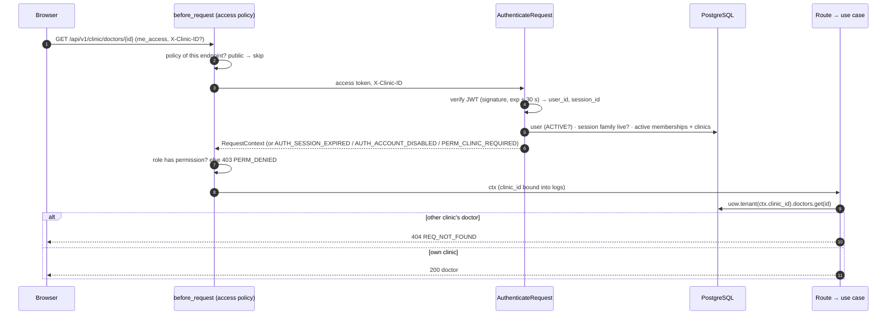

# M1 — Identity, tenancy and audit: design notes

| Field | Value |
|---|---|
| Status | In progress — M1-P1 and M1-P2 done (confirmed 3 Oct 2026); M1-P3 implemented, awaiting the developer's confirmation |
| Spec | `docs/specs/identity-and-tenancy.md` (Approved 2026-10-02) |
| Covers | FR-ORG-01..04, FR-AUTH-01..04, FR-AUD-01..02, FR-OPS-01, FR-OPS-04, NFR-08, NFR-14 |
| Issue / branch / PR | #19 · `m1/19-identity-tenancy-audit` · one draft PR for the whole milestone (ADR-0011) |
| Exit criterion | An ops user onboards a clinic with an owner, doctor and front desk; each signs in and sees only their clinic; the tenancy suite proves isolation |

## Concepts to teach before code (CLAUDE.md "Teaching Expectations")

1. **Entities and value objects.** An entity has an identity that survives change (a clinic is the
   same clinic after it is renamed); a value object is defined by its value and validated once
   when created (`PhoneNumber("+919000000001")` is always E.164). Rules live on them, not in
   handlers.
2. **State machines.** Status fields change only through named methods that refuse illegal moves
   (`DEACTIVATED → ACTIVE` raises `CLN_INVALID_TRANSITION`).
3. **Repository pattern.** Application code asks a repository for domain objects; it never sees
   SQL or ORM rows. The SQLAlchemy adapter maps rows ↔ entities.
4. **Tenancy scoping by construction (ADR-0003).** A tenant repository is *built with* one
   `clinic_id`; none of its methods accept a clinic ID, so "forgot the `WHERE clinic_id`" cannot be
   written. Another clinic's row is simply not found (→ 404, R8).
5. **Unit of work.** One object owns the transaction: every repository used in a command shares one
   session, and the change commits or rolls back as a whole. P4 adds the audit writer to it, which
   is how R11 ("audit in the same transaction") holds.
6. **Time-ordered IDs (UUIDv7).** IDs are created by the application through `IdPort` (so entities
   have identity before they are saved) and sort by creation time (index-friendly).

## Phase plan

| Phase | Builds | Key decisions |
|---|---|---|
| P1 | Domain model, migration `0002`, tenancy-scoped repository base, unit of work, coverage gate | Below |
| P2 | Argon2id hashing, sign-in, refresh rotation with reuse detection, sign-out, lockout | Below (M1-P2 section) |
| P3 | Auth middleware → `RequestContext`; role + membership check on every route; permission matrix tests; `GET /api/v1/me` and read-only clinic endpoints | Below (M1-P3 section) |
| P4 | Append-only `audit_events` written through the unit of work; DB role with `INSERT, SELECT` only; `v_clinic_activity` | R11, AC5, AC6 |
| P5 | Ops API: create clinic → doctors → owner invite; onboarding checklist timestamps; owner staff and doctor management (invite, role change, deactivate) | R9, R12, FR-OPS-01/04, FR-ORG-04 |
| P6 | Web: sign-in, clinic switcher, empty dashboard shell | Spec §6 |

Each phase starts with its design (`/plan-phase`), is approved, implemented, verified by the
developer and confirmed before the next phase starts. All phases are committed to the milestone
branch and appear in the one milestone PR.

---

## M1-P3 — Authorisation on every route

**Status: implemented (3 Oct 2026), awaiting the developer's confirmation.** Covers FR-AUTH-03,
FR-ORG-04 ("effective on the next request"), NFR-08; spec R6, R7, R8, R10; AC3, AC4.

### Concepts

1. **Authentication vs authorisation.** P2 proved *who* you are once and gave you a token. P3
   decides, on every request, *whether you may do this here*: is the session still live, is the
   user still active, which clinic is this request for, and does your role there allow the action.
2. **Default deny.** Every route must declare an access policy (`public`, `authenticated`,
   `clinic(permission)`, `ops`). `create_app` refuses to start if any route has none, so a new
   endpoint cannot ship unprotected by accident.
3. **Stateless token, stateful checks.** The access JWT is checked without the database, but R7
   ("no cached permissions") means the user, the session and the membership are re-read on every
   request. That is what makes deactivation and sign-out take effect on the next request.
4. **Request context.** The result of those checks is a `RequestContext` (request, user, session,
   clinic, membership, role) passed explicitly into use cases — never read from Flask globals in
   application code (apps/api/CLAUDE.md).
5. **404, not 403, across clinics (R8).** A tenant lookup goes through repositories bound to the
   request's clinic; another clinic's row is "not found", so its existence is never confirmed.

### Request flow



### Rules

| Check | Outcome |
|---|---|
| No / invalid / expired `me_access` (30 s skew) | 401 `AUTH_SESSION_EXPIRED` (the web app refreshes, then retries once — P6) |
| Session family revoked (signed out, or reuse detected) | 401 `AUTH_SESSION_EXPIRED` — sign-out now ends access immediately, not after 15 min |
| User `DISABLED` | 403 `AUTH_ACCOUNT_DISABLED` (R7, AC4) |
| Non-ops user with no `ACTIVE` membership left | 403 `AUTH_ACCOUNT_DISABLED` (R7, AC4: a deactivated front desk is rejected on the next request) |
| Clinic route, one active membership, no header | that clinic (R6) |
| Clinic route, `X-Clinic-ID` names one of the user's active memberships | that clinic (R6) |
| Clinic route, several memberships and no header, or a header that is not a UUID or not one of the user's clinics | 400 `PERM_CLINIC_REQUIRED` — the same answer whether or not that clinic exists |
| Clinic route, resolved clinic is `SUSPENDED` | 403 `CLN_SUSPENDED` (new code) |
| Clinic route, role lacks the permission | 403 `PERM_DENIED`, log `perm.denied` with permission and role |
| Ops user (`is_platform_ops`) on a clinic route | 403 `PERM_DENIED` (R10) |
| Non-ops user on an ops route | 403 `PERM_DENIED` (R10) |
| Tenant resource not in the request's clinic | 404 `REQ_NOT_FOUND`, log `tenancy.not_found` (R8, AC3) |

### Permission matrix (domain data, PRD §8.1 is normative)

`domain/identity/permissions.py` encodes every P0 row as a `Permission` enum and a role → set
mapping, so later milestones add endpoints, not policy. P3 uses `CLINIC_VIEW`, `DOCTORS_VIEW`
and `STAFF_MANAGE`; the rest are tested as a table now and attached to routes in M2–M5.

| Permission | OWNER | DOCTOR | FRONT_DESK |
|---|---|---|---|
| `CLINIC_VIEW` (name, timezone, address) | ✅ | ✅ | ✅ |
| `DOCTORS_VIEW` | ✅ | ✅ | ✅ |
| `CLINIC_MANAGE`, `STAFF_MANAGE` | ✅ | — | — |
| `PATIENTS_MANAGE`, `APPOINTMENTS_MANAGE`, `QUEUE_MOVE`, `REMINDERS_SCHEDULE` | ✅ | ✅ | ✅ |
| `CLINICAL_VIEW` | ✅ | ✅ | — (only the "prescription issued" flag) |
| `CLINICAL_WRITE` | ✅ only with a linked doctor profile | ✅ | — |
| `USAGE_METRICS_VIEW` | ✅ | ✅ | — |

Ops permissions are not role-based: ops routes require `is_platform_ops` (P5 adds the first ones).

### Endpoints in P3

| Method | Path | Policy | Returns |
|---|---|---|---|
| GET | `/api/v1/me` | `authenticated` (no clinic needed) | user, `is_platform_ops`, active memberships with clinic status, role and permissions |
| GET | `/api/v1/clinic` | `clinic(CLINIC_VIEW)` | the request's clinic |
| GET | `/api/v1/clinic/doctors` | `clinic(DOCTORS_VIEW)` | the clinic's doctors |
| GET | `/api/v1/clinic/doctors/{doctor_id}` | `clinic(DOCTORS_VIEW)` | one doctor, 404 across clinics |
| GET | `/api/v1/clinic/staff` | `clinic(STAFF_MANAGE)` | memberships with each user's name, role and status |

Existing routes get explicit policies: `/health`, `/ready` and `/api/v1/auth/*` are `public`.

### Decisions

| Decision | Reason |
|---|---|
| P3 adds **read-only** clinic endpoints; staff and doctor changes (invite, role change, deactivate) move to P5 | Every mutation then lands after the audit log (P4), so AC5 holds from the first write. P3 still has real tenant endpoints to prove AC3 against |
| Session liveness is checked per request (one indexed query on `refresh_tokens.family_id`) | Sign-out and reuse revocation end access at once instead of up to 15 minutes later |
| Three queries per authenticated request (user, session, memberships) | R7 forbids caching permissions; fine at pilot scale, revisit with measurements |
| Unknown or foreign `X-Clinic-ID` → `PERM_CLINIC_REQUIRED`, never 404/403 | Does not reveal whether a clinic exists |
| `SUSPENDED` clinic → 403 `CLN_SUSPENDED` on clinic routes; `/me` still lists it with its status | The web app can explain why, instead of a generic denial |
| Ops users are refused on clinic routes even if they hold a membership | R10; support access to a clinic is the post-pilot owner-granted flow (FR-OPS-05). Use a separate account for clinic work |
| Default-deny registry check at start-up, plus a test that lists every route with its policy | "Every route" holds by construction, not by review |
| `tests/tenancy/` gains an HTTP suite and a guard: every clinic route with an ID in its path must have a cross-clinic case | Future endpoints cannot skip the tenancy suite (CLAUDE.md "Tenancy isolation is a permanent test suite") |
| No migration | Uses existing tables and indexes |

### Files

| Layer | Files |
|---|---|
| Domain | `identity/permissions.py` (`Permission`, `ROLE_PERMISSIONS`, `permissions_for(role, has_doctor_profile)`) |
| Application | `context.py` (`RequestContext`), `auth/authenticate.py` (`AuthenticateRequest`, clinic resolution), `auth/errors.py` (+ `PermissionDenied`, `ClinicRequired`, `ClinicSuspended`), `identity/get_me.py`, `clinics/queries.py` (`GetClinic`, `ListDoctors`, `GetDoctor`, `ListStaff`) |
| Ports | `repositories.py`: `RefreshTokenRepository.is_family_live`, `StaffDirectory` (tenant: memberships joined to user names) |
| Adapters | `db/repositories.py` (the two additions) |
| Delivery | `http/access.py` (policies, `before_request` hook, registry check), `http/me.py`, `http/clinic.py`, `errors.py` (new codes), `bootstrap.py` |
| Contract / docs | `openapi.yaml` (5 endpoints, `X-Clinic-ID`), `API.md`, `ERRORS.md` (`CLN_SUSPENDED`, `PERM_*`), `ARCHITECTURE.md` §9, `DEBUGGING.md` |

### Tests

- Domain: the full permission matrix as one table test; owner-without-doctor-profile cannot
  `CLINICAL_WRITE`.
- Application (fakes): token missing/expired/revoked session; disabled user; deactivated last
  membership (AC4); clinic resolution (single, header, missing header with two clinics, foreign or
  malformed header, suspended); ops vs clinic routes.
- HTTP on PostgreSQL: matrix of {owner, doctor, front desk, ops, signed out} × every P3 endpoint →
  expected status; AC4 end to end (deactivate the membership, same access token → 403); sign-out
  then the old access token → 401; `X-Clinic-ID` for a two-clinic user.
- Tenancy (HTTP, AC3): users of clinics A and B; A asks for B's doctor → 404; A's lists contain
  no B rows; the guard test above.
- Start-up: an app with an undeclared route fails to build; contract tests for every new response.

### Verify

```bash
make up && make seed
# sign in as desk@ → GET /api/v1/me 200; GET /api/v1/clinic/staff 403 PERM_DENIED
# sign in as owner@ → GET /api/v1/clinic/staff 200
# sign out → the old me_access on GET /api/v1/me → 401 AUTH_SESSION_EXPIRED
```

### Decisions taken while implementing (3 Oct 2026)

| Decision | Reason |
|---|---|
| The doctor-profile check rides along in the `ClinicAccess` query (left join on the user's active doctor row) | R7 re-reads access on every request; an extra query per request only to answer "is this owner also a doctor" would be wasted work |
| `/me`, sign-in and refresh share one `{user, memberships}` body, and `Membership` now carries `clinic_status` and `permissions` | P2 returned memberships without them, so the web app would have had two shapes for the same thing. The contract change is additive (0.3.0) |
| Doctor and staff lists return `{"items": [...]}` with no cursor | A clinic has one to four doctors and a handful of staff. A `next_cursor` that is always null would be a promise the endpoint does not keep; the paginated envelope starts with patients (M2) |
| The clinic queries return domain entities and delivery serialises them | Nothing is dropped or transformed, so an application-level view layer would only duplicate the fields. Views stay where they earn their place (`SessionResult` redacts tokens) |
| `AuthenticateRequest` converts the adapter's `InvalidAccessToken` into `SessionExpired` | Both are `AUTH_SESSION_EXPIRED`; one error type for "the session is over" keeps the hook and its tests honest |
| `Flask(static_folder=None)` | The API serves JSON only. Without this, Flask registers a `static` route that the policy check would have to special-case |
| A test-only `@ops` route proves R10 in both directions until P5 adds real ops endpoints | The policy is enforced now, so the first real ops endpoint inherits a tested rule |
| The application tests share one harness module (`tests/unit/application/harness.py`) instead of fixtures copied per file | Sign-in (P2) and authorisation (P3) exercise the same composition; one place to wire it means the tests cannot drift apart |

---

## M1-P2 — Sign-in, refresh rotation, sign-out, lockout

Approved by the developer on 3 Oct 2026. Covers FR-AUTH-01, FR-AUTH-02, FR-AUTH-04; spec R1–R5,
AC1, AC2.

### Concepts

1. **Argon2id.** A memory-hard password hash: each guess costs 64 MiB and ~50 ms, so a stolen
   table cannot be brute-forced cheaply. The hash string carries its own salt and parameters, so
   parameters can be raised later and old hashes are upgraded at the next sign-in.
2. **Access token vs refresh token.** The access token is a short-lived (15 min) signed JWT that
   P3 checks on every request without a database lookup. The refresh token is a long-lived
   (14 days) random value, stored only as a SHA-256 hash, used for one thing: getting a new pair.
3. **Rotation with reuse detection.** Every refresh replaces the token. A token family is the chain
   that starts at one sign-in. If an already-replaced token is presented, someone holds a copy
   (theft or replay), so the whole family is revoked and both holders must sign in again (R5).
4. **Cookies, not JavaScript storage (ADR-0006).** Tokens live in `HttpOnly` cookies the page's
   scripts cannot read. `SameSite=Lax` stops other sites' forms sending them; a double-submit CSRF
   token (`me_csrf` cookie echoed in `X-CSRF-Token`) protects state-changing requests that carry
   session cookies. Sign-in only accepts JSON, which a cross-site form cannot send.
5. **Constant-time failure (R2).** An unknown identifier still runs one Argon2 verification against
   a dummy hash, so response time does not reveal whether an account exists.

### Request flow

```mermaid
sequenceDiagram
    autonumber
    participant B as Browser
    participant A as api (auth blueprint)
    participant U as SignIn / RefreshSession
    participant D as PostgreSQL
    B->>A: POST /api/v1/auth/sign-in {identifier, password}
    A->>U: SignInCommand
    U->>D: SELECT user … FOR UPDATE (by email or E.164 phone)
    U->>U: locked? → AUTH_LOCKED · verify Argon2id
    alt wrong password
        U->>D: failed_login_count + 1 (5th → locked_until = now + 15 min); COMMIT
        A-->>B: 401 AUTH_INVALID_CREDENTIALS
    else correct
        U->>D: reset counter, last_login_at, INSERT refresh_tokens (new family); COMMIT
        A-->>B: 200 user + memberships; Set-Cookie me_access, me_refresh, me_csrf
    end
    B->>A: POST /api/v1/auth/refresh (me_refresh, X-CSRF-Token)
    A->>U: refresh token
    U->>D: SELECT refresh_tokens WHERE token_hash … FOR UPDATE
    alt already rotated (reuse)
        U->>D: revoke whole family; COMMIT
        A-->>B: 401 AUTH_REFRESH_REUSED, cookies cleared
    else active
        U->>D: mark replaced, INSERT successor; COMMIT
        A-->>B: 200 + new cookies
    end
```

### Decisions

| Decision | Reason |
|---|---|
| `users.password_hash` is nullable | An invited user has no password until onboarding sets one (P5); a null hash can never sign in and takes the same dummy-hash path |
| Lockout: 5 consecutive failures → `locked_until = now + 15 min`, counter reset to 0; attempts while locked return `AUTH_LOCKED` without checking the password | Spec R3/AC1; after the lock expires the user has five fresh attempts |
| The 5th failure itself returns `AUTH_INVALID_CREDENTIALS`; the 6th returns `AUTH_LOCKED` | Exactly AC1 |
| Disabled user with the right password, or a non-ops user with no `ACTIVE` membership → `AUTH_ACCOUNT_DISABLED` (403); with a wrong password → `AUTH_INVALID_CREDENTIALS` | Never confirms a password for an account that cannot be used; never reveals status to someone without the password |
| User row locked (`FOR UPDATE`) during sign-in; refresh row locked during refresh | Parallel attempts cannot undercount failures or rotate one token twice |
| Strict reuse detection: no grace window for parallel refreshes | Spec R5. The web client (P6) must serialise refreshes |
| Sliding refresh expiry: each rotation gets a fresh 14 days | Spec R4; an absolute family lifetime can be added with an ADR if needed |
| Access JWT: HS256, `iss=mediease-api`, `aud=mediease`, `sub`, `sid` (family), `jti`, `iat`, `exp`; verified with 30 s leeway | Spec §8 clock skew; `sid` lets P3 and sign-out tie an access token to its session |
| Cookies: `me_access` path `/api`, `me_refresh` path `/api/v1/auth`, `me_csrf` path `/` (readable by scripts); all `SameSite=Lax`, `Secure=COOKIE_SECURE` | The refresh token is only ever sent to the auth endpoints |
| CSRF enforced by one `before_request` hook on every unsafe `/api/*` request that carries a session cookie, except sign-in | P3 routes are protected without per-route code |
| `JWT_SIGNING_KEY` ≥ 32 characters in every environment; `change-me` placeholder only in `local` | Fail fast; HS256 needs a key at least as long as its output |
| Per-IP rate limiting is **not** in P2 | Needs shared state across gunicorn workers; covered by the reverse proxy limits in M6-P1 (ARCHITECTURE §11). Account lockout is the P2 control |
| Audit rows for `auth.signed_in` / `auth.sign_in_failed` arrive with the audit log in P4 | P2 emits the log events; P4 adds rows in the same transaction |
| Cross-clinic "which clinics can this user use" read goes through a platform `ClinicAccessRepository` (memberships joined to clinic name), not a tenant repository | ADR-0003 platform repositories; returns IDs, names and roles only |
| `make seed` loads synthetic demo data (one clinic, owner, doctor, front desk, ops user) and refuses to run unless `APP_ENV=local` | Needed to try sign-in by hand; AGENTS.md lists it for M1 |

### Files

| Layer | Files |
|---|---|
| Domain | `identity/user.py` (credentials, lockout), `identity/session.py` (`RefreshToken` states), `identity/access.py` (`ClinicAccess` read model) |
| Application | `auth/errors.py`, `auth/views.py`, `auth/sign_in.py`, `auth/refresh_session.py`, `auth/sign_out.py`, `auth/_session.py` |
| Ports | `clock.py`, `security.py` (`PasswordHasher`, `AccessTokenIssuer`, `RefreshTokenSecrets`), repository + unit-of-work additions |
| Adapters | `clock/system.py`, `security/argon2_hasher.py`, `security/jwt_tokens.py`, `security/refresh_secrets.py`, `db/models/identity.py`, `db/repositories.py`, migration `0003` |
| Delivery | `http/auth.py`, `http/session_cookies.py`, `http/csrf.py`, `http/validation.py`, `errors.py` (domain error → status), `cli/seed.py` |
| Config | `JWT_SIGNING_KEY`, `ACCESS_TOKEN_TTL_SECONDS`, `REFRESH_TOKEN_TTL_SECONDS` |
| Contract | `/api/v1/auth/sign-in`, `/refresh`, `/sign-out` in `contracts/openapi.yaml`; regenerated web types |

New dependencies: `argon2-cffi` (Argon2id, the reference binding) and `PyJWT` (JWT encode and
verify with algorithm pinning).

### Verify

```bash
make up && make seed
curl -si -c /tmp/jar -H 'Content-Type: application/json' \
  -d '{"identifier":"owner@sample-clinic.example","password":"<demo password>"}' \
  localhost:8000/api/v1/auth/sign-in        # 200, three Set-Cookie headers, no token in body
```

Failure paths: wrong password five times then the right one → 423 `AUTH_LOCKED`; replaying an
old `me_refresh` → 401 `AUTH_REFRESH_REUSED` and the newer one stops working; refresh without
`X-CSRF-Token` → 403 `AUTH_CSRF_INVALID`.

---

## M1-P1 — Domain, tables, tenancy-scoped repositories

### What and why

The rest of M1 needs clinics, users, memberships and doctors to exist with their rules enforced,
and a persistence layer in which a cross-clinic query cannot be written. P1 builds exactly that,
with no HTTP endpoints and no auth (those are P2/P3).

### Domain (`domain/`, standard library only)

| Module | Contents |
|---|---|
| `shared/errors.py` | `DomainError` (stable `code`), `InvalidValue` (`REQ_VALIDATION_FAILED`, names the field), `InvalidTransition` (`CLN_INVALID_TRANSITION`) |
| `shared/phone.py` | `PhoneNumber` value object: strips spaces/`-`/`()`, accepts `+<E.164>`, Indian 10-digit, `0`-prefixed and `91`-prefixed input; `masked()` → `+91******3210` (the shared masking helper, CLAUDE.md "Logging") |
| `shared/email.py` | `EmailAddress` value object: trimmed, lower-cased, one `@`, dotted domain, ≤ 254 chars |
| `shared/time.py` | `require_utc(dt)` — timestamps entering the domain must be timezone-aware UTC |
| `clinics/clinic.py` | `Clinic` + `ClinicStatus` (`ONBOARDING → ACTIVE ↔ SUSPENDED`); `activate()` enforces **I1** (needs ≥ 1 active owner) with `CLN_OWNER_REQUIRED` |
| `clinics/doctor.py` | `Doctor`; **I3** non-empty qualification, registration number and council (FR-ORG-02); activate/deactivate |
| `identity/user.py` | `User` + `UserStatus` (`ACTIVE ↔ DISABLED`); email or phone required |
| `identity/membership.py` | `ClinicMembership`, `Role` (`OWNER`, `DOCTOR`, `FRONT_DESK`), `MembershipStatus` (`INVITED → ACTIVE → DEACTIVATED`); `change_role()` / `deactivate()` enforce **R9** (`CLN_LAST_OWNER`) given the clinic's active-owner count |

Entities receive `now` and IDs from their caller; the domain never reads the clock or generates IDs.

### Ports (`ports/`)

- `ids.py` — `IdPort.new_id() -> UUID`.
- `repositories.py` — `ClinicRepository`, `UserRepository` (platform: clinics and users are not
  tenant-owned); `DoctorRepository`, `MembershipRepository` (tenant: bound to one clinic).
- `unit_of_work.py` — `UnitOfWork` (context manager, `commit()`, `rollback()`, `clinics`, `users`,
  `tenant(clinic_id) -> TenantRepositories`).

### Adapters (`adapters/`)

- `ids/uuid7.py` — `Uuid7Generator` (RFC 9562 UUIDv7, monotonic within a process; Python 3.12 has
  no `uuid.uuid7`, so no dependency is added).
- `db/models/` — SQLAlchemy 2 typed models on one `Base` with a constraint naming convention.
- `db/tenancy.py` — `TenantScopedRepository`: holds the session and one `clinic_id`; every query
  starts from `_scoped_select()`; `_add()` refuses an entity from another clinic
  (`TenancyViolation`, a programming error, never a user-facing 404).
- `db/repositories.py` — the four repositories, mapping rows ↔ entities.
- `db/unit_of_work.py` — `SqlAlchemyUnitOfWork` (one session per unit; rolls back unless
  committed).
- `migrations/env.py` uses `Base.metadata`; migration `0002` creates the tables.

Nothing is wired into `bootstrap.py` yet: no route uses the unit of work until P2.

### Schema (migration `0002`)

`clinics`, `users`, `clinic_memberships`, `doctors` as in `docs/DATA_MODEL.md`, with these P1
decisions:

| Decision | Reason |
|---|---|
| `users.email` is `text` with `CHECK (email = lower(email))` + unique, not `citext` | No database extension (the app role may not be allowed to create one); the domain lower-cases emails |
| `users.password_hash`, `failed_login_count`, `locked_until`, `last_login_at` arrive in P2 (`0003`) | Only P2 has behaviour for them (CLAUDE.md "no placeholder code") |
| `clinics.patient_code_prefix`/`next_patient_seq` (M2), `booking_mode` (M3), `plan` (billing) are deferred | Added by the milestone that uses them |
| Status/role enums are `text` + `CHECK` | DATA_MODEL conventions |
| `doctors`: partial unique `(clinic_id, user_id) WHERE user_id IS NOT NULL` | One doctor profile per user per clinic (owner-who-is-a-doctor edge case) |
| Tenant indexes lead with `clinic_id` | ADR-0003 |

### Tests

- Unit (`tests/unit/domain/`): phone normalisation (valid forms, invalid forms, masking), email,
  each state machine (legal and illegal moves), I1, I3, R9, UTC enforcement; UUIDv7 version,
  variant and ordering.
- Integration (`tests/integration/db/`): migrations round-trip with `0002` as head; models and
  migration have no drift (Alembic autogenerate compare is empty); repositories round-trip each
  entity; unit of work commits, rolls back on exception and on exit without commit; DB constraints
  (I2 unique membership, email-or-phone, lower-case email, CHECK on enums).
- Tenancy (`tests/tenancy/`): two clinics — clinic A's repositories cannot `get` or `list` clinic
  B's doctors and memberships, cannot `update` them, and `add` refuses a B entity; every model with
  a `clinic_id` column has a `TenantScopedRepository` (guard against an unscoped table).

### Coverage gate (NFR-14)

`make test-api` and CI keep the whole-package gate (≥ 90%) and add
`coverage report --include` on `domain/` + `application/` with `--fail-under=80`.

### Verify

```bash
make up                      # migrate applies 0002; api healthy
make lint typecheck test     # all green; both coverage gates pass
make psql                    # \dt → clinics, users, clinic_memberships, doctors, alembic_version
```

Failure path: inserting a second membership for the same user and clinic fails with
`uq_clinic_memberships_clinic_id_user_id`; `tenant(clinic_a).doctors.get(<clinic B doctor id>)`
returns `None`.

### Risks

- Timezone validation uses the OS time-zone database through `zoneinfo`; both the API image and the
  dev venv have it (486 zones checked). If a slimmer base drops it, add the `tzdata` package.
