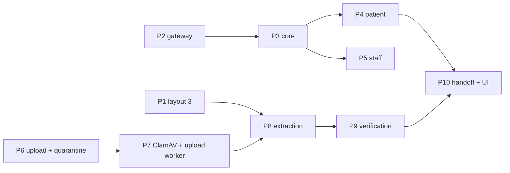

# M7 — AI assistant (M7a) and verified prescription uploads (M7b)

| Field | Value |
|---|---|
| Issue / branch | #65 / `m7/65-assistant-and-verified-uploads` (from `origin/main` at `d53f53d`) |
| Requirements | FR-AI-01..04, FR-RX-11, FR-UPL-01..05, NFR-20 (PRD v1.3 C15, C16) |
| Specs | `docs/specs/assistant.md`, `docs/specs/prescription-uploads.md` |
| ADRs | 0013 (gateway), 0023 (verification code and uploads), 0024 (assistant turns) |
| Review | `docs/milestones/M7-architecture-review.md` (approved 27 Oct 2026, decisions D1–D7) |
| Status | Approved in advance by the developer, 27 Oct 2026; built phase by phase below |

## Why two parts on one branch

D1 split M7 so the assistant does not wait for the upload pipeline, but both parts are one
milestone issue, so they share one branch and one PR (ADR-0011); commits and this note label them
M7a and M7b. One dependency crosses them: layout 3 (M7a-P1) must ship first, because only versions
issued on it carry a code an upload can be verified by, and the assistant's explanation tool
(M7a-P3) is what a verified upload is handed to (M7b-P10).



## The trust rule (ADR-0023)

```
upload → quarantine → ClamAV → identifier only → PortalScope / last-4 check → prescription ID
       → database record → explain_prescription → reply
```

The file is never a source: the extraction port returns an ID or nothing, the file is deleted when
the upload leaves extraction, and the assistant's tools take an `upload_id` only to find the
verified prescription ID, then read the database.

## Phases

| Phase | What | Main files |
|---|---|---|
| M7a-P1 | Layout 3 | `domain/prescriptions/verification.py`, `document.py`, `adapters/pdf/weasy.py`, `assets/prescription-3.*`, `page-3.css.j2`, `mediease-mark.svg` |
| M7a-P2 | Gateway | `ports/llm.py`, `domain/assistant/llm.py`, `adapters/llm/{openai_compatible,console}.py`, settings, `bootstrap.build_llm` |
| M7a-P3 | Core | `domain/assistant/{guard_rails,explain,proposal}.py`, `application/assistant/{turn,tools,confirm}.py`, `adapters/security/proposal_signer.py` |
| M7a-P4 | Patient | `delivery/http/assistant.py`, portal page `apps/web/src/app/(patient)/portal/(app)/assistant`, `features/assistant` |
| M7a-P5 | Staff | the same blueprint (staff routes), clinic page `apps/web/src/app/(clinic)/assistant` |
| M7b-P6 | Uploads | migration `0042`, `domain/uploads/`, `application/uploads/`, `delivery/http/prescription_uploads.py`, the web upload proxy (#30) |
| M7b-P7 | Scanning | `ports/malware.py`, `adapters/malware/clamd.py`, `docker-compose.yml` (`clamav`, `upload-worker`), `WORKER_QUEUE` |
| M7b-P8 | Extraction | `ports/extraction.py`, `adapters/extraction/identifier.py` |
| M7b-P9 | Verification | `application/uploads/verify.py`, the reviewed `prescription_lookup` |
| M7b-P10 | Handoff | assistant context `upload_id`, the sweep, portal UI, Playwright journeys |

The as-built record of each phase is appended below as it lands.

## As built

### M7a (27 Oct 2026)

- **P1 Layout 3.** `CURRENT_LAYOUT = 3`. The verification block and the MediEase mark are
  running elements in the bottom margin boxes of every page (`page-3.css.j2`); the page number
  moved to the top margin when it collided with the code at A5. The QR is inline SVG from
  `segno` (error correction M, 4-module quiet zone, 17 mm): it decodes with zxing-cpp from a
  144 dpi raster at A5 and 216 dpi at A4. The code is in the PDF text layer. Layouts 1 and 2 are
  hash-frozen. The mark is a placeholder (`assets/SOURCES.md`).
- **P2 Gateway.** `LlmPort`; `OpenAICompatibleLlm` (stdlib HTTP, Groq preset by default);
  `ConsoleLlm` (keyword rules that repeat our tools' own summaries, including the booking
  dialogue); `build_llm` with the production refusals. Settings `LLM_*`.
- **P3 Core.** `AssistantEngine` (guard rails, at most 4 tool rounds, proposals, grounding);
  `domain/assistant/{guard_rails,explain,proposal}.py`; `HmacProposalSigner` (a key derived from
  the JWT key); single use through the rate-limit table (one bucket per proposal). No table, no
  migration.
- **P4, P5 Assistants.** `PatientAssistant` (tools over the portal and booking use cases; the
  picker's prescription through `GetPortalPrescription`) and `StaffAssistant` (tools over the
  clinic use cases, filtered by permission). Patient cancel and reschedule stay with the clinic
  (no FR-PRT-08 use case yet). Web: `/portal/assistant` (picker, chat, confirmation card; Home
  links to it; no sixth tab, which would overflow at 360 px) and `/assistant` in every workspace.
- **Tests.** Guard-rail suite (31 advice and 17 restating questions, English and Hindi), adapter
  tests (fake transport and real HTTP), 26 HTTP tests including booking by chat with
  confirmation, bound and single-use tokens and the grounding replacement, a contract test, web
  component tests and the Playwright journey 1 plus the staff journey.

### M7b (27 Oct 2026)

- **P6 Uploads.** Migration `0042`: `prescription_uploads` (platform data owned by a patient
  account; `clinic_id` and the prescription set only once verified) with CHECKs per state, and
  the two upload job kinds in `ck_jobs_system_kind`. `domain/uploads/` holds the lifecycle
  (`QUARANTINED → SCANNING → EXTRACTING → NEEDS_CHALLENGE | VERIFIED | REJECTED`); the file key
  exists only in the first three states. `UploadPrescription` sniffs the bytes, writes the file
  under `uploads/<account>/<upload>` and enqueues the job in the same transaction (the outbox),
  removing the file if the commit fails. `TypePrescriptionCode` resolves a typed code at once.
  The ports are one module, `ports/uploads.py` (repository, the reviewed lookup, the scanner and
  the reader), not the three files the plan named.
- **P7 Scanning.** `ClamdScanner` (clamd `INSTREAM` over a stdlib socket, 64 KB chunks). An
  unreachable or erroring daemon is retried by the job (4 attempts, 1, 5 and 15 minutes apart)
  and then rejects the upload `UPL_SCAN_UNAVAILABLE`; it is never treated as clean.
  `WORKER_QUEUE` filters the claim SQL (`SqlAlchemyJobStore(only=, skip=)`): compose runs
  `worker` with `default` and `upload-worker` with `uploads`, beside `clamav`
  (`clamav/clamav:1.5.4`, signatures on the `clamav-db` volume, clamd on `127.0.0.1:3310` for the
  live test only). The default worker also mounts `blobs` now (it already purged certificates).
- **P8 Extraction.** `PrescriptionIdentifierReader`: the QR (pdfium render at 216 dpi, zxing-cpp,
  QR symbols only, `MEDIEASE-RX:1:<uuid>`) and the printed code in a PDF's text layer. No OCR: a
  photo is read by its QR only, else the user types the code. 40-megapixel cap read from the
  header before decoding, 50 pages at most, 2 read. It returns IDs and methods, nothing else.
  `pypdfium2` and `zxing-cpp` are runtime dependencies now; Pillow is named.
- **P9 Verification.** `verify.py`. Own record: `version_in_scope` (an issued or superseded
  version of a linked record). Anyone else's code, existing or not: `NEEDS_CHALLENGE`, and the
  last-4 digits are checked against the chain's own patient link with `check_last4` and its
  lockout, so a representative needs the prescription's link to exist (the clinic sends it). Five
  failures on the upload end it (`UPL_LOCKED`); every failure answers the same. A pass grants
  that chain for 24 hours and links nothing. A superseded version is verified as itself and
  waits for `ChooseVersion`.
- **P10 Handoff and UI.** `ReadVerifiedUpload` is the patient assistant's upload reader: the
  chosen version's database page, re-authorised every turn (`UPL_NOT_VERIFIED`,
  `UPL_SELECTION_REQUIRED`). `SweepUploads` every 10 minutes: abandoned after 1 hour, a pending
  check after 24 hours, rows after 30 days. Web: an upload card on `/portal/assistant` (file or
  code, polling every 2 s, last-4 form, the version choice, Remove), English and Hindi. A new
  import contract keeps the assistant away from intake, processing, scanning and storage.
- **Issue #30.** Reproduced as specified (an upload through the web origin is proxied by the
  rewrite); fixed with size-checked route handlers for the prescription upload and the ops patient
  import (`lib/api/limited-proxy.ts`): a declared or streamed body over the limit is the API's
  own 413 envelope. 15 of 15 oversized uploads through `:3000` answered 413; the smoke test checks
  it. Other upload paths (visit attachments, certificates) still use the rewrite, where the API's
  auth check answers before the body matters; moving them is backlog.
- **Tests.** Domain unit tests; reader tests on real layout-3 PDFs and QR images; a socket-level
  clamd fake; the live clamd test (EICAR, and an EICAR PDF through the real processing job); 24
  HTTP tests including **the boundary test** (a forged PDF and a photo with edited medicine text
  and a genuine QR verify, and the model is sent only the database lines); a contract test; the
  tenancy and portal-scope suites; web component and proxy tests; Playwright journeys 2-5.
- **Findings.** A bare EICAR file is refused by type (it is not a PDF, JPEG or PNG) before any
  scan, and ClamAV does not flag EICAR behind a `%PDF-` header; the realistic case is EICAR as a
  PDF embedded file, which ClamAV extracts and flags (`Eicar-Signature`). `test_access` had not
  been given the M7a assistant routes; it has them now.
