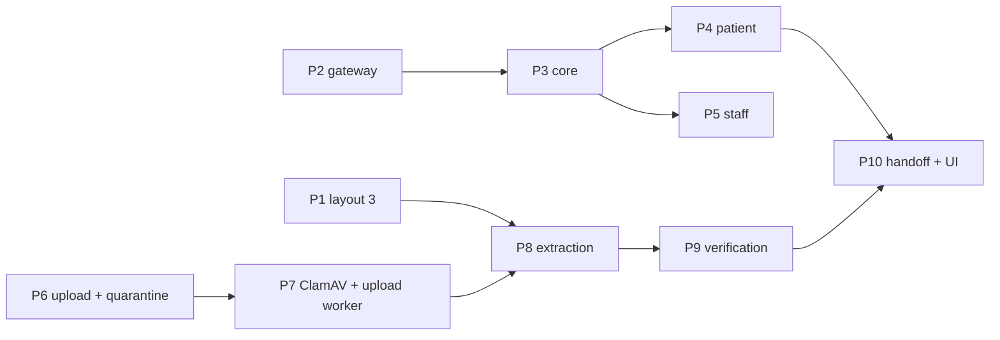

# M7 — AI assistant (M7a) and verified prescription uploads (M7b)

| Field | Value |
|---|---|
| Issue / branch | #65 / `m7/65-assistant-and-verified-uploads` (from `origin/main` at `d53f53d`) |
| Requirements | FR-AI-01..04, FR-RX-11, FR-UPL-01..05, NFR-20 (PRD v1.3 C15, C16) |
| Specs | `docs/specs/assistant.md`, `docs/specs/prescription-uploads.md` |
| ADRs | 0013 (gateway), 0023 (verification code and uploads), 0024 (assistant turns) |
| Review | `docs/milestones/M7-architecture-review.md` (approved 27 Oct 2026, decisions D1–D7) |
| Status | Approved in advance by the developer, 27 Oct 2026; built phase by phase below |

## Why two parts on one branch

D1 split M7 so the assistant does not wait for the upload pipeline, but both parts are one
milestone issue, so they share one branch and one PR (ADR-0011); commits and this note label them
M7a and M7b. One dependency crosses them: layout 3 (M7a-P1) must ship first, because only versions
issued on it carry a code an upload can be verified by, and the assistant's explanation tool
(M7a-P3) is what a verified upload is handed to (M7b-P10).



## The trust rule (ADR-0023)

```
upload → quarantine → ClamAV → identifier only → PortalScope / last-4 check → prescription ID
       → database record → explain_prescription → reply
```

The file is never a source: the extraction port returns an ID or nothing, the file is deleted when
the upload leaves extraction, and the assistant's tools take an `upload_id` only to find the
verified prescription ID, then read the database.

## Phases

| Phase | What | Main files |
|---|---|---|
| M7a-P1 | Layout 3 | `domain/prescriptions/verification.py`, `document.py`, `adapters/pdf/weasy.py`, `assets/prescription-3.*`, `page-3.css.j2`, `mediease-mark.svg` |
| M7a-P2 | Gateway | `ports/llm.py`, `domain/assistant/llm.py`, `adapters/llm/{openai_compatible,console}.py`, settings, `bootstrap.build_llm` |
| M7a-P3 | Core | `domain/assistant/{guard_rails,explain,proposal}.py`, `application/assistant/{turn,tools,confirm}.py`, `adapters/security/proposal_signer.py` |
| M7a-P4 | Patient | `delivery/http/assistant.py`, portal page `apps/web/src/app/(patient)/portal/(app)/assistant`, `features/assistant` |
| M7a-P5 | Staff | the same blueprint (staff routes), clinic page `apps/web/src/app/(clinic)/assistant` |
| M7b-P6 | Uploads | migration `0041`, `domain/uploads/`, `application/uploads/`, `delivery/http/prescription_uploads.py`, the web upload proxy (#30) |
| M7b-P7 | Scanning | `ports/malware.py`, `adapters/malware/clamd.py`, `docker-compose.yml` (`clamav`, `upload-worker`), `WORKER_QUEUE` |
| M7b-P8 | Extraction | `ports/extraction.py`, `adapters/extraction/identifier.py` |
| M7b-P9 | Verification | `application/uploads/verify.py`, the reviewed `prescription_lookup` |
| M7b-P10 | Handoff | assistant context `upload_id`, the sweep, portal UI, Playwright journeys |

The as-built record of each phase is appended below as it lands.

## As built
