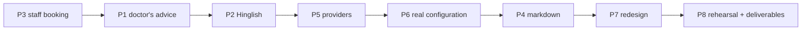

# M7c — Demo polish, real configuration and Phase 2 deliverables

| Field | Value |
|---|---|
| Issue / branch | #69 / `m7c/69-demo-polish` (from `origin/main` at `c2b0274`) |
| Requirements | FR-AI-01..04 (assistant), the developer's feedback of 4 Nov 2026, the Phase 2 deliverables (due 15 Nov 2026) |
| Specs | `docs/specs/assistant.md` (R15–R21 added for M7c) |
| ADRs | 0013 (gateway, addendum for Mistral and NVIDIA), 0024 (turns; stored chats stay out) |
| Status | Approved by the developer, 4 Nov 2026: the plan, the build order and every recommended design decision up to P6. P7 waits for the developer's module list |
| Progress report | `docs/milestones/M7c-progress-report.md` |

## Why a polish milestone before M8

The developer tried M7 with a real model and found the assistant refusing to repeat the doctor's
advice, answering Hinglish with fixed text, offering sessions that had already ended and not
asking which doctor. The Phase 2 review (15 Nov 2026) needs the product deployed, used by design
partners and demonstrated live, so these fixes, the switch to real configuration and the
deliverables come before M8 (multi-clinic WhatsApp), which no partner needs yet.

## Build order

P3 → P1 → P2 → P5 → P6 → P4 → P7 → P8: what partners and the demo touch first. Phase numbers keep
the approved plan's names.

## Phases and decisions

| Phase | What | Main files |
|---|---|---|
| **P3** | Staff assistant books only what can still be booked | `application/assistant/staff.py`, `domain/messaging/formatting.py` |
| **P1** | The doctor's advice is read from the record | `domain/assistant/guard_rails.py`, `application/assistant/patient.py`, `adapters/llm/console.py` |
| **P2** | Hinglish understood; the guard knows romanised wordings | the same files |
| **P5** | Mistral and NVIDIA beside Groq, by settings only | `adapters/llm/openai_compatible.py`, `config/settings.py`, `.env.example`, ADR-0013 |
| **P6** | Real configuration, tested with the developer | `.env.example`, `docs/RUNBOOK.md`, `deliverables/PLACEHOLDERS.md` (local only) |
| **P4** | Safe formatting in the chat | `apps/web/src/features/assistant/` |
| **P7** | Landing page and frontend redesign | named by the developer at the start of the phase |
| **P8** | Rehearsal, full suites, deliverable documents | `deliverables/` (local only), `docs/` |

### P3 decisions
- **D1** `list_sessions` shows only what the booking drawer would offer (`BookDrawer` `bookable`
  and `freeSlots`): open sessions that have not ended and have room; in slot mode, only free slots
  whose end is still ahead. It says how many sessions it left out. A date before the clinic's today
  is refused with words the model can repeat.
- **D2** `book_appointment` and `reschedule_appointment` refuse an ended session or a slot that is
  over before any confirmation card is shown. The domain's `APT_IN_PAST` stays the final check.
- **D3** The system prompt lists the clinic's active doctors with their IDs. With more than one, the
  model must ask which doctor before choosing a session and pass `doctor_id` to `list_sessions`
  (a new optional argument; `ListSessions` already supported it). With one, it must not ask.
- **D4** The prompt gives today's and tomorrow's dates, so "book for tomorrow" needs no date
  arithmetic from the model.
- **D5** The 3:55 AM and 1:00 PM sessions the developer saw were extra sessions left by Playwright
  runs (`apps/web/e2e/queue-support.ts`), not a time-zone bug. D1 hides them once they end; P6
  covers demo data.

### P1 decisions
- **D6** The patient prompt separates the model's own advice (refused) from what the doctor wrote
  (always answered with `explain_prescription`), and names food, rest and precautions as part of
  the doctor's advice. The tool's description says the same.
- **D7** The input guard lets a drug-advice or treatment wording pass when the question is about
  what the doctor wrote ("what did the doctor suggest", "as per the prescription", "doctor ne").
  Emergency, results, dose-change and diagnosis questions are referred as before.
- **D8** The reply checks (R5, R10) are unchanged; a reply that rewords the advice as "you should…"
  is still replaced by the record's own text.

### P2 decisions
- **D9** Both prompts say the user may write Hindi in Latin letters and the reply stays in the
  turn's language (English, or Hindi in Devanagari), because the reply check knows only those two.
- **D10** The input guard gains romanised patterns for every category; the suite gains Hinglish
  advice and restating cases. The console model gains romanised keywords for local demos.

### P5 decisions
- **D11** `LLM_PROVIDER` adds `mistral` (Mistral's own API) and `nvidia` (build.nvidia.com). Both
  speak the OpenAI-compatible chat-completions API with tools, so they are presets of the existing
  adapter, not new adapters. Defaults can be overridden with `LLM_BASE_URL` and `LLM_MODEL`.
- **D12** Hugging Face Inference Providers lists no provider for Mistral Large 4
  (`mistralai/Mistral-Large-4-1T-A52B-NVFP4`, checked 4 Nov 2026), so Mistral is reached through
  its own API.
- **D13** The adapter accepts tool-call arguments sent as a JSON object as well as a string, and
  makes up a call ID when a provider leaves it out, because providers differ there.

### P6 decisions
- **D14** Real values go only into the developer's `.env`; the agent never reads it. The agent
  gives the exact keys, the developer sets them, and the two test together.
- **D15** Every localhost URL and every dummy name or figure in a deliverable is listed in
  `deliverables/PLACEHOLDERS.md`, kept out of git with the rest of `deliverables/`, so real
  partner names are never committed.

### P4 decisions
- **D16** The chat renders a safe subset of Markdown (bold, italics, lists, line breaks) with a
  small renderer of our own that builds React elements. Links, images, tables and raw HTML are
  shown as plain text. This replaces the `react-markdown` suggestion: the patient pages' 200 KB
  budget and AGENTS.md's dependency rule favour about 80 lines of our own code.

## Out of scope
Stored chat history (ADR-0024); real partner evidence, quotes and pricing results (they come from
real events and stay as placeholders).

## As built
Recorded per phase in `docs/milestones/M7c-progress-report.md`.
