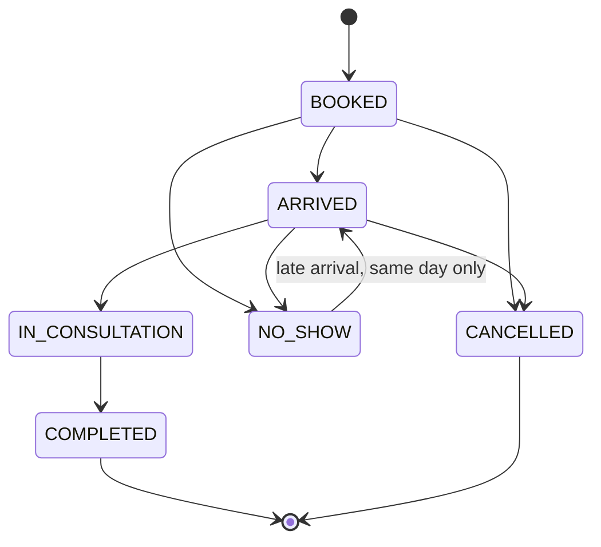

# Spec: Appointments and daily queue

| Field | Value |
|---|---|
| Requirements | FR-APT-01..07, FR-QUE-01..05 |
| Milestone / phases | M3 / P1–P5 |
| Status | Draft |
| Last updated | 2026-09-15 |

## 1. Context
Seven of fourteen clinics book through WhatsApp and phone with no central view (A7–A13).
Many small Indian clinics run numbered tokens rather than fixed times, so both modes are needed.

## 2. Actors and permissions
Owner, doctor, front desk: book, reschedule, cancel, transition, add walk-ins. Owner: schedules.

## 3. Domain model
- `DoctorSchedule`, `ScheduleException`, `Session` (materialised per date), `Appointment`.
- Clinic `booking_mode`: `SLOTS` or `TOKENS`.

## 4. Behaviour
- **R1** Sessions for a date are generated from schedules valid on that date, minus `LEAVE`
  exceptions, plus `EXTRA` exceptions. Generation is idempotent (`UNIQUE (doctor_id, starts_at)`).
- **R2** Times are interpreted in the clinic timezone and stored in UTC. A session belongs to the
  clinic-local date on which it starts.
- **R3** SLOTS mode: slots are `[starts_at, ends_at)` stepped by `slot_minutes`; one active
  appointment per slot.
- **R4** TOKENS mode: a booking takes `next_token` and increments it; tokens are never reused within
  a session, including after cancellation.
- **R5** Booking locks the session row (`SELECT … FOR UPDATE`), checks status, capacity and slot
  availability, inserts the appointment, increments `booked_count`, writes status history, audit
  and (if consented) a `send_booking_confirmation` job — all in one transaction.
- **R6** Booking in the past → `APT_IN_PAST`; outside sessions → `APT_OUTSIDE_SCHEDULE`;
  full → `APT_SESSION_FULL`; slot taken → `APT_SLOT_TAKEN`; closed → `APT_SESSION_CLOSED`.
- **R7** Cancel requires a reason (enum + optional note) and decrements `booked_count`.
- **R8** Reschedule is cancel + book in one transaction; the new appointment references the old one.
- **R9** Transitions follow the state machine; anything else → `QUE_INVALID_TRANSITION` with
  `details.from` and `details.to`. Timestamps `arrived_at`, `started_at`, `completed_at` are set on
  entry to the matching state.
- **R10** `NO_SHOW` is set manually or automatically at session end + 60 minutes for `BOOKED`
  appointments (job in M5; manual only in M3).
- **R11** Walk-ins are added to today's session for the chosen doctor with source `WALK_IN`
  (token mode: next token; slot mode: appended after the last slot, capacity permitting, or
  flagged as overbooked if the owner enabled overbooking).
- **R12** The queue endpoint returns appointments ordered by slot/token with a strong `ETag`
  derived from the session's `updated_at` and appointment versions; clients poll every 5 seconds
  with `If-None-Match` and receive 304 when unchanged.
- **R13** Starting a consultation (`IN_CONSULTATION`) creates or opens the visit (M4 dependency;
  in M3 only the transition happens).

## 5. API surface
See API.md "Schedules, appointments, queue".

## 6. UI notes
- Default landing page for front desk and doctors: **Today's queue** for the selected doctor.
- Book in ≤ 3 interactions: (1) search/select patient, (2) pick slot/next token, (3) confirm.
- Queue row actions are single clicks: Arrived → Start → (doctor) Complete; overflow menu for
  No-show / Cancel / Reschedule.
- Wait time shown from `arrived_at`.

## 7. Events and side effects
| Trigger | Audit | Job | Analytics |
|---|---|---|---|
| Book | `appointment.booked` | `send_booking_confirmation` (M5) | `appointment_created` |
| Transition | `appointment.status_changed` | — | `queue_status_changed` |
| Cancel / reschedule | `appointment.cancelled` / `appointment.rescheduled` | cancellation notice (P1) | — |

## 8. Edge cases
| Case | Expected outcome |
|---|---|
| Schedule changed after bookings exist | Existing appointments keep their session; owner sees a warning listing affected appointments |
| Leave added for a day with bookings | Exception saved; affected appointments listed for manual rescheduling (no auto-cancel) |
| Session crossing midnight IST | Belongs to the start date (R2) |
| DST | Not applicable to `Asia/Kolkata`; code still uses timezone-aware arithmetic |
| Two tabs transitioning the same appointment | Second request gets `QUE_INVALID_TRANSITION` if the state already moved |

## 9. Acceptance criteria
- **AC1 (FR-APT-04)** Given capacity 1 and two parallel booking requests, then exactly one 201 and
  one 409 (`APT_SLOT_TAKEN` or `APT_SESSION_FULL`), and `booked_count = 1`.
- **AC2 (FR-APT-02)** Given TOKENS mode, when three bookings are made and the second is cancelled,
  then the next booking receives token 4.
- **AC3 (FR-QUE-02)** Given a `COMPLETED` appointment, when transitioning to `ARRIVED`, then 409
  `QUE_INVALID_TRANSITION`.
- **AC4 (FR-QUE-03)** Given two browsers on the queue, when one marks a patient arrived, then the
  other shows it within 5 seconds.
- **AC5 (FR-APT-01, R2)** Given a clinic in `Asia/Kolkata` and a session 23:00–01:00, then it is
  listed under the start date and slots are correct in UTC.
- **AC6 (FR-APT-03)** Given the E2E test, then booking takes at most 3 user interactions from the
  queue screen.

## 10. Observability
Events: `appointment.booked`, `appointment.booking_rejected` (`error_code`),
`queue.transition_rejected`, `session.generated` (count). Metrics: booking conflicts per hour,
p95 booking latency.

## 11. Out of scope
Patient self-booking (M7 public page), appointment reminders (FR-APT-08, P1), live patient token
link (FR-QUE-06, P1), automatic no-show job (M5).

## 12. Open questions
- Should overbooking be allowed by default in slot mode? (Default off; owner setting.)
