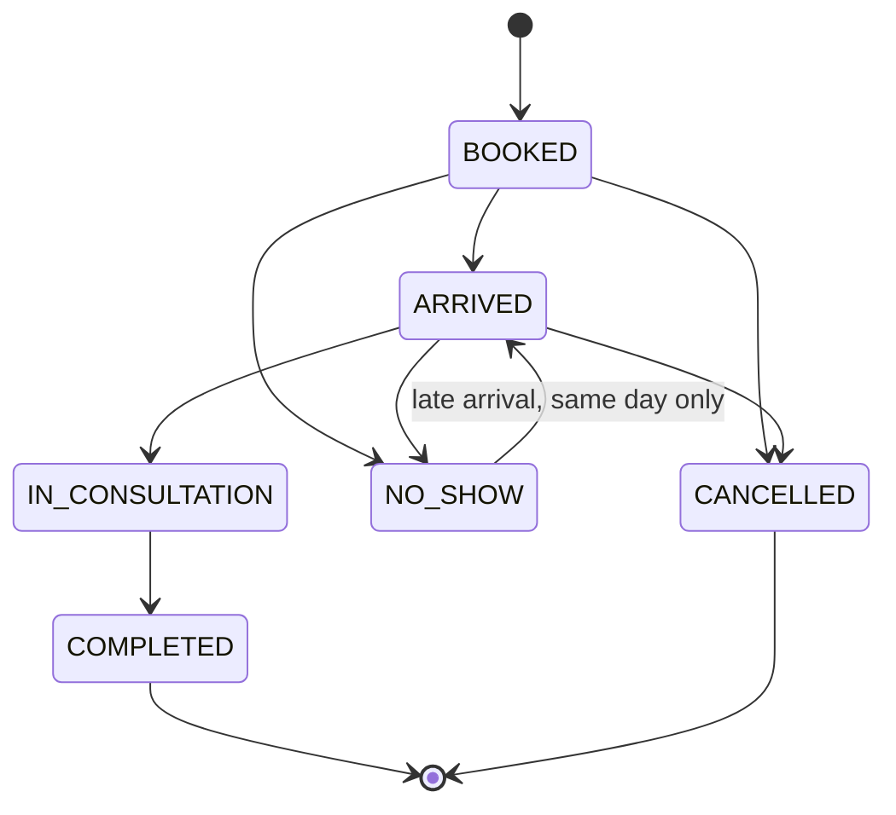

# Spec: Appointments and daily queue

| Field | Value |
|---|---|
| Requirements | FR-APT-01..07, FR-QUE-01..05 |
| Milestone / phases | M3 / P1–P5 |
| Status | Approved (developer sign-off 2026-10-17: decisions D1–D9 for M3-P1 and D10–D16 for M3-P2, D17–D22 for M3-P3, D23–D26 for M3-P4 in §12) |
| Last updated | 2026-10-17 (approved; R1, R3, R4 made precise and R14–R20 added for schedules, exceptions and session generation; M3-P2 decisions D10–D16, R5's confirmation job from M5) |

## 1. Context
Seven of fourteen clinics book through WhatsApp and phone with no central view (A7–A13).
Many small Indian clinics run numbered tokens rather than fixed times, so both modes are needed.

## 2. Actors and permissions
Owner, doctor, front desk: book, reschedule, cancel, transition, add walk-ins. Owner: schedules.

## 3. Domain model
- `DoctorSchedule`, `ScheduleException`, `Session` (materialised per date), `Appointment`.
- Clinic `booking_mode`: `SLOTS` or `TOKENS` (`TOKENS` for existing clinics).
- A **weekly block** is a rule: a weekday (0 = Monday … 6 = Sunday), a clinic-local start and end
  time, and `slot_minutes` (needed in slot mode) or `capacity` (needed in token mode). An end time
  at or before the start time means the block ends the next day (D2).
- A **session** is one instance of a rule on one clinic-local date, stored in UTC; bookings attach to
  sessions, never to rules (D4).

## 4. Behaviour
- **R1** Sessions for a date are generated from schedules valid on that date, minus `LEAVE`
  exceptions, plus `EXTRA` exceptions. Generation is lazy (the first read of a date creates its
  sessions, D1) and idempotent (`UNIQUE (doctor_id, starts_at)`, `ON CONFLICT DO NOTHING`), so two
  simultaneous reads create one set. Only dates from the clinic's today up to 180 days ahead are
  generated; an earlier date shows the sessions it already has, a later one is a validation error.
- **R2** Times are interpreted in the clinic timezone and stored in UTC. A session belongs to the
  clinic-local date on which it starts.
- **R3** SLOTS mode: slots are `[starts_at, ends_at)` stepped by `slot_minutes`; one active
  appointment per slot. The session's capacity is derived: block length ÷ `slot_minutes`, which must
  divide it (D3). TOKENS mode: capacity is given explicitly.
- **R4** TOKENS mode: a booking takes `next_token` and increments it; tokens are never reused within
  a session, including after cancellation.
- **R5** Booking locks the session row (`SELECT … FOR UPDATE`), checks status, capacity and slot
  availability, inserts the appointment, increments `booked_count`, writes status history, audit
  and (if consented, from M5 when the jobs table and messaging port exist, D16) a
  `send_booking_confirmation` job — all in one transaction.
- **R6** Booking in the past → `APT_IN_PAST`; outside sessions → `APT_OUTSIDE_SCHEDULE`;
  full → `APT_SESSION_FULL`; slot taken → `APT_SLOT_TAKEN`; closed → `APT_SESSION_CLOSED`.
- **R7** Cancel requires a reason (enum + optional note) and decrements `booked_count`.
- **R8** Reschedule is cancel + book in one transaction; the new appointment references the old one.
- **R9** Transitions follow the state machine; anything else → `QUE_INVALID_TRANSITION` with
  `details.from` and `details.to`. Timestamps `arrived_at`, `started_at`, `completed_at` are set on
  entry to the matching state.
- **R10** `NO_SHOW` is set manually or automatically at session end + 60 minutes for `BOOKED`
  appointments (job in M5; manual only in M3).
- **R11** Walk-ins are added to today's session for the chosen doctor with source `WALK_IN`
  (token mode: next token; slot mode: appended after the last slot, capacity permitting, or
  flagged as overbooked if the owner enabled overbooking).
- **R12** The queue endpoint returns appointments ordered by slot/token with a strong `ETag`
  derived from the session's `updated_at` and appointment versions; clients poll every 5 seconds
  with `If-None-Match` and receive 304 when unchanged.
- **R14** A block lasts 15 minutes to 12 hours (D2). A block whose end time is at or before its start
  time ends the next day, so 23:00–01:00 is a two-hour block; but 13:00–10:00 would be 21 hours and
  is refused with `SCH_INVALID_BLOCK`, as are a zero-length block, a slot length that does not divide
  the block, and a block without the value the clinic's booking mode needs.
- **R15** No two blocks of one doctor overlap, compared on the circle of the week, so an overnight
  block on day N that spills past midnight conflicts with an early block on day N+1 (and Sunday into
  Monday) → `SCH_OVERLAP`. An `EXTRA` exception is checked the same way against that date's
  sessions, the previous day's overnight session and the other extras.
- **R16** Replacing a schedule (`PUT`) takes effect from the clinic's today: earlier dates keep
  their history. Future sessions that no longer match the rules are deleted if `booked_count = 0`
  and regenerated on the next read; those with bookings are kept and returned as `kept_sessions`
  for the owner to reschedule by hand. Nothing is ever cancelled automatically (D4, §8).
- **R17** `LEAVE` covers a doctor's whole day; at most one per doctor and date
  (`SCH_LEAVE_EXISTS`). Adding it deletes that day's already-generated sessions with
  `booked_count = 0` and keeps and returns those with bookings; removing it lets the day regenerate.
  A part-day absence is a `LEAVE` plus an `EXTRA` for the hours the doctor does work.
- **R18** `EXTRA` adds one block on one date, validated like R14. Removing it deletes its unbooked
  session and returns a booked one in `kept_sessions`. Exceptions are for today or later only.
- **R19** Changing the clinic's booking mode is refused with `SCH_MODE_INCOMPATIBLE` while any active
  doctor's current blocks or future extras lack the value the new mode needs; otherwise unbooked
  future sessions are regenerated in the new mode and booked ones keep theirs.
- **R20** Schedule changes and generation are serialised per doctor: a change locks the doctor row
  (`FOR UPDATE`) and generation takes a shared lock, so a read never builds sessions from a rule
  that is being replaced.
- **R13** Starting a consultation (`IN_CONSULTATION`) creates or opens the visit (M4 dependency;
  in M3 only the transition happens).

## 5. API surface
See API.md "Schedules, appointments, queue".

## 6. UI notes
- Default landing page for front desk and doctors: **Today's queue** for the selected doctor.
- Book in ≤ 3 interactions: (1) search/select patient, (2) pick slot/next token, (3) confirm.
- Queue row actions are single clicks: Arrived → Start → (doctor) Complete; overflow menu for
  No-show / Cancel / Reschedule.
- Wait time shown from `arrived_at`.

## 7. Events and side effects
| Trigger | Audit | Job | Analytics |
|---|---|---|---|
| Schedule replaced / exception added or removed | `schedule.changed` / `schedule.exception_added` / `schedule.exception_removed` | — | — |
| Book | `appointment.booked` | `send_booking_confirmation` (M5) | `appointment_created` |
| Transition | `appointment.status_changed` | — | `queue_status_changed` |
| Cancel / reschedule | `appointment.cancelled` / `appointment.rescheduled` | cancellation notice (P1) | — |

## 8. Edge cases
| Case | Expected outcome |
|---|---|
| Schedule changed after bookings exist | Existing appointments keep their session; owner sees a warning listing affected appointments |
| Leave added for a day with bookings | Exception saved; affected appointments listed for manual rescheduling (no auto-cancel) |
| Session crossing midnight IST | Belongs to the start date (R2) |
| DST | Not applicable to `Asia/Kolkata`; code still uses timezone-aware arithmetic |
| 13:00–10:00 entered by mistake | 21 hours: `422 SCH_INVALID_BLOCK` (R14) |
| Sunday 22:00–02:00 and Monday 01:00–05:00 | `409 SCH_OVERLAP` (R15) |
| Leave on a day whose sessions were generated | Unbooked sessions removed; booked ones returned (R17) |
| Inactive doctor | No sessions are generated; existing ones are kept |
| Two tabs transitioning the same appointment | Second request gets `QUE_INVALID_TRANSITION` if the state already moved |

## 9. Acceptance criteria
- **AC1 (FR-APT-04)** Given capacity 1 and two parallel booking requests, then exactly one 201 and
  one 409 (`APT_SLOT_TAKEN` or `APT_SESSION_FULL`), and `booked_count = 1`.
- **AC2 (FR-APT-02)** Given TOKENS mode, when three bookings are made and the second is cancelled,
  then the next booking receives token 4.
- **AC3 (FR-QUE-02)** Given a `COMPLETED` appointment, when transitioning to `ARRIVED`, then 409
  `QUE_INVALID_TRANSITION`.
- **AC4 (FR-QUE-03)** Given two browsers on the queue, when one marks a patient arrived, then the
  other shows it within 5 seconds.
- **AC5 (FR-APT-01, R2)** Given a clinic in `Asia/Kolkata` and a session 23:00–01:00, then it is
  listed under the start date and slots are correct in UTC.
- **AC6 (FR-APT-03)** Given the E2E test, then booking takes at most 3 user interactions from the
  queue screen.

## 10. Observability
Events: `schedule.changed`, `schedule.exception_added`, `schedule.exception_removed`,
`appointment.booked`, `appointment.booking_rejected` (`error_code`),
`queue.transition_rejected`, `session.generated` (count). Metrics: booking conflicts per hour,
p95 booking latency.

## 11. Out of scope
Patient self-booking (M7 public page), appointment reminders (FR-APT-08, P1), live patient token
link (FR-QUE-06, P1), automatic no-show job (M5).

## 12. Decisions
Resolved at approval (2026-10-17):
- **D1** Sessions are generated lazily on the first read of a date, idempotently (R1).
- **D2** An end at or before the start means next day, bounded by a 12-hour maximum block (R14).
- **D3** Slot-mode capacity is derived from the block and the slot length; token mode states it (R3).
- **D4** Editing a schedule regenerates unbooked future sessions and keeps booked ones, returning
  them; leave behaves the same on its date (R16, R17).
- **D5** A `SCHEDULES_MANAGE` permission for the owner; ops set schedules through an ops route during
  onboarding (RUNBOOK §10 step 5), with no clinical access.
- **D6** Overbooking is off in M3: no setting, `booked_count <= capacity` in the database. The open
  question is closed for M3; walk-ins in slot mode take a free slot or are refused (R11).
- **D7** Overlaps are checked across midnight and across the week (R15).
- **D8** `LEAVE` is whole-day only in M3 (R17).
- **D9** Schedule routes live under the doctor resource, `/api/v1/clinic/doctors/{id}/schedule`, like
  the other doctor endpoints; sessions are `/api/v1/sessions`.
Resolved at M3-P2 approval (2026-10-17):
- **D10** A booked session kept by a change that no longer matches the rules is `CLOSED`: its
  bookings stay and may be cancelled or rescheduled away; new bookings get `APT_SESSION_CLOSED`. A
  later change that matches it again reopens it.
- **D11** A booked session whose block changed only in capacity (same start, end, mode and slot
  length) is adjusted in place when the new capacity is at least `booked_count`; otherwise D10.
- **D12** Token mode books until the session ends; slot mode until the slot ends. Earlier is
  `APT_IN_PAST`.
- **D13** One active appointment per patient per session (`APT_ALREADY_BOOKED`, a partial unique
  index); the same patient with two doctors on one day is allowed.
- **D14** Cancel reasons: `PATIENT_REQUEST`, `CLINIC_REQUEST`, `DOCTOR_UNAVAILABLE`, `DUPLICATE`,
  `OTHER` (needs a note), plus an optional note of up to 200 characters; `RESCHEDULED` is set by
  reschedule only. Cancel is allowed from `BOOKED` and `ARRIVED` until the session ends.
- **D15** Reschedule is from `BOOKED` only, to any open session of the clinic (another doctor or
  another slot of the same session); the source carries over; a `CLOSED` source session is fine.
- **D16** The booking confirmation job (R5, FR-APT-06) arrives with M5's jobs table and messaging
  port; M3 writes none.
Resolved at M3-P3 design (2026-10-17; the developer approved the recommended options in advance):
- **D17** Every role moves the queue (`QUEUE_MOVE`); history and audit record who.
- **D18** A transition names the status it saw and the one it wants (`{from, to}`); a different
  current status is `QUE_INVALID_TRANSITION` with the real `from`.
- **D19** Transitions happen on the session's clinic-local date, or until an overnight session ends;
  `NO_SHOW` once the session (token) or slot (slot mode) has started. Otherwise `QUE_WRONG_TIME`.
- **D20** No undo in M3.
- **D21** A walk-in joins the doctor's open session running now, else the next one today, or the
  named one of today's; none is `QUE_NO_SESSION`. It is `ARRIVED` at once, source `WALK_IN`.
- **D22** The queue read arrives in P3 without caching; P4 adds the `ETag` and 304 (R12).
Resolved at M3-P4 approval (2026-10-17):
- **D23** The queue's strong `ETag` is a hash of the serialised body, so any visible change changes it.
- **D24** `wait_minutes` stays in the body; while patients wait the tag changes at most once a minute.
- **D25** The web gets a polling module in P4 (5 s, `If-None-Match`, paused while hidden, 30 s
  back-off after errors); P5's board builds on it.
- **D26** Only the queue carries an `ETag` in M3; the queue stays `no-store`.
