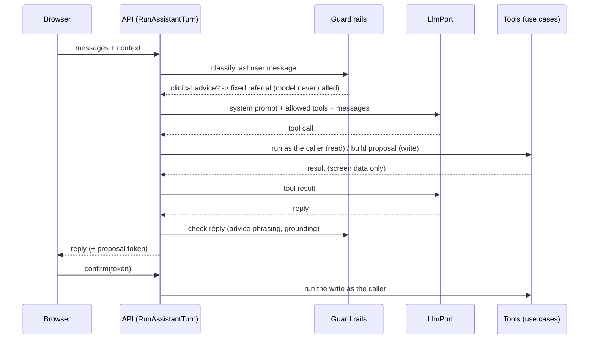

# Spec: The assistant (M7a)

| Field | Value |
|---|---|
| Requirements | FR-AI-01..04, FR-RX-11, NFR-07 |
| Milestone / phases | M7a / P1–P5 (issue #65) |
| Status | Approved (developer, 27 Oct 2026: architecture review and decisions D1–D7 in advance); implemented in M7a |
| Owner | MediEase engineering |
| Last updated | 2026-10-27 |

## 1. Context
Patients ask the same few things: when do I take this, for how long, can I book on Friday. Staff
want to find a patient or book without leaving the keyboard. PRD C4/C15 adds an assistant that does
this through tools over the existing use cases, with the caller's own permissions, and never gives
medical advice (principle 6). ADR-0013 (gateway) and ADR-0024 (turns, confirmations, guard rails).

## 2. Actors and permissions
| Actor | Can | Cannot |
|---|---|---|
| Patient account (`@patient`) | Ask about its linked records: appointments, booking requests, prescriptions (list); find clinics and slots; request a booking and answer a proposal after confirming; have a chosen prescription explained | See another account's data; cancel or reschedule (no patient use case yet, FR-PRT-08: the assistant points to the clinic) |
| Staff (`@clinic(APPOINTMENTS_MANAGE)`, every role) | Today's queue, sessions of a day, book, cancel, reschedule (APPOINTMENTS_MANAGE); find a patient (PATIENTS_MANAGE) | Anything their role cannot do through the API; clinical content (no clinical tools for staff in M7a) |
| The model | Choose a tool and phrase replies | Run a write; see a tool it may not use; see upload bytes or text |

## 3. Domain model
No table. A **turn** is the visible conversation plus an optional context; the reply is
`ANSWER`, `REFERRAL`, `CONFIRM` (with a proposal) or `UNAVAILABLE`.

## 4. Behaviour
- **R1 (P2, FR-AI-03)** The model is reached only through `LlmPort`. `LLM_PROVIDER` is `console`
  (deterministic, offline), `groq`, `deepinfra` or `openai`; the three real ones share one
  OpenAI-compatible adapter (chat completions with tools, stdlib HTTP, `LLM_TIMEOUT_SECONDS`).
  Base URL and model default per provider and can be overridden. `console` is refused in
  production; a real provider needs `LLM_API_KEY`, and in staging and production also
  `LLM_PATIENT_DATA_ALLOWED=true` (the provider contract and privacy review are done).
- **R2 (FR-AI-03)** Provider failures map to `AI_UNAVAILABLE` (503; timeouts, 5xx, malformed
  answers) and `AI_PROVIDER_BUSY` (503 with `Retry-After`, the provider's 429). Each call logs
  `assistant.llm_called` with provider, model, latency and token counts, never text.
- **R3 (FR-AI-01)** A turn carries 1–20 messages (`user` or `assistant`, 1–2,000 characters
  each, the last from the user), an optional `language` (`en`, `hi`; else the account's) and an
  optional context. Tool calls and results are never accepted from the client.
- **R4 (FR-AI-02)** Before the model, the last user message is classified. Requests to diagnose,
  interpret results ("is 180 high", reports, tests), change, stop, start or suggest a drug or dose,
  or recommend treatment get the fixed referral in the turn's language, kind `REFERRAL`; the
  message is not sent to the model. Restating questions ("when do I take it", "what did the
  doctor write") pass.
- **R5 (FR-AI-02)** After the model, a reply with advice phrasing ("you should take", "increase
  the dose", "it sounds like you have", "normal range", …) is replaced by the referral.
- **R6 (FR-AI-01)** The model is offered only the tools the caller may use (staff tools filtered by
  permission). Read tools run the use case as the caller; results carry only what the caller's
  screens show, with phone numbers masked to their last 4 digits. At most 4 tool rounds per turn,
  then `UNAVAILABLE` ("I could not finish that").
- **R7 (FR-AI-01)** A write tool (patient: `request_booking`, `answer_proposal`; staff:
  `book_appointment`, `cancel_appointment`, `reschedule_appointment`) never runs in a turn. It
  returns a proposal: a summary written by our code and a token signed with HMAC-SHA256 (a key
  derived from `JWT_SIGNING_KEY` for this purpose only) binding the caller (account; or user and
  clinic), the action, its arguments and a 10-minute expiry. The reply is `CONFIRM`.
- **R8 (FR-AI-01)** `POST …/assistant/confirm` runs the proposal as the caller of that request:
  another caller, another clinic, an expired or altered token is `AI_PROPOSAL_INVALID` (404); a
  token already confirmed is `AI_PROPOSAL_USED` (409). The use case re-checks every permission
  and business rule, so a confirmed action can still fail with its own error.
- **R9 (FR-AI-04)** A prescription is in context only when the request names it:
  `{"prescription_id"}` (the portal picker; an `ISSUED` version in the account's `PortalScope`)
  or `{"upload_id"}` (a verified upload with a chosen version, spec prescription-uploads R16).
  Each turn re-authorises it; otherwise `REQ_NOT_FOUND`. Without context, `explain_prescription`
  asks the user to pick one.
- **R10 (FR-AI-04)** `explain_prescription` builds the explanation from the version's database
  record with the phrasebook (the patient page's words): per medicine its name, form and strength,
  how much, when, how to give, how long, storage, warnings and notes as written; the doctor's
  advice; the next visit. An optional `medicine_number` narrows it to one medicine. A reply
  following that tool may only use numbers present in the tool's data; otherwise the
  deterministic text is returned. A historical (superseded) version is introduced as such.
- **R11 (FR-AI-01)** Turns are rate limited: 12 a minute per account or user, else
  `AI_RATE_LIMITED` (429, `Retry-After`).
- **R12 (NFR-07)** `assistant.turn_completed` logs the kind, tool names, rounds and the context's
  IDs; never message text, tool arguments or results. Confirmed writes are audited by their
  use cases as today.

### Layout 3 (P1, FR-RX-11)
- **R13** Versions issued from M7a-P1 are printed on layout 3: layout 2 plus a fixed block in the
  page's bottom margin on every page: the MediEase mark with the footer (left), and the
  verification label, the version's ID as text and a 17 mm QR code with `MEDIEASE-RX:1:<id>`
  (right). The page number moves to the top margin. Layouts 1 and 2 are frozen (hash tests).
- **R14** The mark and the QR are inline SVG; the renderer still fetches nothing. The mark is a
  placeholder until the official logo arrives (`assets/SOURCES.md`).

## 5. API surface
| Method | Path | Request | Success | Errors |
|---|---|---|---|---|
| POST | `/api/v1/portal/assistant/turns` | `messages`, `language?`, `context?` | 200 `{kind, reply, proposal?, context?}` | 401, 404, 422, 429, 503 |
| POST | `/api/v1/portal/assistant/confirm` | `{token}` | 200 `{kind: "DONE", reply}` | 401, 404 `AI_PROPOSAL_INVALID`, 409, the action's own errors |
| POST | `/api/v1/assistant/turns` (staff, `X-Clinic-ID`) | as above (no context) | as above | 401, 403, 422, 429, 503 |
| POST | `/api/v1/assistant/confirm` (staff) | `{token}` | as above | as above |

## 6. UI notes
- Portal **Assistant** page (`/portal/assistant`, 360 px first): a *My prescriptions* picker (the
  current versions, newest first) that sets the context, the chat, a confirmation card with
  *Confirm* and *Cancel* for proposals, and the fixed notice "The assistant explains what your
  doctor wrote. It cannot give medical advice." English and Hindi.
- Clinic **Assistant** page (`/assistant`, every role, 1366×768, keyboard first): chat and the same
  confirmation card.
- Loading, empty and error states (with "Ref: <request_id>").

## 7. Events and side effects
| Trigger | Audit action | Job enqueued | Analytics event |
|---|---|---|---|
| Turn | — | — | — |
| Confirm | the use case's own (`booking_request.*`, `appointment.*`) | the use case's own | — |

## 8. Edge cases
| Case | Expected outcome |
|---|---|
| "Should I take two tablets instead of one?" | `REFERRAL`; the model is not called |
| "When do I take the syrup?" with a prescription chosen | The record's *when* for that medicine |
| The model replies with a dose not in the record | The deterministic explanation instead |
| The model asks to book with no slot yet | A clarifying question (multi-turn), no proposal |
| Confirm twice | Second is `AI_PROPOSAL_USED` |
| Staff token replayed by another user or in another clinic | `AI_PROPOSAL_INVALID` |
| Front desk asks for a patient's diagnosis | No tool exists; the guard refers or the model declines |

## 9. Acceptance criteria
- **AC1 (FR-AI-03)** Changing `LLM_PROVIDER` from `console` to `groq` changes only settings; the
  adapter's request and tool-call parsing pass against a fake OpenAI-compatible server.
- **AC2 (FR-AI-02)** The guard-rail suite (English and Hindi) refers every advice request without
  calling the model and passes every restating question.
- **AC3 (FR-AI-01)** Booking by chat: a clarifying question, then a proposal, then confirm
  creates the booking request (patient) or the appointment (staff) exactly once.
- **AC4 (FR-AI-01)** Tools act as the caller: a patient cannot reach another account's records; a
  front-desk user is not offered tools their role lacks; tokens are bound to the caller.
- **AC5 (FR-AI-04)** The explanation of a chosen prescription contains the record's lines and only
  the record's numbers; with no context the assistant asks the user to choose.
- **AC6 (FR-RX-11)** A layout-3 PDF's text contains the ID and its QR decodes to
  `MEDIEASE-RX:1:<id>` on every page, A5 and A4, English and Hindi.

## 10. Observability
`assistant.turn_completed`, `assistant.referred`, `assistant.reply_replaced`,
`assistant.llm_called`, `assistant.llm_failed`, `assistant.confirmed`, `assistant.proposal_refused`.
Error codes: `AI_UNAVAILABLE`, `AI_PROVIDER_BUSY`, `AI_RATE_LIMITED`, `AI_PROPOSAL_INVALID`,
`AI_PROPOSAL_USED`.

## 11. Out of scope
Stored conversations; voice; patient-side cancel and reschedule (FR-PRT-08); clinical tools for
staff; streaming replies; the animated landing page (backlog, PRD C15); any model reading files.

## 12. Decisions
D1 split M7 (M7a, M7b); D2 the QR payload; D4 no OCR; D5 clinic logos deferred; D7 the picker
for linked patients (developer, 27 Oct 2026). Stateless turns and signed proposals: ADR-0024.

## 13. Open questions
None blocking. The Hindi referral and labels need the same native-speaker review as the
phrasebook (L-07).
