# Spec: Public clinic page and booking requests

| Field | Value |
|---|---|
| Status | Approved by the developer 25 Oct 2026 with two changes (R12: age and sex optional unless the clinic requires them; R18a: staff may explicitly override a hold); built (M6b-P4, 26 Oct 2026; as-built differences in `docs/milestones/M6b-patient-portal-booking.md`). P5 (accept, decline, propose, expiry, linking) is added when it is designed |
| PRD | §8.9 FR-PUB-01..04; §8.14 FR-BKG-01..03, 07, FR-DIS-05, 07, 08; NFR-02, 10, 11, 17, 19 |
| ADR | ADR-0003 (tenancy), ADR-0015 (patient accounts), ADR-0017 (notifications), ADR-0018 (soft hold, Proposed) |
| Design | `docs/milestones/M6b-patient-portal-booking.md` "M6b-P4" |
| Last updated | 2026-10-25 |

## 1. Context
A clinic shares one link, `/c/{slug}`, on WhatsApp and its Google Business Profile. A patient
opens it, sees the clinic's doctors and when they sit, and asks for a time. The clinic decides
(FR-PUB-02): MediEase never books by itself. Two patients must not be told "requested" for the
same slot (FR-BKG-02), and the page must not become a way to flood a clinic or to read anything
the clinic did not publish (NFR-17, NFR-19).

## 2. Actors and permissions
- **Anyone:** reads a clinic's page and availability.
- **Patient** (`@patient`, a **verified** account): makes a request and sees their own requests.
- **Front desk and owners:** see the clinic's pending requests (read-only in P4) and their
  notifications. **Doctors:** the same for their own requests.
- **Ops:** nothing here.

## 3. Domain model
- **`BookingRequest`** (tenant): `clinic_id`, `doctor_id`, `session_id`, `slot_start` (slot mode;
  null in token mode), `account_id`, `contact_phone` (E.164), `age_years` and `sex` (null unless
  given), `reason` (null or 1–200 characters), `status`, `hold_expires_at`, `respond_by` (the
  response deadline), `hold_overridden_at` / `hold_overridden_by` (a staff override, R18a),
  `created_at`.
  - P4 creates `PENDING` only. P5 adds `ACCEPTED`, `DECLINED`, `EXPIRED`, `CANCELLED` and
    `PROPOSED`.
  - A **live hold** is a `PENDING` request with `hold_expires_at > now` (ADR-0018).
- **`Clinic.request_hold_minutes`**: 30–480, default 120. **`Clinic.request_requires_age_sex`**:
  default false. **`Clinic.has_public_page`**: one rule.
- **Two clocks (developer, 25 Oct 2026).** The *hold* protects the slot (default 2 hours, 30
  minutes to 8 hours). The *response deadline* `respond_by` is how long the request may stay
  open: 4 hours after it was made, or 1 hour before the slot if that is sooner (FR-BKG-06). The
  hold never outlasts the deadline. After the hold ends the slot is bookable again; the request
  stays `PENDING` until the deadline, when P5 expires it. P5's accept or decline is the decision.

```mermaid
stateDiagram-v2
    [*] --> Pending: patient requests (hold starts)
    Pending --> Pending: hold lapses (status unchanged; P5 expires it)
    Pending --> Accepted: P5
    Pending --> Declined: P5
    Pending --> Expired: P5
```

## 4. Behaviour

### The page
- **R1** `/c/{slug}` exists for a clinic with `has_public_page` (`ACTIVE` until M6c adds
  verification). For an unknown slug or any other clinic, the page, its availability and a
  request answer the **same** 404 `REQ_NOT_FOUND` (NFR-19).
- **R2** The page body holds only: clinic name, address, city, state, pincode, phone; a map link
  built from the address; hours; and per active doctor the display name, qualification and
  specialty. Nothing else, ever (NFR-17; an allow-list test).
- **R3** Hours are derived from the doctors' active weekly blocks: per doctor and for the clinic,
  by weekday, in the clinic's time zone. Leave and exceptions show in availability, not in hours.
- **R4** The page is in English or Hindi (the portal's language switch and `me_pt_lang`), loads
  under 200 KB at 360 px and passes the automated accessibility check (NFR-02, NFR-10, NFR-11).
- **R5** The page offers *Share on WhatsApp* and *Copy link*; its Open Graph tags carry the
  clinic's name and address only (FR-PUB-04). It is `noindex` until M6c (FR-DIS-06, L-04).

### Availability
- **R6** `GET /public/clinics/{slug}/availability?doctor_id=&from=` covers 14 days from `from`
  (default today, clinic calendar). A slot or session is offered only if it starts at least
  2 hours from now, so the deadline (1 hour before it) is still ahead.
- **R7** Slot mode: the doctor's slots minus booked slots and slots under a live hold. Token mode:
  each open session with its places left (capacity − booked − live holds), never a token number
  (FR-DIS-05). Sessions with no place left are listed as full.
- **R8** Reading availability writes nothing; a session is materialised only when a request is
  made for it.

### Requests
- **R9** `POST /portal/booking-requests {clinic_slug, doctor_id, session_id, slot_start,
  contact_phone, age_years, sex, reason, not_emergency_ack}` needs a signed-in, **verified**
  account, else 403 `PRT_UNVERIFIED_ACCOUNT`.
- **R10** Under the session's row lock (the booking lock order), the request is refused 409
  `APT_SLOT_TAKEN` when the slot is booked or under a live hold, or `APT_SESSION_FULL` when no
  place is left; otherwise it is created `PENDING` with `hold_expires_at = min(now +
  request_hold_minutes, respond_by)` and `respond_by = min(now + 4 hours, start − 1 hour)`. Two parallel requests for one slot give one 201 and one 409.
- **R11** The slot must be on the session's grid, the session open, its doctor active, its start
  at least 2 hours away and within the 14 days, else 422 on the field.
- **R12** `contact_phone` is an Indian mobile normalised to E.164 and always required.
  `age_years` (0–120) and `sex` (`FEMALE`, `MALE`, `OTHER` or `UNDISCLOSED`) are **optional**, and
  required only when the clinic sets `request_requires_age_sex` (else 422 on the field; the page
  marks them required). `reason` optional, 1–200 characters; `not_emergency_ack` must be true. The name is the account's. Nothing is stored on the account.
- **R13** The form shows, in the page's language: "Not for emergencies. In an emergency call
  112 or go to the nearest hospital."
- **R14** At most 5 `PENDING` requests per account (409 `PRT_TOO_MANY_REQUESTS`) and one per
  account per session (409 `PRT_REQUEST_EXISTS`).
- **R15** Rate limits: per account 5 an hour, per IP 20 an hour, per phone 5 a day for requests;
  per IP 60 a minute for the page and availability. Over a limit: 429 `PRT_RATE_LIMITED` with
  `Retry-After`. No automatic ban (FR-BKG-07).
- **R16** The request, its audit row and the `BookingRequested` event commit together.

### The hold and staff booking
- **R17** A hold lapses by time alone; nothing runs. A lapsed request stays `PENDING` until P5
  expires it, but holds nothing.
- **R18** Staff booking into a slot under a live hold, or the last place of a session whose other
  places are booked or held, is refused 409 `APT_SLOT_HELD` with the hold's end time; once the
  hold lapses the booking succeeds. FR-BKG-08 otherwise applies.
- **R18a** *Override (developer, 25 Oct 2026).* A patient must not be able to block a slot the
  clinic needs. Staff with the right to book may book anyway only through an explicit action,
  **Book anyway (override the patient's request)**, with a confirmation that names the request
  (first name and the hold's end). The API takes `override_hold: true`. Then, in the booking's
  transaction, the blocking hold ends at once (`hold_expires_at = now`, `hold_overridden_at`,
  `hold_overridden_by`) and **`appointment.hold_overridden`** is audited (STAFF; IDs of the
  appointment, session and request(s) only). In token mode, if places are free but held, the
  newest hold ends. The request stays `PENDING` (the patient is told by P5/P6; accept then fails
  as the slot is taken). Overriding cannot create a place: a full session stays `APT_SESSION_FULL`.
- **R19** A schedule change never retires a session with a live hold; it closes it, as for a
  booked one (appointments D10).

### Who sees what
- **R20** `GET /portal/booking-requests` and *My Appointments* show the account's requests as
  **Requested**, under their clinic, with doctor and place, whether or not the account is linked
  to that clinic. Never another account's.
- **R21** Front desk and owners get the in-app notification `booking.requested`: the account's
  first name, the place and the doctor; never the reason, phone or age. Doctors get it for their
  own requests if they turn it on (default off).
- **R22** `GET /booking-requests` (staff: front desk, owners; doctors their own) lists the
  clinic's `PENDING` requests, oldest first: name, age, sex, phone, doctor, place, reason,
  received and held until. Read-only in P4.
- **R23** The staff session view shows a held slot or place as **Held** (until when), without the
  patient's details.

### Privacy
- **R24** The reason is clinical (C3): never in a log, notification, error message or audit row.
  The phone is masked in logs; the age and sex are never logged.
- **R25** Requests are tenant data: clinic B never sees clinic A's, and an account sees only its
  own (NFR-08, NFR-18).
- **R26** Reading the page and availability is not audited; a request writes
  `booking_request.created` (PATIENT) with IDs, the doctor and the place only.

### Settings
- **R27** Owners set `request_hold_minutes` (30–480) in clinic settings, where the page's link is
  shown with *Copy*.

### Out of the page's way
- **R28** A suspended clinic's page and availability answer 404 at once; its pending requests are
  handled in P5 (FR-ONB-05).
- **R29** A doctor made inactive disappears from the page; their sessions are not offered.
- **R30** Signing in or up from the page returns the patient to the same doctor, day and slot
  (FR-DIS-08); if it was taken meanwhile, the page says so and shows the day again.

## 5. API surface
Contract 0.33.0: `GET /api/v1/public/clinics/{slug}`, `GET /api/v1/public/clinics/{slug}/availability`
(public); `POST` / `GET /api/v1/portal/booking-requests` (`@patient`); `GET /api/v1/booking-requests`
(staff); `request_hold_minutes` on the clinic settings.

## 6. UI notes
- `/c/{slug}`: the clinic card, hours, doctors; *Request an appointment*: doctor, day (14 days),
  slot or session; then the form with the emergency notice; then "Requested".
- *My Appointments*: a request is a row with the word *Requested*.
- Staff: *Booking requests* in the navigation for front desk, owners and doctors; Held on the
  session view; the hold time and page link in clinic settings.

## 7. Events and side effects
| Trigger | Audit | Notification | Notes |
|---|---|---|---|
| Request created | `booking_request.created` (PATIENT) | `booking.requested` to front desk and owners (doctor by preference) | Hold starts; IDs, doctor and place only |
| Hold lapses | — | — | By time; nothing runs (ADR-0018) |
| Staff override | `appointment.hold_overridden` (STAFF) | — | Appointment, session and request IDs only |

## 8. Edge cases
| Case | Expected outcome |
|---|---|
| Two accounts request the last slot at once | One 201, one 409 `APT_SLOT_TAKEN` |
| Front desk books a held slot by phone | 409 `APT_SLOT_HELD`; **Book anyway** (confirmed, audited) ends the hold; or wait for it to lapse |
| The doctor takes leave over a held session | The session is closed, not retired; the request stays for P5 to answer |
| An unverified password account | 403 `PRT_UNVERIFIED_ACCOUNT`, with a link to resend the email |
| A family shares one phone | The phone limit (5 a day) applies to all; each account has its own cap |

## 9. Acceptance criteria
- **AC1 (R10)** Two parallel requests for one slot: one 201, one 409; the slot shows Held.
- **AC2 (R1, NFR-19)** An unknown slug and a suspended clinic answer byte-identical 404s on the
  page, availability and a request.
- **AC3 (R2, NFR-17)** The page and availability bodies contain only allow-listed fields; no
  registration number, staff, patient or appointment data.
- **AC4 (R7, R17)** A held slot is missing from availability; after the hold lapses it is offered
  again with no job run.
- **AC5 (R18, R18a)** Staff booking a held slot gets `APT_SLOT_HELD`; with `override_hold` it
  books, ends the hold and writes `appointment.hold_overridden`; without it, it books once the
  hold lapses.
- **AC6 (R14, R15)** The sixth open request is refused; limits answer 429 with `Retry-After`.
- **AC7 (R21, R24)** The notification title, logs and audit rows contain no reason, phone or age.
- **AC8 (R30)** Sign-in from the page returns to the same slot.

## 10. Observability
`booking_request.created` (request, clinic, doctor, session IDs), `booking_request.refused`
(reason code), `public.page_not_found` (no slug echoed beyond its hash). Never the phone, age,
sex or reason.

## 11. Out of scope
Accept, decline, propose and expiry, linking by an accepted request (P5); patient cancel and
reschedule (FR-PRT-08); dependents (FR-PRT-09); directory, search, verification, listing and
indexing (M6c); WhatsApp to staff or patients about requests (P6, L-02).

## 12. Open questions
- Q12 (PRD §14.3): which response window clinics keep; P5 decides the default with the pilot.
