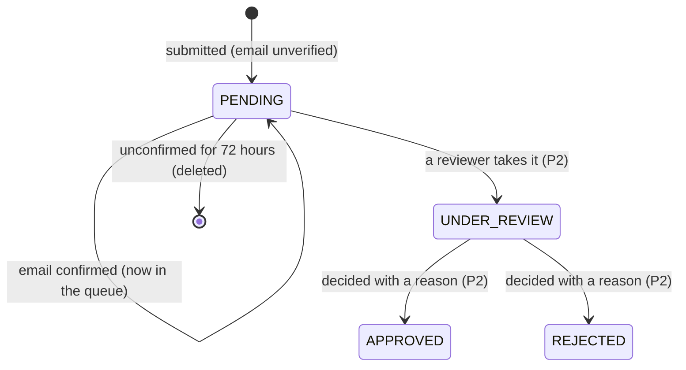

# Spec: Clinic applications, verification and listing

| Field | Value |
|---|---|
| Requirements | FR-ONB-01, 02, 07 (P1); FR-ONB-03, 05 (P2); FR-ONB-04, 06, 08 (P3); FR-ONB-05, 09, 10 (P4); NFR-19 |
| Milestone / phases | M6c / P1–P4 |
| Status | P1 (R1–R23, AC1–AC9) **Approved** 26 Oct 2026 (developer decisions D1–D3); P2–P4 written at their start |
| Owner | Developer |
| Last updated | 2026-10-26 |

## 1. Context
A clinic or a solo doctor must be able to ask to join MediEase without phoning anyone, and
MediEase must check every doctor's registration by hand before a clinic is shown to patients
(PRD C8, risk "fake or unqualified clinic or doctor listed"). The application is kept apart from
the clinic: nothing exists in a clinic's tenant until a reviewer approves (FR-ONB-02, ADR-0020).

## 2. Actors and permissions
| Actor | Can | Cannot |
|---|---|---|
| Applicant (signed out) | Submit an application; confirm their email by the emailed link | See any other application; learn whether a registration number is used elsewhere |
| Ops (`@ops`, P1) | List confirmed applications (summary only) | Open the detail or certificates, or decide (P2, `OPS_REVIEWER`) |
| Staff, patients | — | Anything here |

## 3. Domain model

`ClinicApplication` (platform data): reference, kind (`CLINIC`, `SOLO_DOCTOR`), status, the clinic
(name, address line, city, state, PIN, phone, specialties), the owner (name, phone, email,
`owner_practises`), `email_verified_at`, the confirmation secret's digest and expiry,
`submitted_at`, `ip_hash`, the duplicate flags, and 1–10 `ApplicationDoctor`s (position, name,
qualification, council, registration number, `is_owner`, the certificate's key, content type,
size and SHA-256).

## 4. Behaviour (P1)

### The form
- **R1** `POST /api/v1/public/applications` needs no sign-in. It takes `multipart/form-data`: one
  part `application` (JSON, `ClinicApplicationInput`) and one file part `certificate_{n}` for each
  doctor position `n`. The whole request must be at most 30 MB; more is 413 before parsing.
- **R2** Kind `CLINIC` has 1–10 doctors; kind `SOLO_DOCTOR` has exactly 1, and it is the owner
  (`owner_practises` is true and that doctor is `is_owner`).
- **R3** For `CLINIC`, `owner_practises` true requires exactly one doctor with `is_owner`; false
  requires none.
- **R4** Required: clinic name (1–200), address line (1–300), city (1–100), state (1–100), PIN (six
  digits, not starting with 0), clinic phone (an Indian mobile or landline, normalised to E.164),
  1–10 specialties from the published list, owner name (1–200), owner mobile (Indian mobile,
  E.164), owner email (a valid address, at most 254, lower-cased). Per doctor: name (1–200),
  qualification (1–200), council (one of the published councils: the National Medical
  Commission and the state medical councils), registration number (1–50, trimmed, internal
  spaces removed).
- **R5** Two doctors of one application may not share a council and registration number (422 on
  the second).
- **R6** A field error is 422 `REQ_VALIDATION` naming the field (`doctors.1.registration_number`);
  nothing is stored.
- **R7** Each doctor must have exactly one certificate: a PDF, JPEG or PNG recognised by its first
  bytes (`%PDF-`, `FF D8 FF`, `89 50 4E 47 0D 0A 1A 0A`), 1 byte to 5 MB. Otherwise 422
  `ONB_FILE_REJECTED` with `details.position` and `details.reason` (`type`, `size`, `missing`);
  nothing is stored. The declared file name and content type are ignored.
- **R8** A request whose hidden field `website` is not empty is answered exactly like a success
  (202 with a reference) and stores nothing.

### Storing and confirming
- **R9** A valid submission stores the application (`PENDING`, email unverified) and its doctors,
  writes each certificate to private blob storage under `applications/{application_id}/doctor-{n}`
  with its SHA-256, and in the same transaction enqueues one `send_application_email` job
  (confirm). Answer 202 `{reference, email_masked}`; the reference is `MA-{year}-{4+ digits}`,
  unique.
- **R10** If a stored file cannot be written, the request fails with 503 and leaves no rows; files
  already written are deleted.
- **R11** The confirmation link is `PUBLIC_BASE_URL/apply/confirm/{token}`: a 256-bit secret whose
  SHA-256 digest is stored; it expires 48 hours after submission and works once.
- **R12** `POST /api/v1/public/applications/confirm {token}` sets `email_verified_at`, clears the
  secret, and enqueues the "received" email. An unknown, used or expired token is 404
  `ONB_CONFIRM_INVALID`, one answer for all three.
- **R13** A new submission with the same owner email while an earlier one is still unverified
  deletes the earlier one (rows and files) in the same transaction.
- **R14** An application unverified 72 hours after submission is deleted with its files by the
  daily purge.
- **R15** P1 writes no other status than `PENDING`. Nothing in P1 creates or changes a clinic,
  user, membership or doctor.

### Abuse and duplicates
- **R16** Limits, checked before anything is stored: 5 submissions a day per caller address
  (hashed); 3 a day per owner phone and 3 a day per owner email, counted from the applications
  table (a phone or email never appears in a bucket name). Over a limit: 429 `ONB_RATE_LIMITED`
  with `Retry-After`. Confirming is limited to 20 attempts a minute per address.
- **R17** On submission, each doctor's (council, registration number) is compared with other
  applications that are confirmed and not rejected, and with existing doctors. A match marks the
  application `possible_duplicate` and records the matching references (or clinic IDs) for the
  reviewer. The submission still succeeds and its answer is identical.

### Ops in P1
- **R18** `GET /api/v1/ops/applications` (`@ops`) lists confirmed applications, oldest first:
  reference, kind, clinic name, city, number of doctors, `submitted_at`, `email_verified_at`,
  `possible_duplicate`. No phone, email, registration number or certificate. Unconfirmed
  applications are never listed.

### Privacy and retention
- **R19** Logs carry the application ID, reference, kind and counts only: never a name, phone,
  email, registration number or file name. The emails contain the reference and the clinic's
  name only.
- **R20** Audit, with no clinic: `application.submitted` and `application.email_verified`, actor
  type `APPLICANT` (no user), metadata the application ID, kind and doctor count.
- **R21** Retention: unverified 72 hours (R14); the P2 rules keep rejected applications 180 days
  and approved ones while their clinic exists.
- **R22** Certificates are never reachable by a public URL; no route in P1 returns one.

### Language and promise (D2, D3)
- **R23** `/apply`, its confirm page and the two application emails are in English only in M6c
  (D2). The form, the "Check your email" page and the "received" email must each say that
  MediEase checks every doctor's registration by hand and **will reply by email within 2 working
  days** (D3).

## 5. API surface (P1)
| Method | Path | Request | Success | Errors |
|---|---|---|---|---|
| POST | `/api/v1/public/applications` | multipart: `application` (JSON), `certificate_{n}` | 202 `ApplicationReceipt {reference, email_masked}` | 413, 422 `REQ_VALIDATION`, 422 `ONB_FILE_REJECTED`, 429 `ONB_RATE_LIMITED`, 503 |
| POST | `/api/v1/public/applications/confirm` | `{token}` | 200 `{reference}` | 404 `ONB_CONFIRM_INVALID`, 429 |
| GET | `/api/v1/ops/applications` | — | 200 `{items: OpsApplicationSummary[]}` | 401, 403 |

All three answer `Cache-Control: no-store`; the public two also `X-Robots-Tag: noindex`.

## 6. UI notes
- `/apply` (public, 360 px first, under 200 KB, English only, D2): choose *A clinic* or *A doctor with my
  own practice*; then the clinic, the owner, the doctors (add up to 10; for each, the certificate
  picker accepting `.pdf,.jpg,.jpeg,.png`), a review step, *Submit*. Errors next to their field
  and summarised at the top; the step keeps what was typed when going back.
- After submitting: "Check your email. We sent a link to a•••@example.test to confirm your
  application." The note (R23): "MediEase checks each doctor's registration by hand and will
  reply by email within 2 working days."
- `/apply/confirm/{token}`: "Thank you. We received application MA-2026-0042." or "This link is
  not valid any more. Apply again." (one message for unknown, used and expired).
- Ops clinic list: "N applications waiting" with the summary list.

## 7. Events and side effects
| Trigger | Audit action | Job enqueued | Analytics event |
|---|---|---|---|
| Submission stored | `application.submitted` (APPLICANT) | `send_application_email` (confirm) | none |
| Email confirmed | `application.email_verified` (APPLICANT) | `send_application_email` (received) | none |
| Unverified 72 h | none (log `application.purged` with a count) | — | none |

## 8. Edge cases
| Case | Expected outcome |
|---|---|
| A PDF renamed `.png` | Accepted as a PDF (first bytes decide) |
| An executable renamed `.pdf` | 422 `ONB_FILE_REJECTED` `reason=type` |
| 5 MB + 1 byte | 422 `ONB_FILE_REJECTED` `reason=size` |
| A doctor without a file | 422 `ONB_FILE_REJECTED` `reason=missing` |
| The honeypot filled | 202 with a reference; nothing stored |
| Same email submits twice before confirming | The first is deleted; only the second's link works |
| A doctor already practising at a MediEase clinic applies for a second clinic | Accepted, flagged `possible_duplicate` for the reviewer |
| The confirm link opened twice | The second time: `ONB_CONFIRM_INVALID`, the same answer as an unknown or expired link |
| Blob storage down | 503; no rows; no email |

## 9. Acceptance criteria (P1)
- **AC1 (FR-ONB-01)** — Given a solo doctor with a valid PDF certificate, when they submit, then
  the application is `PENDING` with the email unverified, the file is in private storage with its
  hash, and one confirmation email is queued.
- **AC2 (FR-ONB-01)** — Given that application, when the link is opened, then the email is
  verified, the application appears in `GET /ops/applications`, and the "received" email is
  queued; opening it again is `ONB_CONFIRM_INVALID`.
- **AC3 (FR-ONB-02)** — Given any submission or confirmation, then no clinic, user, membership or
  doctor row is created.
- **AC4 (R7)** — Given a text file renamed `.pdf` for doctor 2, when submitting, then 422
  `ONB_FILE_REJECTED` with `position=2`, and nothing is stored.
- **AC5 (FR-ONB-07)** — Given 3 submissions today from one owner phone, when a fourth is sent,
  then 429 `ONB_RATE_LIMITED` with `Retry-After`.
- **AC6 (FR-ONB-07)** — Given a confirmed application with council C and number N, when another
  application lists C and N, then the second is flagged `possible_duplicate` with the first's
  reference, and its answer is the same as an unflagged one.
- **AC7 (R14)** — Given an application unverified for 72 hours, when the purge runs, then its rows
  and files are gone.
- **AC8 (R19, R20)** — Given a submission and a confirmation, then no log line or audit metadata
  contains the owner's name, phone or email, a registration number or a file name.
- **AC9 (R23)** — Given the form, the "Check your email" page and the "received" email, then each
  says MediEase will reply within 2 working days, in English.

## 10. Observability
Log events: `application.submitted` (id, reference, kind, doctors), `application.rejected_input`
(field or reason only), `application.rate_limited` (bucket kind), `application.email_verified`,
`application.duplicate_flagged` (id, count), `application.purged` (count). Error codes:
`ONB_RATE_LIMITED`, `ONB_FILE_REJECTED`, `ONB_CONFIRM_INVALID`, `REQ_VALIDATION`.

## 11. Out of scope
Reviewing and deciding (P2); creating the clinic (P3); listing (P4); automatic council-register
lookups; payments; the applicant's status page (P2); Hindi on the clinic side (not in M6c, D2).

## 12. Open questions
None. Resolved 26 Oct 2026: activation when the owner accepts the invitation (D1); English only
(D2); "within 2 working days" (D3).
