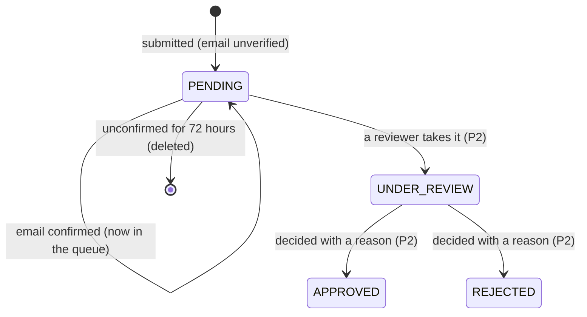

# Spec: Clinic applications, verification and listing

| Field | Value |
|---|---|
| Requirements | FR-ONB-01, 02, 07 (P1); FR-ONB-03, 05 (P2); FR-ONB-04, 06, 08 (P3); FR-ONB-05, 09, 10 (P4); NFR-19 |
| Milestone / phases | M6c / P1–P4 |
| Status | P1 (R1–R23, AC1–AC9) **Approved** 26 Oct 2026 (developer decisions D1–D3) and built (as-built notes in the M6c design note); P2 (R24–R40, AC10, AC14) and P3 (R41–R49, AC11–AC13) P4 (R50–R58, AC15–AC16) and P5 (R59–R64, AC17) approved in advance by the developer 26 Oct 2026 and built |
| Owner | Developer |
| Last updated | 2026-10-26 |

## 1. Context
A clinic or a solo doctor must be able to ask to join MediEase without phoning anyone, and
MediEase must check every doctor's registration by hand before a clinic is shown to patients
(PRD C8, risk "fake or unqualified clinic or doctor listed"). The application is kept apart from
the clinic: nothing exists in a clinic's tenant until a reviewer approves (FR-ONB-02, ADR-0020).

## 2. Actors and permissions
| Actor | Can | Cannot |
|---|---|---|
| Applicant (signed out) | Submit an application; confirm their email by the emailed link | See any other application; learn whether a registration number is used elsewhere |
| Ops (`@ops`, P1) | List confirmed applications (summary only) | Open the detail or certificates, or decide (P2, `OPS_REVIEWER`) |
| Staff, patients | — | Anything here |

## 3. Domain model

`ClinicApplication` (platform data): reference, kind (`CLINIC`, `SOLO_DOCTOR`), status, the clinic
(name, address line, city, state, PIN, phone, specialties), the owner (name, phone, email,
`owner_practises`), `email_verified_at`, the confirmation secret's digest and expiry,
`submitted_at`, `ip_hash`, the duplicate flags, and 1–10 `ApplicationDoctor`s (position, name,
qualification, council, registration number, `is_owner`, the certificate's key, content type,
size and SHA-256).

## 4. Behaviour (P1)

### The form
- **R1** `POST /api/v1/public/applications` needs no sign-in. It takes `multipart/form-data`: one
  part `application` (JSON, `ClinicApplicationInput`) and one file part `certificate_{n}` for each
  doctor position `n`. The whole request must be at most 30 MB; more is 413 before parsing.
- **R2** Kind `CLINIC` has 1–10 doctors; kind `SOLO_DOCTOR` has exactly 1, and it is the owner
  (`owner_practises` is true and that doctor is `is_owner`).
- **R3** For `CLINIC`, `owner_practises` true requires exactly one doctor with `is_owner`; false
  requires none.
- **R4** Required: clinic name (1–200), address line (1–300), city (1–100), state (1–100), PIN (six
  digits, not starting with 0), clinic phone (an Indian mobile or landline, normalised to E.164),
  1–10 specialties from the published list, owner name (1–200), owner mobile (Indian mobile,
  E.164), owner email (a valid address, at most 254, lower-cased). Per doctor: name (1–200),
  qualification (1–200), council (one of the published councils: the National Medical
  Commission and the state medical councils), registration number (1–50, trimmed, internal
  spaces removed).
- **R5** Two doctors of one application may not share a council and registration number (422 on
  the second).
- **R6** A field error is 422 `REQ_VALIDATION_FAILED` naming the field (`doctors.1.registration_number`);
  nothing is stored.
- **R7** Each doctor must have exactly one certificate: a PDF, JPEG or PNG recognised by its first
  bytes (`%PDF-`, `FF D8 FF`, `89 50 4E 47 0D 0A 1A 0A`), 1 byte to 5 MB. Otherwise 422
  `ONB_FILE_REJECTED` with `details.position` and `details.reason` (`type`, `size`, `missing`);
  nothing is stored. The declared file name and content type are ignored.
- **R8** A request whose hidden field `website` is not empty is answered exactly like a success
  (202 with a reference) and stores nothing.

### Storing and confirming
- **R9** A valid submission stores the application (`PENDING`, email unverified) and its doctors,
  writes each certificate to private blob storage under `applications/{application_id}/doctor-{n}`
  with its SHA-256, and in the same transaction enqueues one `send_application_email` job
  (confirm). Answer 202 `{reference, email_masked}`; the reference is `MA-{year}-{4+ digits}`,
  unique.
- **R10** If a stored file cannot be written, the request fails with 503 `ONB_UPLOAD_FAILED` and
  leaves no rows; files already written are deleted.
- **R11** The confirmation link is `PUBLIC_BASE_URL/apply/confirm/{token}`: a 256-bit secret whose
  SHA-256 digest is stored; it expires 48 hours after submission and works once.
- **R12** `POST /api/v1/public/applications/confirm {token}` sets `email_verified_at`, clears the
  secret, and enqueues the "received" email. Opening the emailed link only shows a *Confirm my
  application* button; pressing it sends this request, so a mail scanner that fetches the link
  confirms nothing (as the patient verify page, M6a-P4). An unknown, used or expired token is 404
  `ONB_CONFIRM_INVALID`, one answer for all three.
- **R13** A new submission with the same owner email while an earlier one is still unverified
  deletes the earlier one (rows and files) in the same transaction.
- **R14** An application unverified 72 hours after submission is deleted with its files by the
  hourly `purge_applications` job.
- **R15** P1 writes no other status than `PENDING`. Nothing in P1 creates or changes a clinic,
  user, membership or doctor.

### Abuse and duplicates
- **R16** Limits, checked before anything is stored: 5 submissions a day per caller address
  (hashed); 3 a day per owner phone and 3 a day per owner email, counted from the applications
  table (a phone or email never appears in a bucket name). Over a limit: 429 `ONB_RATE_LIMITED`
  with `Retry-After`. Confirming is limited to 20 attempts a minute per address.
- **R17** On submission, each doctor's (council, registration number) is compared with other
  applications that are confirmed and not rejected, and with existing doctors (by the normalised
  number alone, because ops-created doctors carry a council typed by hand). A match marks the
  application `possible_duplicate` and records the matching references (or clinic IDs) for the
  reviewer. The submission still succeeds and its answer is identical.

### Ops in P1
- **R18** `GET /api/v1/ops/applications` (`@ops`) lists confirmed applications, oldest first:
  reference, kind, clinic name, city, number of doctors, `submitted_at`, `email_verified_at`,
  `possible_duplicate`. No phone, email, registration number or certificate. Unconfirmed
  applications are never listed.

### Privacy and retention
- **R19** Logs carry the application ID, reference, kind and counts only: never a name, phone,
  email, registration number or file name. The emails contain the reference and the clinic's
  name only.
- **R20** Audit, with no clinic: `application.submitted` and `application.email_verified`, actor
  type `APPLICANT` (no user), metadata the application ID, kind and doctor count.
- **R21** Retention: unverified 72 hours (R14); the P2 rules keep rejected applications 180 days
  and approved ones while their clinic exists.
- **R22** Certificates are never reachable by a public URL; no route in P1 returns one.

### Language and promise (D2, D3)
- **R23** `/apply`, its confirm page and the two application emails are in English only in M6c
  (D2). The form, the "Check your email" page and the "received" email must each say that
  MediEase checks every doctor's registration by hand and **will reply by email within 2 working
  days** (D3).

## 4b. Behaviour (P2: the reviewer's workflow)

### Roles and the queue
- **R24** `users.ops_roles` holds `OPS_ADMIN` and/or `OPS_REVIEWER`. Every ops user from before
  M6c holds both. The review routes need `OPS_REVIEWER` (`@reviewer`); the existing `@ops` routes
  (clinics, imports, messaging costs) need `OPS_ADMIN`. Without the role: 403 `PERM_DENIED`.
- **R25** `GET /api/v1/ops/applications?queue=waiting|review|decided` lists confirmed applications
  (`PENDING`, `UNDER_REVIEW`, or `APPROVED`/`REJECTED`), oldest first, with the summary fields of
  R18 plus status, `taken_at` and `decided_at`. Without `queue`, every confirmed application.
  Another value is 422.
- **R26** `GET /api/v1/ops/applications/{id}` returns the whole application with each doctor's
  registration and latest check; `GET .../doctors/{doctor_id}/certificate` streams the file with its
  stored type, `inline`, `nosniff` and `sandbox` CSP. Both are audited (`application.viewed`,
  `application.certificate_viewed`). An unconfirmed or unknown application is 404.

### Taking and checking
- **R27** `POST .../take` moves `PENDING` to `UNDER_REVIEW` with the reviewer and time, under a row
  lock. Taking one already under review is 409 `ONB_ALREADY_TAKEN`.
- **R28** Any reviewer may continue an application under review; `taken_by` keeps who took it.
- **R29** `PUT .../doctors/{doctor_id}/check {register_checked, certificate_matches, result, note}`
  is allowed only `UNDER_REVIEW` (409 `ONB_NOT_UNDER_REVIEW`).
- **R30** `VERIFIED` needs both answers true (422); `NOT_VERIFIED` may have either. The note is at
  most 500 characters and is never sent to the applicant.
- **R31** A new check replaces the doctor's earlier one. `all_verified` is true when every doctor's
  check is `VERIFIED`.
- **R32** Every check is audited (`application.doctor_checked`: the doctor's position and result).

### Rejecting
- **R33** `POST .../reject {reason, message}` from `UNDER_REVIEW` (else 409 `ONB_NOT_UNDER_REVIEW`):
  reason one of `REGISTRATION_NOT_FOUND`, `CERTIFICATE_UNCLEAR`, `DETAILS_DO_NOT_MATCH`,
  `NOT_ELIGIBLE`, `DUPLICATE`, `OTHER`; message up to 500 characters, required for `OTHER`. The
  application becomes `REJECTED` with the reviewer, time, reason and message; audited
  (`application.rejected`, the reason code only).
- **R34** The applicant is emailed the reason's fixed words, the reviewer's message, and that they
  may apply again at `/apply`.
- **R35** A rejected application is deleted with its certificates 180 days after the decision by
  the hourly purge.
- **R36** Re-applying is a new application; the earlier rejected one does not block it and is not
  a duplicate match.
- **R37** There is no status page: the applicant is told by email at each step (received,
  rejected, approved with the invitation).

### Privacy and screens
- **R38** Logs carry IDs, references, statuses and reason codes only; audit metadata never holds
  the message, a note, a name or a registration number.
- **R39** `/ops/applications` (the queue by state) and `/ops/applications/{id}` (details, *Open
  certificate* through the session as a blob, the check form, *Take for review*, *Reject…*,
  *Approve and create the clinic*). The ops navigation shows each screen only to the role that can
  open it.
- **R40** Responses are `no-store`. A certificate is never reachable by a public or pre-signed URL.

## 4c. Behaviour (P3: approval and verification)

- **R41** `POST .../approve` needs `UNDER_REVIEW` (409 `ONB_NOT_UNDER_REVIEW`) and every doctor's
  check `VERIFIED` (422 otherwise).
- **R42** The body is the reviewer's choices: `slug` (3-63), `booking_mode` (default `TOKENS`),
  `timezone` (default Asia/Kolkata), and optional corrections of the clinic's name, address, city,
  state and PIN (null keeps the application's). The clinic, its doctors, the owner's invitation,
  the verification records and `APPROVED` are written in **one transaction** through the same rule
  sets as the ops wizard (FR-ONB-08). Any failure (a slug taken: 409 `CLN_SLUG_TAKEN`) leaves
  nothing and the application stays `UNDER_REVIEW`.
- **R43** The owner is invited as `OWNER` by email to the application's confirmed address (the
  `send_staff_invite` job mints the link); when the owner practises, the invitation links them to
  their doctor profile. The answer is 201 `{application, clinic, invitation_delivery}`.
- **R44** The clinic starts `ONBOARDING` and becomes `ACTIVE` when the owner accepts (D1). It has no
  public page until then.
- **R45** An ops-created clinic starts unverified. A reviewer verifies a doctor with
  `POST /api/v1/ops/clinics/{id}/doctors/{doctor_id}/verify {register_checked, certificate_matches}`
  (both true, else 422) and then the clinic with `POST /api/v1/ops/clinics/{id}/verify` (422 until
  at least one active doctor is verified). Source `OPS_CHECK`. Both are idempotent.
- **R46** Changing a verified doctor's registration number or council clears that doctor's
  verification. Nothing else clears it.
- **R47** `has_public_page` is `ACTIVE` and verified. The public page, its availability, new booking
  requests, answers to proposals and the live token link all use it; anything else is the same 404
  as an unknown slug.
- **R48** Audit: `application.approved`, `clinic.verified` and `doctor.verified` (source, IDs only).
- **R49** Existing clinics are not verified by the migration; `make seed` verifies, lists and
  completes the demo clinics.

## 4d. Behaviour (P4: suspension and listing)

### The listing
- **R50** `GET /api/v1/clinic/listing` (`CLINIC_VIEW`) answers the listing (`listed`,
  `listed_at`), whether the clinic is verified and **discoverable**, the clinic's problems and each
  doctor's state (`is_active`, `verified`, `visible`, `has_schedule`, `can_be_visible`, problems).
- **R51** The clinic's problems, in this order: `NOT_ACTIVE`, `NOT_VERIFIED`, `ADDRESS_MISSING`
  (address line, city or PIN missing), `NO_BOOKABLE_DOCTOR` (no doctor who is active, verified,
  visible and has weekly hours in force). A doctor's: `INACTIVE`, `NOT_VERIFIED`, `NO_SCHEDULE`,
  `HIDDEN`.
- **R52** `PUT /api/v1/clinic/listing {listed}` (`CLINIC_MANAGE`, owners): listing needs no
  problem (409 `CLN_LISTING_BLOCKED`, `details.problems` comma-separated); unlisting always works.
  `listed` needs the clinic verified (a database CHECK too). Audited `clinic.listing_changed`.
- **R53** `PUT /api/v1/clinic/listing/doctors/{doctor_id} {visible}` (`CLINIC_MANAGE`): showing
  needs the doctor active and verified (409 `CLN_DOCTOR_NOT_VERIFIED`); hiding always works.
  Another clinic's doctor is 404. Audited `doctor.visibility_changed`.
- **R54** A doctor is shown on the public page and in the directory when active, verified and
  visible (from P5).
- **R55** **Discoverable** = listed and no problem (`is_discoverable`, the one rule for profiles,
  the sitemap and search). A listed clinic that develops a problem (a doctor's registration
  changed, R46) stays listed but is not discoverable until it is fixed.

### Suspension
- **R56** `POST /api/v1/ops/clinics/{id}/suspend {reason, note}` (`OPS_ADMIN`): `ACTIVE` ->
  `SUSPENDED` (409 `CLN_INVALID_TRANSITION` otherwise). Reasons `VERIFICATION_PROBLEM`,
  `CLINIC_REQUEST`, `TERMS_BREACH`, `PAYMENT`, `OTHER` (a note is required for `OTHER`, 422). The
  audit (`clinic.suspended`) holds the reason and the count of withdrawn requests, never the note.
  The public page, its availability, new requests, answers and the live token links stop at once
  (they need `ACTIVE`), and staff are refused with `CLN_SUSPENDED`.
- **R57** In the same transaction every open booking request of the clinic is declined by the
  system with `CLINIC_UNAVAILABLE`, and each requester gets a portal notice that stays visible
  although the clinic is suspended. The answer email is not sent (the worker cancels a suspended
  clinic's jobs). Confirmed appointments are not cancelled: the clinic or MediEase calls patients.
- **R58** `POST /api/v1/ops/clinics/{id}/reactivate` (`OPS_ADMIN`): `SUSPENDED` -> `ACTIVE` (422
  otherwise; 409 `CLN_OWNER_REQUIRED` without an active owner). The owner's listing choice is kept.
  Audited `clinic.reactivated`.

## 4e. Behaviour (P5: public profiles)

- **R59** A doctor is **public** when active, verified and shown (`Doctor.is_public`). Only public
  doctors appear on `/c/{slug}`; availability for any other doctor is the same 404 as an unknown
  one, and a request for one is refused (`APT_SESSION_CLOSED`, 409).
- **R60** Approval shows the application's doctors (`visible` true); the owner may hide any. A
  doctor's profile is `/c/{slug}/doctors/{doctor_id}`: the clinic page for that doctor alone, its
  times loaded at once. A doctor who is not public is the page's 404.
- **R61** `PUT /api/v1/clinic/listing/doctors/{doctor_id}/profile {languages, fee_paise}`
  (`CLINIC_MANAGE`): languages from the published list (`language_options`; 422 otherwise), the
  fee 0 to 1 000 000 paise or null. The public body adds the clinic's `specialties` and each
  doctor's `languages` and `fee_paise` (still an allow-list).
- **R62** `indexable` = discoverable (R55) and `search_indexing` (the owner's opt-out, `PUT
  /clinic/listing {search_indexing}`). The web page is `index, follow` with a canonical URL when
  indexable and `noindex, nofollow` otherwise. The API's JSON is always `noindex`.
- **R63** `GET /api/v1/public/sitemap` lists, as absolute URLs under `PUBLIC_BASE_URL`, each
  indexable clinic page and its public doctors' profiles (at most 5,000 clinics; cacheable an
  hour). The web app serves it as `/sitemap.xml`; `/robots.txt` allows the public pages and names
  the sitemap, and disallows signed-in areas, patient links and the API.
- **R64** Nothing else is published: no patient count, rating, registration number or staff
  detail (NFR-17; the allow-list test fails on any other key).

## 5. API surface (P1-P5)
| Method | Path | Request | Success | Errors |
|---|---|---|---|---|
| POST | `/api/v1/public/applications` | multipart: `application` (JSON), `certificate_{n}` | 202 `ApplicationReceipt {reference, email_masked}` | 413, 415, 422 `REQ_VALIDATION_FAILED`, 422 `ONB_FILE_REJECTED`, 429 `ONB_RATE_LIMITED`, 503 `ONB_UPLOAD_FAILED` |
| POST | `/api/v1/public/applications/confirm` | `{token}` | 200 `{reference}` | 404 `ONB_CONFIRM_INVALID`, 429 `ONB_RATE_LIMITED` |
| GET | `/api/v1/ops/applications` | — | 200 `{items: OpsApplicationSummary[]}` | 401, 403 |

P2 and P3 (contract 0.37.0, 0.38.0):

| Method | Path | Rule | Access | Success | Errors |
|---|---|---|---|---|---|
| GET | `/api/v1/ops/applications?queue=` | The reviewer queue (R25) | `OPS_REVIEWER` | 200 `{items}` | 401, 403, 422 |
| GET | `/api/v1/ops/applications/{id}` | Detail, audited (R26) | `OPS_REVIEWER` | 200 `OpsApplicationDetail` | 401, 403, 404 |
| GET | `/api/v1/ops/applications/{id}/doctors/{doctor_id}/certificate` | The file, audited | `OPS_REVIEWER` | 200 the file | 401, 403, 404 |
| POST | `/api/v1/ops/applications/{id}/take` | R27 | `OPS_REVIEWER` | 200 detail | 404, 409 `ONB_ALREADY_TAKEN` |
| PUT | `/api/v1/ops/applications/{id}/doctors/{doctor_id}/check` | R29-R31 | `OPS_REVIEWER` | 200 detail | 404, 409 `ONB_NOT_UNDER_REVIEW`, 422 |
| POST | `/api/v1/ops/applications/{id}/reject` | R33 | `OPS_REVIEWER` | 200 detail | 404, 409, 422 |
| POST | `/api/v1/ops/applications/{id}/approve` | R41-R43 | `OPS_REVIEWER` | 201 `{application, clinic, invitation_delivery}` | 404, 409 `ONB_NOT_UNDER_REVIEW` / `CLN_SLUG_TAKEN`, 422 |
| POST | `/api/v1/ops/clinics/{id}/doctors/{doctor_id}/verify` | R45 | `OPS_REVIEWER` | 200 `{verified, changed}` | 404, 422 |
| POST | `/api/v1/ops/clinics/{id}/verify` | R45 | `OPS_REVIEWER` | 200 `Clinic` | 404, 422 |
| GET | `/api/v1/clinic/listing` | R50 | `CLINIC_VIEW` | 200 `ClinicListing` | 401, 403 |
| PUT | `/api/v1/clinic/listing` | R52 | `CLINIC_MANAGE` | 200 `ClinicListing` | 409 `CLN_LISTING_BLOCKED` |
| PUT | `/api/v1/clinic/listing/doctors/{doctor_id}` | R53 | `CLINIC_MANAGE` | 200 `ClinicListing` | 404, 409 `CLN_DOCTOR_NOT_VERIFIED` |
| POST | `/api/v1/ops/clinics/{id}/suspend` | R56, R57 | `OPS_ADMIN` | 200 `{clinic, requests_withdrawn}` | 404, 409, 422 |
| POST | `/api/v1/ops/clinics/{id}/reactivate` | R58 | `OPS_ADMIN` | 200 `Clinic` | 404, 409, 422 |
| PUT | `/api/v1/clinic/listing/doctors/{doctor_id}/profile` | R61 | `CLINIC_MANAGE` | 200 `ClinicListing` | 404, 422 |
| GET | `/api/v1/public/sitemap` | R63 | public | 200 `{base_url, items}` | — |

All three answer `Cache-Control: no-store`; the public two also `X-Robots-Tag: noindex`.

## 6. UI notes
- `/apply` (public, 360 px first, under 200 KB, English only, D2): choose *A clinic* or *A doctor with my
  own practice*; then the clinic, the owner, the doctors (add up to 10; for each, the certificate
  picker accepting `.pdf,.jpg,.jpeg,.png`), a review step, *Submit*. Errors next to their field
  and summarised at the top; the step keeps what was typed when going back.
- After submitting: "Check your email. We sent a link to a•••@example.test to confirm your
  application." The note (R23): "MediEase checks each doctor's registration by hand and will
  reply by email within 2 working days."
- `/apply/confirm/{token}`: "Thank you. We received application MA-2026-0042." or "This link is
  not valid any more. Apply again." (one message for unknown, used and expired).
- Ops clinic list: "N applications waiting" with the summary list.

## 7. Events and side effects
| Trigger | Audit action | Job enqueued | Analytics event |
|---|---|---|---|
| Submission stored | `application.submitted` (APPLICANT) | `send_application_email` (confirm) | none |
| Email confirmed | `application.email_verified` (APPLICANT) | `send_application_email` (received) | none |
| Unverified 72 h | none (log `application.purged` with a count) | — | none |

## 8. Edge cases
| Case | Expected outcome |
|---|---|
| A PDF renamed `.png` | Accepted as a PDF (first bytes decide) |
| An executable renamed `.pdf` | 422 `ONB_FILE_REJECTED` `reason=type` |
| 5 MB + 1 byte | 422 `ONB_FILE_REJECTED` `reason=size` |
| A doctor without a file | 422 `ONB_FILE_REJECTED` `reason=missing` |
| The honeypot filled | 202 with a reference; nothing stored |
| Same email submits twice before confirming | The first is deleted; only the second's link works |
| A doctor already practising at a MediEase clinic applies for a second clinic | Accepted, flagged `possible_duplicate` for the reviewer |
| The confirm link opened twice | The second time: `ONB_CONFIRM_INVALID`, the same answer as an unknown or expired link |
| Blob storage down | 503; no rows; no email |

## 9. Acceptance criteria (P1)
- **AC1 (FR-ONB-01)** — Given a solo doctor with a valid PDF certificate, when they submit, then
  the application is `PENDING` with the email unverified, the file is in private storage with its
  hash, and one confirmation email is queued.
- **AC2 (FR-ONB-01)** — Given that application, when the link is opened, then the email is
  verified, the application appears in `GET /ops/applications`, and the "received" email is
  queued; opening it again is `ONB_CONFIRM_INVALID`.
- **AC3 (FR-ONB-02)** — Given any submission or confirmation, then no clinic, user, membership or
  doctor row is created.
- **AC4 (R7)** — Given a text file renamed `.pdf` for doctor 2, when submitting, then 422
  `ONB_FILE_REJECTED` with `position=2`, and nothing is stored.
- **AC5 (FR-ONB-07)** — Given 3 submissions today from one owner phone, when a fourth is sent,
  then 429 `ONB_RATE_LIMITED` with `Retry-After`.
- **AC6 (FR-ONB-07)** — Given a confirmed application with council C and number N, when another
  application lists C and N, then the second is flagged `possible_duplicate` with the first's
  reference, and its answer is the same as an unflagged one.
- **AC7 (R14)** — Given an application unverified for 72 hours, when the purge runs, then its rows
  and files are gone.
- **AC8 (R19, R20)** — Given a submission and a confirmation, then no log line or audit metadata
  contains the owner's name, phone or email, a registration number or a file name.
- **AC9 (R23)** — Given the form, the "Check your email" page and the "received" email, then each
  says MediEase will reply within 2 working days, in English.

## 9b. Acceptance criteria (P2, P3)
- **AC10 (FR-ONB-03, 05)** — Given a confirmed application, when a reviewer takes it, checks both
  doctors and rejects it with `REGISTRATION_NOT_FOUND` and a message, then a second take is 409
  `ONB_ALREADY_TAKEN`, the application is `REJECTED`, the applicant is emailed the reason's words
  and the message, and the audit holds viewed, certificate viewed, taken, checked and rejected
  with no message text.
- **AC11 (FR-ONB-04, 08)** — Given every doctor `VERIFIED`, when the reviewer approves with a slug,
  then one clinic (`ONBOARDING`, verified from the application) with its verified doctors and one
  emailed owner invitation exist, the application is `APPROVED` with the clinic, and the public
  page is 404 until the owner accepts.
- **AC12 (R42)** — Given a slug already used, when approving, then 409 and no clinic, doctor or
  invitation is created; the application stays `UNDER_REVIEW`.
- **AC13 (FR-ONB-06)** — Given an unverified ACTIVE clinic, then its public page is 404; when a
  reviewer verifies a doctor (both answers yes) and then the clinic, then the page is 200.
- **AC14 (R24)** — Given an `OPS_ADMIN`-only user, the review routes are 403; given an
  `OPS_REVIEWER`-only user, the clinic list is 403.

- **AC15 (FR-ONB-05)** — Given an `ACTIVE` clinic with an open request, when ops suspends it,
  then the request is `DECLINED` (`CLINIC_UNAVAILABLE`, by the system), the patient's portal shows
  the notice, the public page is 404, staff get `CLN_SUSPENDED`; reactivating brings the page back.
- **AC16 (FR-ONB-09, 10)** — Given a verified clinic without an address and a hidden, unverified
  doctor without hours, then listing is 409 `CLN_LISTING_BLOCKED` naming `ADDRESS_MISSING` and
  `NO_BOOKABLE_DOCTOR`, and showing the doctor is 409 `CLN_DOCTOR_NOT_VERIFIED`; once each is fixed
  the clinic can be listed and is discoverable.

- **AC17 (FR-DIS-03, 06)** — Given a discoverable clinic, then its page says `indexable` and the
  sitemap lists it and its public doctors; when the owner opts out, neither; a doctor the owner
  hides disappears from the page and its availability is 404.

## 10. Observability
Log events: `application.submitted` (id, reference, kind, doctors), `application.rejected_input`
(field or reason only), `application.rate_limited` (bucket kind), `application.email_verified`,
`application.duplicate_flagged` (id, count), `application.purged` (count). Error codes:
`ONB_RATE_LIMITED`, `ONB_FILE_REJECTED`, `ONB_CONFIRM_INVALID`, `ONB_UPLOAD_FAILED`,
`REQ_VALIDATION_FAILED`.

## 11. Out of scope
Automatic council-register lookups; cancelling a suspended clinic's appointments (R57); payments; an applicant status page (not
built, R37); Hindi on the clinic side (not in M6c, D2).

## 12. Open questions
None. Resolved 26 Oct 2026: activation when the owner accepts the invitation (D1); English only
(D2); "within 2 working days" (D3).
