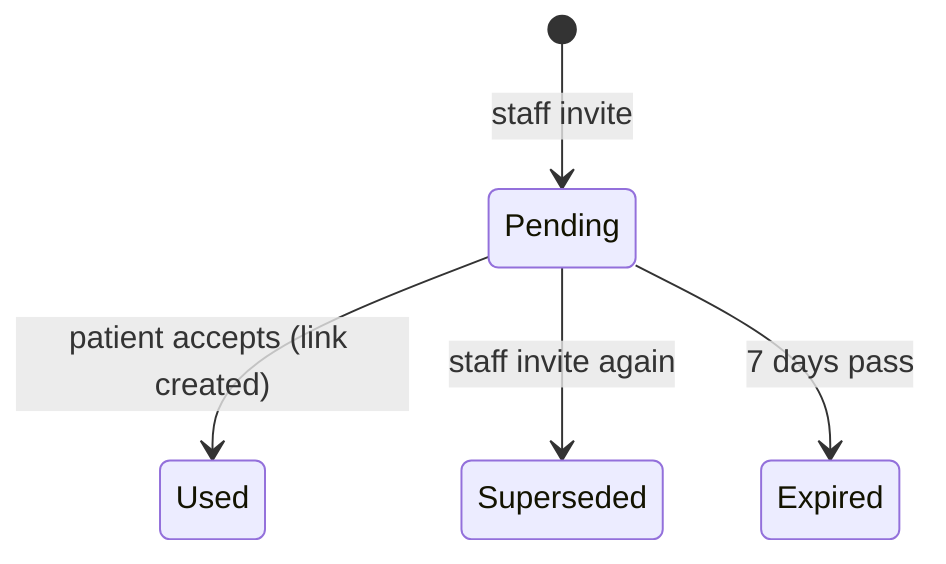

# Spec: Patient portal — linking and what a patient sees

| Field | Value |
|---|---|
| Requirements | FR-PRT-02, 03, 06 (b, c); NFR-18 (P1). FR-PRT-04, 05, 07 (P2), FR-REM-03 (P3) and patient notifications (P6) are added in their phases |
| Milestone / phases | M6b / P1 (this version), P2, P3, P6 |
| Status | Approved for P1 (developer sign-off 24 Oct 2026, with the M6b-P1 design: A on all eight) |
| Last updated | 2026-10-24 |

## 1. Context
A patient account (M6a-P3) holds no clinic data. Patients want their appointments and
prescriptions in one place without phoning the clinic, and a clinic must never leak one family
member's record to another who shares the phone (PRD §2, FR-PAT-02). A link is therefore made
only from proof the clinic gave the patient (FR-PRT-06).

## 2. Actors and permissions
- **Patient** (a signed-in patient account, `@patient`): links, unlinks and reads their own linked
  records only.
- **Staff with `PATIENTS_MANAGE`** (owner, doctor, front desk): invite a patient, see whether the
  record is linked, and unlink it.
- **Ops**: no access to links or the portal.

## 3. Domain model
- **`PatientAccountLink`** (tenant): `clinic_id`, `patient_id`, `account_id`, `method`
  (`INVITE` | `RX_LINK` | `BOOKING` from P5), `created_at`, `created_by_user_id` (null unless an
  invite), `revoked_at`, `revoked_by` (`PATIENT` | `STAFF`, null while active).
  - Invariants: at most one active link per `(clinic_id, patient_id)`; at most one active link
    per `(clinic_id, account_id)`.
- **`PatientPortalInvite`** (tenant): `clinic_id`, `patient_id`, `token_hash` (SHA-256 of a
  256-bit secret), `expires_at` (created + 7 days), `used_at`, `used_by_account_id`,
  `superseded_at`, `created_by` (user), `created_at`.
  - At most one usable invite per patient record: creating one supersedes the previous.

## 4. Behaviour

### Linking
- **R1** An invite link is `PUBLIC_BASE_URL/portal/link/{token}`. The API returns the URL once,
  when the invite is created; it is never stored or shown again.
- **R2** Describing an invite (`GET /portal/invites/{token}`) needs a signed-in patient and
  returns the clinic's name and the patient's first name and code. An unknown, used, superseded or
  expired token is 404 `PRT_INVITE_INVALID`, the same answer for each.
- **R3** Accepting an invite creates an `INVITE` link and marks the invite used, in one
  transaction under a row lock on the invite. A second accept of the same token is
  `PRT_INVITE_INVALID`.
- **R4** If the record already has an active link to another account, or the account already has
  an active link in that clinic, accepting is 409 `PRT_ALREADY_LINKED` and the invite stays
  usable.
- **R5** Linking by prescription link (`POST /portal/links/prescription {token, phone_last4}`)
  needs a **verified** account (Google, or `email_verified_at` set); otherwise 403
  `PRT_UNVERIFIED_ACCOUNT`, before the last-4 check runs.
- **R6** The last-4 check is the prescription link's own (prescriptions spec R10): the same
  comparison, failure counter and five-try lockout, under the link's row lock. A wrong answer is
  `LINK_CHALLENGE_FAILED` (with attempts left); a locked link is `LINK_LOCKED`, for the page too.
  A right answer creates an `RX_LINK` link to the prescription's patient and clinic. An already
  linked record or account answers as R4.
- **R7** Nothing links automatically: not by phone number, email or name, and not by opening a
  prescription page.

### Unlinking
- **R8** The patient may unlink any of their links (`DELETE /portal/links/{link_id}`); staff may
  unlink a record (`DELETE /patients/{id}/portal-link`). The link gets `revoked_at` and
  `revoked_by`; the patient record is unchanged. A revoked link grants nothing from the next
  request on.

### What a link grants (NFR-18)
- **R9** Every portal read is limited to the account's **active** links. A path ID that belongs to
  another clinic, another patient in the same clinic, or a revoked link answers 404
  `REQ_NOT_FOUND`.
- **R10** `GET /portal/links` lists the active links: the clinic (name, phone, address, city), the
  patient's first name and code, the method and `created_at`.
- **R11** `GET /portal/appointments` returns, grouped by clinic, the linked patient's
  appointments: doctor's name, date, slot time or token, and status (every status), upcoming
  first, then past newest first; at most 50 per clinic.
- **R12** `GET /portal/prescriptions` lists each issued chain's latest issued version (doctor,
  issued date, version); `GET /portal/prescriptions/{rx_id}` returns the patient page (as the
  public link shows it, `?lang=en|hi`), and `/pdf` the PDF. A draft or a superseded version's ID
  is 404. Visit notes, vitals, diagnosis and addenda are never returned.
- **R13** `GET /portal/reminders` returns the linked patient's reminders with kind, date, due
  time and visible status (FR-REM-05).
- **R14** Staff see a record's portal status (`GET /patients/{id}/portal`): `NOT_LINKED`,
  `INVITED` (with the invite's expiry) or `LINKED` (with method and `created_at`); never the
  account's email or name.

## 5. API surface
See API.md "Patient portal" and `contracts/openapi.yaml` 0.29.0.

## 6. UI notes
- P1: the staff *Patient app* card on the patient profile (status, *Invite to the patient app*
  with the link and QR shown once, *Invite again*, *Unlink* with confirmation); the two link pages
  (`/portal/link/{token}`: "Link your records at *Clinic* (First · CODE)", *Link* or *Not me*;
  `/portal/link/prescription/{token}`: the last-4 field). Signed-out visitors are sent to sign in
  or sign up and back.
- P2 adds the portal screens.

## 7. Events and side effects
| Trigger | Audit | Notes |
|---|---|---|
| Invite created | `patient.portal_invited` (STAFF) | Metadata: patient code, expiry |
| Link created | `patient.portal_linked` (PATIENT) | Metadata: method, clinic and patient IDs |
| Link revoked | `patient.portal_unlinked` (PATIENT or STAFF) | Metadata: method, who |
| Wrong last-4 in the portal | `patient_link.challenge_failed` (PATIENT) | As on the page; `patient_link.locked` at five |
| Portal reads | — | Not audited (decision 7) |

## 8. Edge cases
| Case | Expected outcome |
|---|---|
| Two family members share a phone; one links | The other's record stays unlinked and invisible to that account |
| An invite is opened by an account already linked to another record in that clinic | 409 `PRT_ALREADY_LINKED`; the invite stays usable for the right person |
| Staff invite again after the patient lost the link | The old link stops working (`PRT_INVITE_INVALID`) |
| A prescription link is locked by wrong answers in the portal | The public page shows it locked too; staff reset it (M4-P5) |
| A linked patient record's prescription is revised | The portal shows the latest issued version, with the "updated" note |
| The clinic is suspended | Its links stay but the portal shows nothing from it (404 on its IDs) until it is active again |

## 9. Acceptance criteria
- **AC1 (FR-PRT-06 b)** Given staff invite Asha (SC-0004), when a signed-in account accepts the
  link, then `GET /portal/links` lists Sample Clinic with "Asha · SC-0004", and a second accept is
  `PRT_INVITE_INVALID`.
- **AC2 (FR-PRT-06 c)** Given an unverified password account, when it posts a prescription link and
  the right digits, then 403 `PRT_UNVERIFIED_ACCOUNT` and no link; given a verified account and
  the right digits, then an `RX_LINK` link exists.
- **AC3 (FR-PRT-03)** Given a linked account, then it reads the record's appointments, issued
  prescriptions and reminders, and no response contains a visit's notes or a draft.
- **AC4 (NFR-18)** Given account A linked in clinic A, when it requests any portal route with an ID
  of clinic B or of another clinic-A patient, then 404 `REQ_NOT_FOUND`.
- **AC5 (FR-PRT-06)** Given two patients sharing a phone in one clinic, when one is linked, then the
  account never sees the other.
- **AC6** Given a link revoked by staff, when the patient's next request is made, then the clinic is
  absent from `GET /portal/links` and its IDs are 404.

## 10. Observability
Log events: `portal.invite_created`, `portal.linked` (method), `portal.unlinked`,
`portal.invite_invalid`, `portal.link_refused` (reason). IDs only; never a phone digit, name or
email.

## 11. Out of scope
Booking requests and linking by an accepted request (P5, `booking-requests.md`); dependents on one
account (FR-PRT-09); patient cancel or reschedule (FR-PRT-08); data export and deletion
(FR-PRT-10); sending the invite on WhatsApp (P6).

## 12. Open questions
None for P1 once the design is approved.
