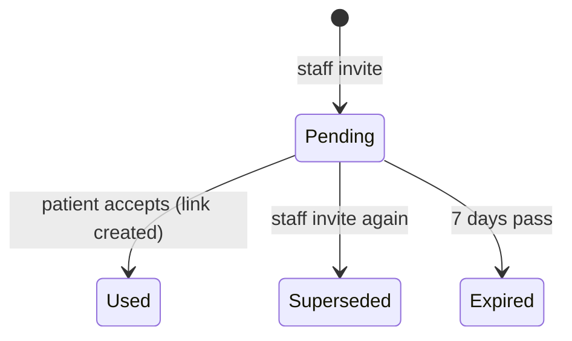

# Spec: Patient portal — linking and what a patient sees

| Field | Value |
|---|---|
| Requirements | FR-PRT-02, 03, 06 (b, c); NFR-18 (P1). FR-PRT-04, 05, 07 (P2), FR-REM-03 (P3) and patient notifications (P6) are added in their phases |
| Milestone / phases | M6b / P1, P2, P3, P3b, P6 |
| Status | P1 approved (developer sign-off 24 Oct 2026, A on all eight) and built; P2 (R15–R27, AC7–AC12) approved and built; P3 (R28–R44, AC13–AC18) and P3b (R45–R54, AC19–AC22) Draft, awaiting approval |
| Last updated | 2026-10-24 |

## 1. Context
A patient account (M6a-P3) holds no clinic data. Patients want their appointments and
prescriptions in one place without phoning the clinic, and a clinic must never leak one family
member's record to another who shares the phone (PRD §2, FR-PAT-02). A link is therefore made
only from proof the clinic gave the patient (FR-PRT-06).

## 2. Actors and permissions
- **Patient** (a signed-in patient account, `@patient`): links, unlinks and reads their own linked
  records only.
- **Staff with `PATIENTS_MANAGE`** (owner, doctor, front desk): invite a patient, see whether the
  record is linked, and unlink it.
- **Ops**: no access to links or the portal.

## 3. Domain model
- **`PatientAccountLink`** (tenant): `clinic_id`, `patient_id`, `account_id`, `method`
  (`INVITE` | `RX_LINK` | `BOOKING` from P5), `created_at`, `created_by_user_id` (null unless an
  invite), `revoked_at`, `revoked_by` (`PATIENT` | `STAFF`, null while active).
  - Invariants: at most one active link per `(clinic_id, patient_id)`; at most one active link
    per `(clinic_id, account_id)`.
- **`PatientPortalInvite`** (tenant): `clinic_id`, `patient_id`, `token_hash` (SHA-256 of a
  256-bit secret), `expires_at` (created + 7 days), `used_at`, `used_by_account_id`,
  `superseded_at`, `created_by` (user), `created_at`.
  - At most one usable invite per patient record: creating one supersedes the previous.

## 4. Behaviour

### Linking
- **R1** An invite link is `PUBLIC_BASE_URL/portal/link/{token}`. The API returns the URL once,
  when the invite is created; it is never stored or shown again.
- **R2** Describing an invite (`GET /portal/invites/{token}`) needs a signed-in patient and
  returns the clinic's name and the patient's first name and code. An unknown, used, superseded or
  expired token is 404 `PRT_INVITE_INVALID`, the same answer for each.
- **R3** Accepting an invite creates an `INVITE` link and marks the invite used, in one
  transaction under a row lock on the invite. A second accept of the same token is
  `PRT_INVITE_INVALID`.
- **R4** If the record already has an active link to another account, or the account already has
  an active link in that clinic, accepting is 409 `PRT_ALREADY_LINKED` and the invite stays
  usable.
- **R5** Linking by prescription link (`POST /portal/links/prescription {token, phone_last4}`)
  needs a **verified** account (Google, or `email_verified_at` set); otherwise 403
  `PRT_UNVERIFIED_ACCOUNT`, before the last-4 check runs.
- **R6** The last-4 check is the prescription link's own (prescriptions spec R10): the same
  comparison, failure counter and five-try lockout, under the link's row lock. A wrong answer is
  `LINK_CHALLENGE_FAILED` (with attempts left); a locked link is `LINK_LOCKED`, for the page too.
  A right answer creates an `RX_LINK` link to the prescription's patient and clinic. An already
  linked record or account answers as R4.
- **R7** Nothing links automatically: not by phone number, email or name, and not by opening a
  prescription page.

### Unlinking
- **R8** The patient may unlink any of their links (`DELETE /portal/links/{link_id}`); staff may
  unlink a record (`DELETE /patients/{id}/portal-link`). The link gets `revoked_at` and
  `revoked_by`; the patient record is unchanged. A revoked link grants nothing from the next
  request on.

### What a link grants (NFR-18)
- **R9** Every portal read is limited to the account's **active** links. A path ID that belongs to
  another clinic, another patient in the same clinic, or a revoked link answers 404
  `REQ_NOT_FOUND`.
- **R10** `GET /portal/links` lists the active links: the clinic (name, phone, address, city), the
  patient's first name and code, the method and `created_at`.
- **R11** `GET /portal/appointments` returns, grouped by clinic, the linked patient's
  appointments: doctor's name, date, slot time or token, and status (every status), upcoming
  first, then past newest first; at most 50 per clinic.
- **R12** `GET /portal/prescriptions` lists each issued chain's latest issued version (doctor,
  issued date, version); `GET /portal/prescriptions/{rx_id}` returns the patient page (as the
  public link shows it, `?lang=en|hi`), and `/pdf` the PDF. A draft or a superseded version's ID
  is 404. Visit notes, vitals, diagnosis and addenda are never returned.
- **R13** `GET /portal/reminders` returns the linked patient's reminders with kind, date, due
  time and visible status (FR-REM-05).
- **R14** Staff see a record's portal status (`GET /patients/{id}/portal`): `NOT_LINKED`,
  `INVITED` (with the invite's expiry) or `LINKED` (with method and `created_at`); never the
  account's email or name.

### The portal screens (P2, Draft)
- **R15** Signed-in portal screens share one shell: a header with the language switch and a tab
  bar (*Home*, *Appointments*, *Prescriptions*, *Account*), at the bottom below 768 px. Every
  screen works at 360 px without horizontal scrolling.
- **R16** **Fresh dashboard (FR-PRT-05).** With no active link, *Home* shows "No appointments
  yet", one primary action *Find a doctor* and a secondary explanation of how to link records
  (an invitation from the clinic, or *Save to my MediEase* on a prescription link). Nothing is
  imported or inferred. Until directory search exists (M6c), *Find a doctor* opens a page that
  says so and offers the same two ways.
- **R17** With links, *Home* shows the next upcoming appointment (clinic, doctor, day and time or
  token, status), the latest prescription, and up to 3 upcoming reminders; *Find a doctor*
  remains as a secondary action.
- **R18** **My Appointments (FR-PRT-07)** is grouped by clinic (name and a call button); inside a
  group, upcoming first (soonest first), then past (newest first). Each row shows the doctor, the
  day and time on the clinic's clock (a slot) or the token and session times (token mode), and a
  status in words: `BOOKED` *Confirmed*, `ARRIVED` and `IN_CONSULTATION` *At the clinic*,
  `COMPLETED` *Completed*, `CANCELLED` *Cancelled*, `NO_SHOW` *Missed*. A clinic's records never
  appear in another clinic's group.
- **R19** *Prescriptions* lists each linked clinic's current prescriptions (doctor, issued date,
  "updated" for a revision). Opening one shows the patient page exactly as the prescription link
  does, in the account's language with a switch, and *Download PDF*.
- **R20** *Account* shows the name, email and sign-in method, the language, the linked clinics
  (name, address, phone, how and since when linked) each with *Unlink* behind a confirmation
  that says the clinic's appointments and prescriptions will disappear from the account, and
  *Sign out*.
- **R21** **Language (FR-PRT-04, NFR-11).** The account has a language, `en` or `hi`, default
  `en`, changed from the header (`PATCH /portal/me {language}`) and kept across devices. Before
  sign-in, the auth pages follow a `me_pt_lang` cookie, which also sets a new account's language.
  Every portal word, date and time is in that language; the doctor's own text is shown as
  written. Errors the portal knows are worded in both languages; any other shows the API's
  message and the Ref.
- **R22** Times are stored in UTC and shown in each clinic's time zone, which the portal API
  returns with the clinic.
- **R23** **Budget (NFR-02).** Each portal screen's first load is under 200 KB transferred at
  360 px. No analytics or tracking scripts.
- **R24** **Accessibility (NFR-10).** WCAG 2.1 AA: labelled controls, visible focus, focus moved
  to errors, status in text as well as colour, targets at least 44 px, `lang` set to the page's
  language. An automated check (axe) finds no serious or critical violation on any portal screen
  in either language.
- **R25** An ended portal session on any screen returns to the portal sign-in with the reason;
  after signing in the person comes back to the same screen.
- **R26** A prescription or link ID the account no longer reaches (unlinked, another account's)
  shows "not found" with a way back to *Home*, never the other record.
- **R27** Nothing on the portal screens is cached for another person: responses are `no-store`
  and nothing personal is written to local storage.

### The medicine planner (P3, Draft)
Developer decisions D1–D9 (design note "Medicine planner: the developer's decisions").
- **R28** *Safety boundary.* The plan displays and organises what the doctor wrote. It never
  decides how a medicine is taken, infers or adds an instruction, computes or changes a dose,
  merges lines or prescriptions, or resolves a contradiction.
- **R29** *One engine.* Every schedule shown anywhere (the portal, the PDF, the patient page,
  P6's reminders) comes from the domain engine (`domain/prescriptions/schedule.py`, `plan.py`).
  No screen interprets a frequency value; the web shows the API's plan.
- **R30** *Slots.* A structured frequency is a pattern of `0`/`1`, read against the central slot
  set for its length: 3 = morning, afternoon, night; 4 = morning, afternoon, evening, night. A
  `1` schedules the medicine in that slot. `SOS`, `ONCE` and `CUSTOM` have no slot and are
  listed under "As the doctor wrote" with the doctor's words.
- **R31** *When and how stay apart.* Each entry shows when (slot and time, food timing) and how
  (the preparation instructions) as the doctor chose them, in the patient page's words. Bedtime is
  shown as written even when it may conflict with the slots.
- **R32** *Course.* A course starts on the prescription's `starts_on` (default its issue day,
  clinic calendar). `DAYS`: day 1 to day M, shown as "Day N of M". `UNTIL_REVIEW` ("Until your next
  review"), `ONGOING` ("Ongoing — as prescribed") and a not-stated duration ("Duration not stated —
  ask your clinic") show from the start while the version is current, with no invented end.
- **R33** *Versions.* Only each chain's current version has a plan; a revision's plan starts from
  its own `starts_on`; the earlier version and anything recorded against it are not changed.
- **R34** *Daily times.* Scheduled times come from the account's slot times (defaults 08:00,
  14:00, 18:00, 21:00; each 05:00–23:30 and increasing), changed under *Account*, on the clinic's
  clock.
- **R35** `GET /portal/medicine-plan?date=` (default today; ±30 days, else 422) and
  `GET /portal/medicine-plan/courses` return plans for the account's linked records only, through
  `PortalScope`; courses of `DAYS` that ended more than 7 days ago are left out.
- **R36** *Medicines tab.* *Today* by slot (with its time), then "As the doctor wrote"; each entry:
  medicine and dose as written, food timing, how to give, course progress or duration words,
  clinic and doctor. *Courses* per prescription. The same medicine on two prescriptions is two
  entries with their own context.
- **R37** Every planner screen says "This plan only lays out your prescription. If anything is
  unclear, ask your doctor." (and its Hindi) with *Contact your clinic* (a call button).
- **R38** *Reminder preferences.* Per prescription line and per slot the line has: on or off
  (default off) and a preferred time (default the slot's time, 05:00–23:30). Refused for untimed
  lines and for slots the line does not have. They never change the prescribed frequency, dose,
  duration or instructions.
- **R39** A revision does not inherit reminder preferences; its first plan says "This
  prescription was updated — set your reminders again". Preferences are cleared when the link
  ends.
- **R40** Reminder delivery ("medicine due", in-app, never naming the medicine) is P6; P3 stores
  and shows the preferences only.
- **R41** Reading the plan and changing times or preferences are not audited; logs carry IDs only,
  never a medicine, dose or instruction.
- **R42** Every planner word is in the account's language; medicine names, doses and the doctor's
  own text are shown as written.
- **R43** Each planner screen loads under 200 KB at 360 px and passes the automated accessibility
  check in both languages.
- **R44** Prescriptions with no current version for a linked record (none issued) give an empty
  plan with "No medicines from your prescriptions yet".

### Dose tracking (P3b, Draft)
- **R45** The patient may mark a timed dose of the current plan **Taken** or **Skipped**; the time
  marked is recorded. Untimed lines cannot be marked.
- **R46** A dose can be marked, changed or cleared from 00:00 of its day (clinic time) until 48
  hours after its scheduled time; never for a future day; read-only after the window.
- **R47** A past dose with no record is shown "Not recorded". Nothing is stored for it, and it is
  never called missed or given a reason.
- **R48** For Skipped and Not recorded, the only guidance is "If you are unsure what to do,
  contact your clinic" with the call button. No other advice is ever shown.
- **R49** Records belong to the prescription version and line they were made for; a revision
  starts without records; history shows each version separately.
- **R50** Records are visible only to the patient account, through `PortalScope`; no staff, ops
  or clinic route reaches them.
- **R51** Dose records are health data (C3): no audit rows per change, no state, medicine or time
  in any log, never sent to analytics or a model.
- **R52** On unlink they are hidden at once and kept; a relink of the same account and record
  shows them again.
- **R53** Retention: deleted one year after the course ends (`DAYS`), or one year after the dose
  date for open-ended courses, by the purge job — a product period subject to privacy and legal
  review.
- **R54** Account deletion removes them and the patient's export includes them (repository
  functions in P3b; run by support on request until FR-PRT-10's screens exist).
## 5. API surface
See API.md "Patient portal" and `contracts/openapi.yaml` 0.29.0. P2 (0.30.0): `language` on the account and `PATCH /portal/me`; the clinic's `timezone` on links and appointment groups; the prescription page's default language is the account's.

## 6. UI notes
- P1: the staff *Patient app* card on the patient profile (status, *Invite to the patient app*
  with the link and QR shown once, *Invite again*, *Unlink* with confirmation); the two link pages
  (`/portal/link/{token}`: "Link your records at *Clinic* (First · CODE)", *Link* or *Not me*;
  `/portal/link/prescription/{token}`: the last-4 field). Signed-out visitors are sent to sign in
  or sign up and back.
- P2: the portal screens, R15–R27.

## 7. Events and side effects
| Trigger | Audit | Notes |
|---|---|---|
| Invite created | `patient.portal_invited` (STAFF) | Metadata: patient code, expiry |
| Link created | `patient.portal_linked` (PATIENT) | Metadata: method, clinic and patient IDs |
| Link revoked | `patient.portal_unlinked` (PATIENT or STAFF) | Metadata: method, who |
| Wrong last-4 in the portal | `patient_link.challenge_failed` (PATIENT) | As on the page; `patient_link.locked` at five |
| Portal reads | — | Not audited (decision 7) |

## 8. Edge cases
| Case | Expected outcome |
|---|---|
| Two family members share a phone; one links | The other's record stays unlinked and invisible to that account |
| An invite is opened by an account already linked to another record in that clinic | 409 `PRT_ALREADY_LINKED`; the invite stays usable for the right person |
| Staff invite again after the patient lost the link | The old link stops working (`PRT_INVITE_INVALID`) |
| A prescription link is locked by wrong answers in the portal | The public page shows it locked too; staff reset it (M4-P5) |
| A linked patient record's prescription is revised | The portal shows the latest issued version, with the "updated" note |
| The clinic is suspended | Its links stay but the portal shows nothing from it (404 on its IDs) until it is active again |

## 9. Acceptance criteria
- **AC1 (FR-PRT-06 b)** Given staff invite Asha (SC-0004), when a signed-in account accepts the
  link, then `GET /portal/links` lists Sample Clinic with "Asha · SC-0004", and a second accept is
  `PRT_INVITE_INVALID`.
- **AC2 (FR-PRT-06 c)** Given an unverified password account, when it posts a prescription link and
  the right digits, then 403 `PRT_UNVERIFIED_ACCOUNT` and no link; given a verified account and
  the right digits, then an `RX_LINK` link exists.
- **AC3 (FR-PRT-03)** Given a linked account, then it reads the record's appointments, issued
  prescriptions and reminders, and no response contains a visit's notes or a draft.
- **AC4 (NFR-18)** Given account A linked in clinic A, when it requests any portal route with an ID
  of clinic B or of another clinic-A patient, then 404 `REQ_NOT_FOUND`.
- **AC5 (FR-PRT-06)** Given two patients sharing a phone in one clinic, when one is linked, then the
  account never sees the other.
- **AC6** Given a link revoked by staff, when the patient's next request is made, then the clinic is
  absent from `GET /portal/links` and its IDs are 404.
- **AC7 (FR-PRT-05)** Given a new account, then *Home* shows no appointments, no prescriptions and
  one primary action *Find a doctor*.
- **AC8 (FR-PRT-07)** Given an account linked in two clinics, then *Appointments* shows two groups,
  each holding only that clinic's appointments, with *Confirmed* for a booked one and the time on
  the clinic's clock.
- **AC9 (FR-PRT-03)** Given a linked account, when it opens a prescription, then it sees the same
  page as the prescription link and can download the PDF.
- **AC10 (FR-PRT-04, NFR-11)** Given the switch set to Hindi, then every portal screen is in Hindi,
  and after signing in on another browser it is still Hindi.
- **AC11 (NFR-02, NFR-10)** Each portal screen at 360 px loads under 200 KB, has no horizontal
  overflow and passes the automated accessibility check in English and Hindi.
- **AC12 (R20)** Given the patient unlinks a clinic from *Account*, then that clinic disappears
  from every screen at once.
- **AC13 (R30, R32)** Given a line `1-1-0`, after food, `DAYS` 5, started today, then *Today*
  shows it under Morning and Afternoon as "Day 1 of 5, after food" and *Courses* ends on day 5;
  given `1-0-1-1` it shows under Morning, Evening and Night.
- **AC14 (R30)** Given an `SOS` line, then it is under "As the doctor wrote" with the doctor's
  words, no time and no reminder switch.
- **AC15 (R32)** Given a line with no duration stated, then it reads "Duration not stated — ask
  your clinic" and has no end date.
- **AC16 (R33)** Given a revision issued with a new start, then the plan shows the new version
  only, and the earlier version and its PDF are unchanged.
- **AC17 (R38, R39)** Given a reminder turned on for the morning slot at 07:30, then it is still on
  after reload, cannot be set on an untimed line, does not carry to a revision, and is gone after
  unlinking.
- **AC18 (R35, NFR-18)** A plan never contains a line of another clinic's or another record's
  prescription.
- **AC19 (R45, R46)** Given a dose marked Taken at 08:12, then it shows "Taken at 08:12"; it can be
  changed to Skipped within 48 hours and not after; tomorrow's doses cannot be marked.
- **AC20 (R47, R48)** Given yesterday's evening dose not marked, then it shows "Not recorded" with
  *Contact your clinic* and no other guidance, and no record exists for it.
- **AC21 (R50, R52)** Staff and ops cannot read dose records through any route; after unlinking the
  patient sees none, and after relinking the same record they reappear.
- **AC22 (R51)** No log line written while marking contains a dose state, a medicine or a time.

## 10. Observability
Log events: `portal.invite_created`, `portal.linked` (method), `portal.unlinked`,
`portal.invite_invalid`, `portal.link_refused` (reason). IDs only; never a phone digit, name or
email. P2: `portal.language_changed`. P3: `portal.slot_times_changed`, `portal.reminder_pref_changed`
(prescription and line IDs, slot, on/off). P3b: `dose.marked`, `dose.cleared` (IDs and counts only,
never a state, medicine or time, R51).

## 11. Out of scope
Booking requests and linking by an accepted request (P5, `booking-requests.md`); dependents on one
account (FR-PRT-09); patient cancel or reschedule (FR-PRT-08); data export and deletion
(FR-PRT-10); sending the invite on WhatsApp (P6).

## 12. Open questions
None for P1 once the design is approved.
