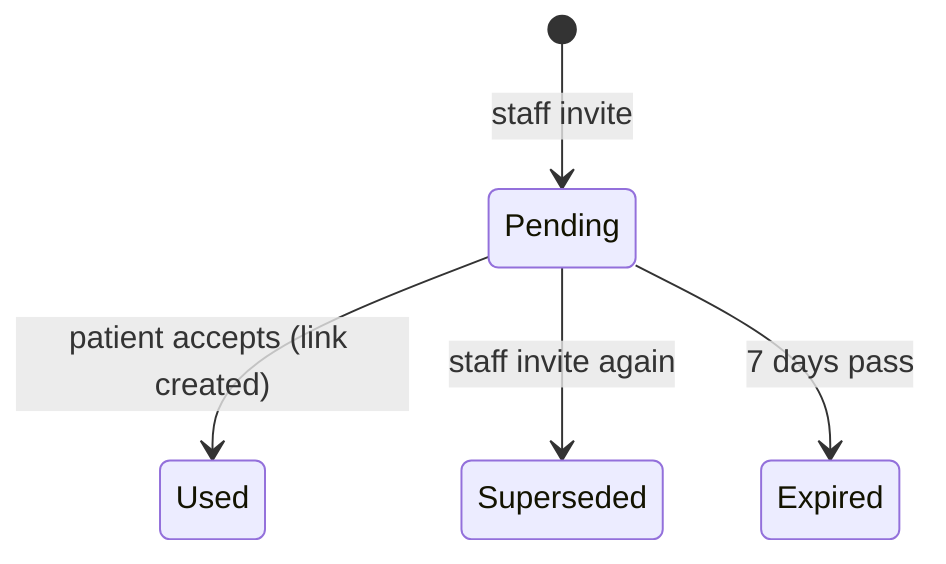

# Spec: Patient portal — linking and what a patient sees

| Field | Value |
|---|---|
| Requirements | FR-PRT-02, 03, 06 (b, c); NFR-18 (P1). FR-PRT-04, 05, 07 (P2), FR-REM-03 (P3) and patient notifications (P6) are added in their phases |
| Milestone / phases | M6b / P1 (this version), P2, P3, P6 |
| Status | P1 approved (developer sign-off 24 Oct 2026, A on all eight) and built; P2 (R15–R27, AC7–AC12) Draft, awaiting approval |
| Last updated | 2026-10-24 |

## 1. Context
A patient account (M6a-P3) holds no clinic data. Patients want their appointments and
prescriptions in one place without phoning the clinic, and a clinic must never leak one family
member's record to another who shares the phone (PRD §2, FR-PAT-02). A link is therefore made
only from proof the clinic gave the patient (FR-PRT-06).

## 2. Actors and permissions
- **Patient** (a signed-in patient account, `@patient`): links, unlinks and reads their own linked
  records only.
- **Staff with `PATIENTS_MANAGE`** (owner, doctor, front desk): invite a patient, see whether the
  record is linked, and unlink it.
- **Ops**: no access to links or the portal.

## 3. Domain model
- **`PatientAccountLink`** (tenant): `clinic_id`, `patient_id`, `account_id`, `method`
  (`INVITE` | `RX_LINK` | `BOOKING` from P5), `created_at`, `created_by_user_id` (null unless an
  invite), `revoked_at`, `revoked_by` (`PATIENT` | `STAFF`, null while active).
  - Invariants: at most one active link per `(clinic_id, patient_id)`; at most one active link
    per `(clinic_id, account_id)`.
- **`PatientPortalInvite`** (tenant): `clinic_id`, `patient_id`, `token_hash` (SHA-256 of a
  256-bit secret), `expires_at` (created + 7 days), `used_at`, `used_by_account_id`,
  `superseded_at`, `created_by` (user), `created_at`.
  - At most one usable invite per patient record: creating one supersedes the previous.

## 4. Behaviour

### Linking
- **R1** An invite link is `PUBLIC_BASE_URL/portal/link/{token}`. The API returns the URL once,
  when the invite is created; it is never stored or shown again.
- **R2** Describing an invite (`GET /portal/invites/{token}`) needs a signed-in patient and
  returns the clinic's name and the patient's first name and code. An unknown, used, superseded or
  expired token is 404 `PRT_INVITE_INVALID`, the same answer for each.
- **R3** Accepting an invite creates an `INVITE` link and marks the invite used, in one
  transaction under a row lock on the invite. A second accept of the same token is
  `PRT_INVITE_INVALID`.
- **R4** If the record already has an active link to another account, or the account already has
  an active link in that clinic, accepting is 409 `PRT_ALREADY_LINKED` and the invite stays
  usable.
- **R5** Linking by prescription link (`POST /portal/links/prescription {token, phone_last4}`)
  needs a **verified** account (Google, or `email_verified_at` set); otherwise 403
  `PRT_UNVERIFIED_ACCOUNT`, before the last-4 check runs.
- **R6** The last-4 check is the prescription link's own (prescriptions spec R10): the same
  comparison, failure counter and five-try lockout, under the link's row lock. A wrong answer is
  `LINK_CHALLENGE_FAILED` (with attempts left); a locked link is `LINK_LOCKED`, for the page too.
  A right answer creates an `RX_LINK` link to the prescription's patient and clinic. An already
  linked record or account answers as R4.
- **R7** Nothing links automatically: not by phone number, email or name, and not by opening a
  prescription page.

### Unlinking
- **R8** The patient may unlink any of their links (`DELETE /portal/links/{link_id}`); staff may
  unlink a record (`DELETE /patients/{id}/portal-link`). The link gets `revoked_at` and
  `revoked_by`; the patient record is unchanged. A revoked link grants nothing from the next
  request on.

### What a link grants (NFR-18)
- **R9** Every portal read is limited to the account's **active** links. A path ID that belongs to
  another clinic, another patient in the same clinic, or a revoked link answers 404
  `REQ_NOT_FOUND`.
- **R10** `GET /portal/links` lists the active links: the clinic (name, phone, address, city), the
  patient's first name and code, the method and `created_at`.
- **R11** `GET /portal/appointments` returns, grouped by clinic, the linked patient's
  appointments: doctor's name, date, slot time or token, and status (every status), upcoming
  first, then past newest first; at most 50 per clinic.
- **R12** `GET /portal/prescriptions` lists each issued chain's latest issued version (doctor,
  issued date, version); `GET /portal/prescriptions/{rx_id}` returns the patient page (as the
  public link shows it, `?lang=en|hi`), and `/pdf` the PDF. A draft or a superseded version's ID
  is 404. Visit notes, vitals, diagnosis and addenda are never returned.
- **R13** `GET /portal/reminders` returns the linked patient's reminders with kind, date, due
  time and visible status (FR-REM-05).
- **R14** Staff see a record's portal status (`GET /patients/{id}/portal`): `NOT_LINKED`,
  `INVITED` (with the invite's expiry) or `LINKED` (with method and `created_at`); never the
  account's email or name.

### The portal screens (P2, Draft)
- **R15** Signed-in portal screens share one shell: a header with the language switch and a tab
  bar (*Home*, *Appointments*, *Prescriptions*, *Account*), at the bottom below 768 px. Every
  screen works at 360 px without horizontal scrolling.
- **R16** **Fresh dashboard (FR-PRT-05).** With no active link, *Home* shows "No appointments
  yet", one primary action *Find a doctor* and a secondary explanation of how to link records
  (an invitation from the clinic, or *Save to my MediEase* on a prescription link). Nothing is
  imported or inferred. Until directory search exists (M6c), *Find a doctor* opens a page that
  says so and offers the same two ways.
- **R17** With links, *Home* shows the next upcoming appointment (clinic, doctor, day and time or
  token, status), the latest prescription, and up to 3 upcoming reminders; *Find a doctor*
  remains as a secondary action.
- **R18** **My Appointments (FR-PRT-07)** is grouped by clinic (name and a call button); inside a
  group, upcoming first (soonest first), then past (newest first). Each row shows the doctor, the
  day and time on the clinic's clock (a slot) or the token and session times (token mode), and a
  status in words: `BOOKED` *Confirmed*, `ARRIVED` and `IN_CONSULTATION` *At the clinic*,
  `COMPLETED` *Completed*, `CANCELLED` *Cancelled*, `NO_SHOW` *Missed*. A clinic's records never
  appear in another clinic's group.
- **R19** *Prescriptions* lists each linked clinic's current prescriptions (doctor, issued date,
  "updated" for a revision). Opening one shows the patient page exactly as the prescription link
  does, in the account's language with a switch, and *Download PDF*.
- **R20** *Account* shows the name, email and sign-in method, the language, the linked clinics
  (name, address, phone, how and since when linked) each with *Unlink* behind a confirmation
  that says the clinic's appointments and prescriptions will disappear from the account, and
  *Sign out*.
- **R21** **Language (FR-PRT-04, NFR-11).** The account has a language, `en` or `hi`, default
  `en`, changed from the header (`PATCH /portal/me {language}`) and kept across devices. Before
  sign-in, the auth pages follow a `me_pt_lang` cookie, which also sets a new account's language.
  Every portal word, date and time is in that language; the doctor's own text is shown as
  written. Errors the portal knows are worded in both languages; any other shows the API's
  message and the Ref.
- **R22** Times are stored in UTC and shown in each clinic's time zone, which the portal API
  returns with the clinic.
- **R23** **Budget (NFR-02).** Each portal screen's first load is under 200 KB transferred at
  360 px. No analytics or tracking scripts.
- **R24** **Accessibility (NFR-10).** WCAG 2.1 AA: labelled controls, visible focus, focus moved
  to errors, status in text as well as colour, targets at least 44 px, `lang` set to the page's
  language. An automated check (axe) finds no serious or critical violation on any portal screen
  in either language.
- **R25** An ended portal session on any screen returns to the portal sign-in with the reason;
  after signing in the person comes back to the same screen.
- **R26** A prescription or link ID the account no longer reaches (unlinked, another account's)
  shows "not found" with a way back to *Home*, never the other record.
- **R27** Nothing on the portal screens is cached for another person: responses are `no-store`
  and nothing personal is written to local storage.

## 5. API surface
See API.md "Patient portal" and `contracts/openapi.yaml` 0.29.0. P2 (0.30.0): `language` on the account and `PATCH /portal/me`; the clinic's `timezone` on links and appointment groups; the prescription page's default language is the account's.

## 6. UI notes
- P1: the staff *Patient app* card on the patient profile (status, *Invite to the patient app*
  with the link and QR shown once, *Invite again*, *Unlink* with confirmation); the two link pages
  (`/portal/link/{token}`: "Link your records at *Clinic* (First · CODE)", *Link* or *Not me*;
  `/portal/link/prescription/{token}`: the last-4 field). Signed-out visitors are sent to sign in
  or sign up and back.
- P2: the portal screens, R15–R27.

## 7. Events and side effects
| Trigger | Audit | Notes |
|---|---|---|
| Invite created | `patient.portal_invited` (STAFF) | Metadata: patient code, expiry |
| Link created | `patient.portal_linked` (PATIENT) | Metadata: method, clinic and patient IDs |
| Link revoked | `patient.portal_unlinked` (PATIENT or STAFF) | Metadata: method, who |
| Wrong last-4 in the portal | `patient_link.challenge_failed` (PATIENT) | As on the page; `patient_link.locked` at five |
| Portal reads | — | Not audited (decision 7) |

## 8. Edge cases
| Case | Expected outcome |
|---|---|
| Two family members share a phone; one links | The other's record stays unlinked and invisible to that account |
| An invite is opened by an account already linked to another record in that clinic | 409 `PRT_ALREADY_LINKED`; the invite stays usable for the right person |
| Staff invite again after the patient lost the link | The old link stops working (`PRT_INVITE_INVALID`) |
| A prescription link is locked by wrong answers in the portal | The public page shows it locked too; staff reset it (M4-P5) |
| A linked patient record's prescription is revised | The portal shows the latest issued version, with the "updated" note |
| The clinic is suspended | Its links stay but the portal shows nothing from it (404 on its IDs) until it is active again |

## 9. Acceptance criteria
- **AC1 (FR-PRT-06 b)** Given staff invite Asha (SC-0004), when a signed-in account accepts the
  link, then `GET /portal/links` lists Sample Clinic with "Asha · SC-0004", and a second accept is
  `PRT_INVITE_INVALID`.
- **AC2 (FR-PRT-06 c)** Given an unverified password account, when it posts a prescription link and
  the right digits, then 403 `PRT_UNVERIFIED_ACCOUNT` and no link; given a verified account and
  the right digits, then an `RX_LINK` link exists.
- **AC3 (FR-PRT-03)** Given a linked account, then it reads the record's appointments, issued
  prescriptions and reminders, and no response contains a visit's notes or a draft.
- **AC4 (NFR-18)** Given account A linked in clinic A, when it requests any portal route with an ID
  of clinic B or of another clinic-A patient, then 404 `REQ_NOT_FOUND`.
- **AC5 (FR-PRT-06)** Given two patients sharing a phone in one clinic, when one is linked, then the
  account never sees the other.
- **AC6** Given a link revoked by staff, when the patient's next request is made, then the clinic is
  absent from `GET /portal/links` and its IDs are 404.
- **AC7 (FR-PRT-05)** Given a new account, then *Home* shows no appointments, no prescriptions and
  one primary action *Find a doctor*.
- **AC8 (FR-PRT-07)** Given an account linked in two clinics, then *Appointments* shows two groups,
  each holding only that clinic's appointments, with *Confirmed* for a booked one and the time on
  the clinic's clock.
- **AC9 (FR-PRT-03)** Given a linked account, when it opens a prescription, then it sees the same
  page as the prescription link and can download the PDF.
- **AC10 (FR-PRT-04, NFR-11)** Given the switch set to Hindi, then every portal screen is in Hindi,
  and after signing in on another browser it is still Hindi.
- **AC11 (NFR-02, NFR-10)** Each portal screen at 360 px loads under 200 KB, has no horizontal
  overflow and passes the automated accessibility check in English and Hindi.
- **AC12 (R20)** Given the patient unlinks a clinic from *Account*, then that clinic disappears
  from every screen at once.
## 10. Observability
Log events: `portal.invite_created`, `portal.linked` (method), `portal.unlinked`,
`portal.invite_invalid`, `portal.link_refused` (reason). IDs only; never a phone digit, name or
email.

## 11. Out of scope
Booking requests and linking by an accepted request (P5, `booking-requests.md`); dependents on one
account (FR-PRT-09); patient cancel or reschedule (FR-PRT-08); data export and deletion
(FR-PRT-10); sending the invite on WhatsApp (P6).

## 12. Open questions
None for P1 once the design is approved.
