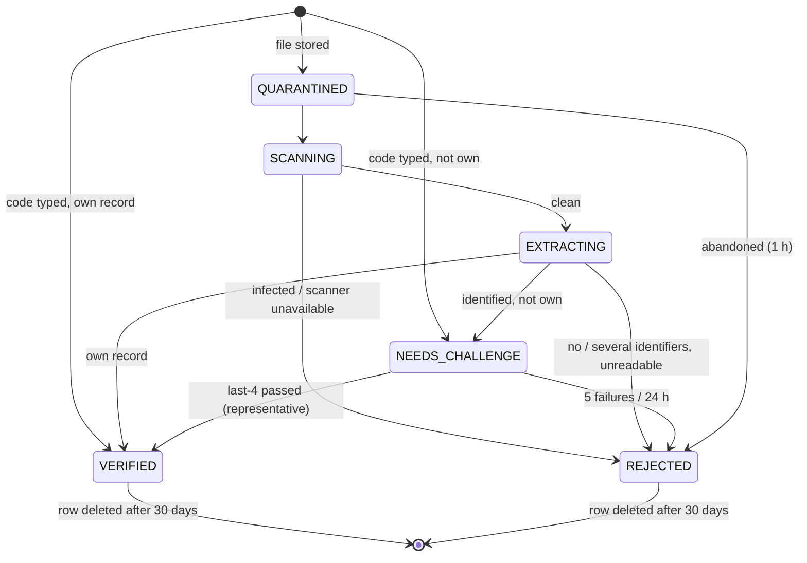

# Spec: Verified prescription uploads (M7b)

| Field | Value |
|---|---|
| Requirements | FR-UPL-01..05, FR-AI-04, NFR-20, FR-RX-08, NFR-18 |
| Milestone / phases | M7b / P6–P10 (issue #65) |
| Status | Approved (developer, 27 Oct 2026: architecture review, decisions D1–D7, approved in advance); implemented in M7b on the M7 branch, 27 Oct 2026 (as built: `docs/milestones/M7-assistant-and-verified-uploads.md`) |
| Owner | MediEase engineering |
| Last updated | 2026-10-27 |

## 1. Context
Someone holding a MediEase prescription (the patient, a parent, a carer) wants the assistant to
explain it, but the prescription is not in their own portal. They upload a photo or the PDF, or
type its verification code (FR-RX-11). MediEase accepts only prescriptions it issued, and the file
is only ever a pointer: the database record is the source of truth (ADR-0023). A linked patient
uses the picker instead (D7).

## 2. Actors and permissions
| Actor | Can | Cannot |
|---|---|---|
| Patient account (`@patient`) | Upload a file or type a code; see its own uploads' state; answer the last-4 check; choose the historical or latest version; delete its upload; use a verified upload in the assistant | See another account's uploads; open the uploaded file again; reach the patient's record, appointments or other prescriptions through a representative grant |
| Clinic staff, ops | Nothing: uploads never appear on staff or ops screens | — |
| Upload worker | Scan, read the identifier, verify, delete | Send anything to a model |

## 3. Domain model
`prescription_uploads` (platform data, owned by the patient account; `clinic_id` is set only when
verified): `id`, `account_id`, `source` (`FILE`, `CODE`), `state`, `content_type`, `size_bytes`,
`sha256`, `quarantine_key` (only while the file exists), `candidate_id` (the identified version,
while the check is pending), `clinic_id`, `prescription_id`, `access` (`OWN`, `REPRESENTATIVE`),
`selected_id`, `rejection_code`, `failed_challenges`, `created_at`, `updated_at`, `verified_at`,
`expires_at`, `finished_at`.

Invariants (domain and database CHECKs): `VERIFIED` ⇔ `prescription_id`, `clinic_id`, `access`,
`verified_at` and `expires_at` are set; `REJECTED` ⇔ `rejection_code` is set; a file key exists
only in `QUARANTINED`, `SCANNING` and `EXTRACTING`; `candidate_id` only in `NEEDS_CHALLENGE`.

## 4. Behaviour
### Upload and quarantine (P6, FR-UPL-01, NFR-20)
- **R1** `POST /api/v1/portal/prescription-uploads` takes multipart part `file`: PDF, JPEG or PNG
  recognised by its first bytes (the shared sniffer), 1 byte to 10 MB; the request is refused with
  413 before parsing beyond 10 MB + 64 KB. The file is stored write-once at
  `uploads/{account_id}/{upload_id}` (the quarantine prefix), the row is `QUARANTINED` and the
  processing job is enqueued in the same transaction; if the commit fails the file is removed.
  Answer 202 with the upload.
- **R2** Limits: 10 uploads or codes per account per hour and 30 per caller (IP fingerprint) per
  hour, else `UPL_RATE_LIMITED` (429, `Retry-After`); at most 3 uploads of an account in
  processing at once, else `UPL_TOO_MANY` (409).
- **R3** The web origin answers an oversized upload with the API's 413, not a 500 (issue #30):
  the proxy route for uploads streams the body and checks its length.

### Scanning (P7, FR-UPL-02)
- **R4** The upload worker (`WORKER_QUEUE=uploads`) claims only upload job kinds; the default worker
  never claims them, so scanning cannot delay reminders or notifications.
- **R5** The file is streamed to clamd (`INSTREAM`) through `MalwareScannerPort` before anything
  parses it. `FOUND` → `REJECTED (UPL_INFECTED)`; an unreachable or failing scanner is retried
  (1, 5, 15 minutes); after the last attempt → `REJECTED (UPL_SCAN_UNAVAILABLE)`. Never skipped.

### Identifier extraction (P8, FR-UPL-03)
- **R6** Only after a clean scan: a PDF is opened with pdfium (at most 2 pages read, at most 50
  pages in the file, page size and render size capped); its text layer and its pages rendered at
  216 dpi are read; an image is decoded with Pillow (at most 40 megapixels). QR codes are decoded
  with zxing-cpp. Accepted identifiers: `MEDIEASE-RX:1:<uuid>` payloads and printed codes in the
  text layer (FR-RX-11 grammar). No OCR.
- **R7** Exactly one distinct ID → identified. None → `REJECTED (UPL_NO_IDENTIFIER)` (the UI
  offers a retake or the typed code). More than one (for example a QR and a printed code that
  disagree) → `REJECTED (UPL_AMBIGUOUS)`. A file that cannot be decoded within the limits →
  `REJECTED (UPL_UNREADABLE)`.
- **R8** The extraction port returns an ID or nothing. Text, images and any other content read
  from the file never leave the adapter; nothing from the file is stored but its type, size and
  SHA-256.
- **R9** `POST …/prescription-uploads/by-code` `{code}` accepts the printed code (any case, with or
  without dashes) or a full payload and goes straight to verification (no file, no scan).
  An unparseable code is `REQ_VALIDATION_FAILED`.

### Verification (P9, FR-UPL-04)
- **R10** The identified ID is looked up only inside the account's `PortalScope` (its active
  links, suspended clinics left out), accepting `ISSUED` and `SUPERSEDED` versions of a linked
  record → `VERIFIED`, access `OWN`.
- **R11** Otherwise → `NEEDS_CHALLENGE`, whether or not the ID exists, and nothing about the
  prescription is shown. `POST …/{id}/challenge {phone_last4}` (verified email required,
  `PRT_UNVERIFIED_ACCOUNT`): the clinic is found by a reviewed IDs-only lookup; the chain's patient
  link (not revoked) is checked with the FR-RX-08 last-4 rule and its lockout (`check_last4`).
  Pass → `VERIFIED`, access `REPRESENTATIVE`, scoped to that prescription chain.
- **R12** Every failure, including an ID that does not exist, has no link or whose clinic is
  suspended, counts on the upload and answers `UPL_CHALLENGE_FAILED` (401) with the attempts
  left from the upload's own count, so the answer never reveals whether the prescription exists;
  the fifth → `REJECTED (UPL_LOCKED)`. A real link's own counter also counts (five lock the link
  for everyone, as today; staff can reset it).
- **R13** A grant lasts 24 hours (`expires_at`); after that the upload cannot be used.
- **R14** A representative grant never creates a portal link and opens nothing but that chain's
  versions: not the patient's appointments, bills, reminders or other prescriptions (NFR-18).
- **R15** If the identified version is superseded, the upload says so with the latest version's
  number and date (only once verified), and `selected` is empty until the user chooses with
  `POST …/{id}/selection {choice: UPLOADED | LATEST}`. The choice can be changed; nothing is
  ever substituted silently. A current version is selected automatically (nothing to choose).

### Handoff, lifecycle and privacy (P10, FR-UPL-05)
- **R16** The assistant accepts `context: {upload_id}` only for the account's own `VERIFIED`,
  unexpired upload with a selection (`UPL_SELECTION_REQUIRED`, 409, before that), re-checks the
  access each turn (`OWN` through `PortalScope`; `REPRESENTATIVE` through the chain) and explains
  the selected version from the database (assistant R10). The model never receives upload bytes,
  extracted text, file names or blob keys.
- **R17** The file is deleted as soon as the upload leaves `EXTRACTING` (identified or rejected)
  or is rejected earlier; `DELETE …/{id}` deletes the file (if any) and ends the grant
  (`REJECTED (UPL_WITHDRAWN)`).
- **R18** A sweep every 10 minutes rejects uploads still in `QUARANTINED`, `SCANNING` or
  `EXTRACTING` after 1 hour (`UPL_ABANDONED`) and `NEEDS_CHALLENGE` after 24 hours
  (`UPL_EXPIRED`), deleting their files, and deletes rows (and any file) 30 days after creation.
- **R19** Uploads never appear on clinic or ops screens and are never added to the patient's
  records or attachments. Logs and audit carry IDs, states, codes, type and size only (never the
  file name, the code typed, or anything read). Audit: `prescription_upload.verified` (with the
  clinic, the prescription and the access) and `prescription_upload.challenge_failed`.

## 5. API surface
| Method | Path | Request | Success | Errors |
|---|---|---|---|---|
| POST | `/api/v1/portal/prescription-uploads` | multipart `file` | 202 upload | 413, 415, 422 `UPL_FILE_REJECTED`, 409 `UPL_TOO_MANY`, 429 |
| POST | `/api/v1/portal/prescription-uploads/by-code` | `{code}` | 201 upload | 422, 409, 429 |
| GET | `/api/v1/portal/prescription-uploads/{id}` | — | 200 upload | 404 |
| POST | `/api/v1/portal/prescription-uploads/{id}/challenge` | `{phone_last4}` | 200 upload | 401 `UPL_CHALLENGE_FAILED`, 403, 404, 409 `UPL_NOT_AWAITING`, 429 |
| POST | `/api/v1/portal/prescription-uploads/{id}/selection` | `{choice}` | 200 upload | 404, 409 `UPL_NOT_VERIFIED` |
| DELETE | `/api/v1/portal/prescription-uploads/{id}` | — | 204 | 404 |

The upload body: `id`, `state`, `source`, `rejection_code`, `attempts_left` (only in
`NEEDS_CHALLENGE`), `created_at`, and once verified `verification`: `access`, `clinic_name`,
`doctor_name`, `version`, `issued_at`, `superseded`, `latest` (`version`, `issued_at`) when
superseded, `selected` (`UPLOADED`, `LATEST` or null), `expires_at`. Never a storage key, a hash, a
scanner name or any ID other than the upload's.

## 6. UI notes
In the portal assistant page: *Upload a prescription* (file or camera, or *Type the code*), a state
line (Uploading, Checking for viruses, Reading the code, Checking access, Verified, Not accepted
with the reason and a retry), the last-4 form for a prescription that is not in the account
("This prescription is not in your account. Enter the last 4 digits of the patient's phone number
on the clinic's records."), the historical/latest choice, then *Ask about this prescription*. The
representative notice: "You can ask about this prescription only. It does not open the patient's
records." English and Hindi.

## 7. Events and side effects
| Trigger | Audit action | Job enqueued | Analytics event |
|---|---|---|---|
| File uploaded | — | `process_prescription_upload` | — |
| Verified | `prescription_upload.verified` | — | — |
| Challenge failed | `prescription_upload.challenge_failed` (and the link's own) | — | — |
| Every 10 minutes | — | `purge_prescription_uploads` (recurring) | — |

## 8. Edge cases
| Case | Expected outcome |
|---|---|
| A genuine QR pasted on edited medicine lines | Verified by the ID; the assistant explains the database record only |
| The EICAR test file | `REJECTED (UPL_INFECTED)`, the file deleted |
| A text file renamed `.pdf` | 422 `UPL_FILE_REJECTED` at upload |
| A photo of a layout-2 prescription | `REJECTED (UPL_NO_IDENTIFIER)` |
| Another account's prescription, wrong digits | `UPL_CHALLENGE_FAILED`; same answer as a made-up code |
| A family member with the right digits | Verified as representative for that prescription only |
| A superseded version uploaded | Verified as historical; the user chooses; the assistant follows the choice |
| clamd down | Retried, then `UPL_SCAN_UNAVAILABLE`, file deleted |
| The user leaves during processing | Abandoned after 1 hour, file deleted |

## 9. Acceptance criteria
- **AC1 (FR-UPL-02)** The EICAR file is rejected by the real ClamAV and its file deleted; a clean
  PDF passes.
- **AC2 (FR-UPL-03)** A layout-3 PDF and a photo-like rendering of it are identified by QR; a PDF
  whose QR is missing by its text layer; a file with two different codes is ambiguous.
- **AC3 (FR-UPL-04)** An own prescription is verified `OWN`; another account's needs the check and
  the wrong digits answer exactly as an unknown code; the right digits give a representative grant
  that opens no other record.
- **AC4 (FR-UPL-04)** A superseded upload is verified as historical; the assistant explains the
  version the user chose and refuses before a choice.
- **AC5 (FR-UPL-05, FR-AI-04)** With a genuine code on edited content, the model receives only the
  database record and none of the edited text; the file is gone after the outcome.
- **AC6 (FR-UPL-05)** Abandoned uploads are rejected and their files deleted by the sweep; rows go
  after 30 days.
- **AC7 (NFR-20)** Oversized, wrong-type and too many uploads are refused; a 10 MB upload through
  the web origin answers 202 or the API's 413, never 500.

## 10. Observability
`upload.received`, `upload.scanned` (result), `upload.identified` (method: `QR`, `TEXT`, `CODE`),
`upload.verified` (access), `upload.rejected` (code), `upload.file_deleted`, `upload.swept`
(counts). Error codes: `UPL_FILE_REJECTED`, `UPL_RATE_LIMITED`, `UPL_TOO_MANY`,
`UPL_CHALLENGE_FAILED`, `UPL_NOT_AWAITING`, `UPL_NOT_VERIFIED`, `UPL_SELECTION_REQUIRED`;
rejection codes `UPL_INFECTED`, `UPL_SCAN_UNAVAILABLE`, `UPL_NO_IDENTIFIER`, `UPL_AMBIGUOUS`,
`UPL_UNREADABLE`, `UPL_LOCKED`, `UPL_ABANDONED`, `UPL_EXPIRED`, `UPL_WITHDRAWN`.

## 11. Out of scope
OCR (Tesseract only if pilot data shows a need); external or non-MediEase prescriptions; storing
uploads as documents; staff review of uploads; multimodal models; uploads of prescriptions issued
before layout 3 (no code to read: they can type nothing and should use the portal or the link).

## 12. Decisions
D2 the payload; D3 explicit historical or latest; D4 no OCR; D6 uploads never shown to staff and
deleted after the outcome; D7 the picker for linked patients (developer, 27 Oct 2026). The
representative grant reuses the FR-RX-08 proof and lockout (ADR-0023 §4).

## 13. Open questions
The 30-day row retention and 24-hour grant are product choices pending counsel (L-04).
