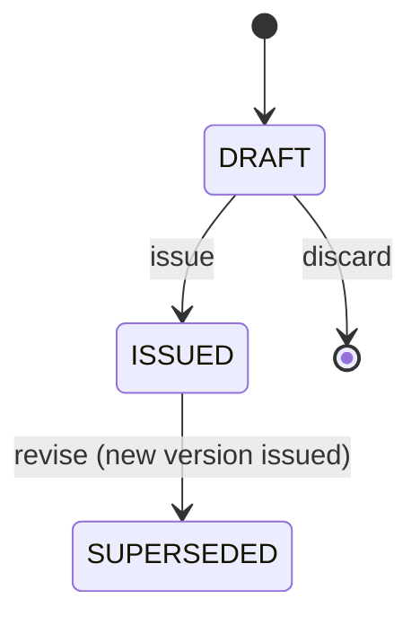

# Spec: Visits and digital prescriptions

| Field | Value |
|---|---|
| Requirements | FR-VIS-01..03, FR-VIS-05, FR-RX-01..10, FR-AUD-01, NFR-07 |
| Milestone / phases | M4 / P1–P6 |
| Status | Approved (developer sign-off 2026-10-17: decisions D1–D5 with the developer's refinements; ADR-0012) |
| Last updated | 2026-10-17 (approved; §2 made precise for owners; R5 adjusted for M4 without the M5 worker; R14–R20 added for delivery, read audit, the PDF cache and bilingual rendering) |

## 1. Context
Medicine instructions are explained once and lost (A14); parents struggle with dosage, dilution,
storage and feeding (A3); prescription clarity is Radiance's top concern (A6). This is the
product's differentiated wedge.

## 2. Actors and permissions
The permission matrix in PRD §8.1 is normative (`domain/identity/permissions.py`):

| Who | Clinical content (`CLINICAL_VIEW`) | Writes visits and prescriptions (`CLINICAL_WRITE`) |
|---|---|---|
| Doctor | Yes, for every patient of the clinic (continuity of care) | Their own visits only (the visit's doctor) |
| Owner who is also a doctor | Yes | Their own visits only |
| Owner who is not a doctor | Yes, read only | No |
| Front desk | **No.** Sees that a prescription was issued and can show or resend the link, never its content | No |

Patients view through a patient link only. Whether front desk may print the PDF (it shows the
content) is an open question for the M4-P4 design; until then the PDF needs `CLINICAL_VIEW`.

## 3. Domain model
- `Visit` (`OPEN → COMPLETED`; locked 24 h after completion), `VisitAddendum` (append-only).
- `Prescription` (`DRAFT → ISSUED → SUPERSEDED`), `PrescriptionItem`, `Advice`,
  `DoctorSnapshot` (captured at issue), `LinkDelivery` (the pending-delivery marker, D2).
- `PatientLink` (purpose `RX_VIEW`).

Structured instruction vocabulary (rendered in `en` and `hi` from a phrasebook versioned in the
repository, D5):
- `frequency`: `1-0-0`, `0-1-0`, `0-0-1`, `1-0-1`, `1-1-1`, `1-1-1-1`, `SOS`, `ONCE`, `CUSTOM`
- `timing`: `BEFORE_FOOD`, `AFTER_FOOD`, `WITH_FOOD`, `EMPTY_STOMACH`, `BEDTIME`, `ANY`
- `preparation` phrases: `SHAKE_WELL`, `DILUTE_IN_WATER` (+ amount), `DISSOLVE`, `CHEW`,
  `DO_NOT_CRUSH`, `CUSTOM`
- `storage` phrases: `ROOM_TEMP`, `REFRIGERATE`, `AWAY_FROM_LIGHT`, `DISCARD_AFTER_DAYS` (+ n)

These are *formatting* vocabularies chosen by the doctor, not clinical recommendations.

## 4. Behaviour
- **R1** A visit starts from an `IN_CONSULTATION` appointment, by that session's doctor, or directly
  for a walk-in (how a walk-in reaches a visit is decided in the M4-P1 design); one visit per
  appointment (`VIS_ALREADY_EXISTS`, with the existing visit's ID).
- **R2** Visit history on the consultation screen shows the last 10 visits with prescriptions,
  newest first, within 1 s.
- **R3** Completing a visit sets `locked_at = completed_at + 24 h`. After lock, edits return
  `VIS_LOCKED`; addenda are allowed.
- **R4** A draft prescription can be edited freely by its doctor. Issuing requires at least one
  item or advice entry (`RX_EMPTY`) and complete doctor details (`RX_DOCTOR_INCOMPLETE`).
- **R5** Issuing is atomic: status `ISSUED`, `issued_at`, `doctor_snapshot`, `language` (R20), audit
  `prescription.issued`, and the pending-delivery marker (R14). No job is enqueued in M4: the PDF
  is rendered on first request (R18) and the link is shown in the clinic (QR code and copy) until
  M5 delivers it. A `follow_up_date` is stored for M5's reminder rules.
- **R6** Issued prescriptions are immutable (application check + database trigger). Revising creates
  version n+1 as a draft copying the content; issuing it marks the previous version `SUPERSEDED`.
  The trigger allows only the operational columns (`status` to `SUPERSEDED`, `pdf_object_key` once,
  the delivery marker).
- **R7** Medicine autocomplete returns the doctor's favourites and the clinic's previously used
  medicine names only, ranked by use count. No external drug database, no dose suggestions.
- **R8** The PDF includes clinic name/address/phone, doctor name, qualification, registration
  number and council, patient name/code/age/sex, date, items, advice, follow-up date, and a
  footer "Digitally generated via MediEase". A5 by default, A4 as a clinic setting. Hindi text
  renders correctly (vendored Noto Sans Devanagari, ADR-0012).
- **R9** Patient links: token = base64url(header.claims.signature), HMAC-SHA256 with a versioned key;
  claims `jti`, `cid`, `pur=RX_VIEW`, `rid`, `exp` (90 days). Server checks signature, expiry,
  revocation and purpose.
- **R10** Opening a link requires the last 4 digits of the patient's contact phone. 5 failures lock
  the link (`LINK_LOCKED`) until staff reset it. Success issues a 30-minute view cookie scoped to
  that link.
- **R11** The patient page shows the **latest issued version** for the prescription chain and a
  banner "Updated by your doctor on <date>" if superseded versions exist.
- **R12** The patient page renders in the patient's language (R20); free text is shown as the doctor
  wrote it. No clinical content appears in the page title, Open Graph tags or URL.
- **R13** Every successful open writes `patient_link.opened`; the analytics event carries only IDs.
- **R14** *Pending delivery (D2).* On issue the prescription records `link_delivery = PENDING` and
  `link_delivery_requested_at = issued_at` when the patient allows WhatsApp or SMS, else
  `NOT_CONSENTED`. Issuing a newer version sets the older version's `PENDING` to `SUPERSEDED`, so
  only the latest is ever sent. M4 sends nothing.
- **R15** *M5 freshness guard (D2).* The M5 sender delivers a `PENDING` link only if the
  prescription was issued within the last **24 hours** and consent still holds at send time;
  otherwise it marks it `EXPIRED` (audited as `SYSTEM`) and sends nothing. Turning M5 on therefore
  never messages patients about prescriptions issued during M4. The window is a setting with a
  24-hour maximum; a test in M5 proves a 25-hour-old `PENDING` link is not sent.
- **R16** *Read audit at the logical view (D4).* Every response that shows clinical content to staff
  writes exactly **one** audit row for that view, at the use-case boundary, never per entity
  inside it: opening the consultation screen (one aggregate read of the visit, its draft and the
  history) is one `visit.viewed`; a patient's history list is one `patient.visits_viewed`; a PDF
  download is one `prescription.pdf_downloaded`. A write is audited by its own action, not again as
  a read. Metadata holds IDs, counts and enums only, never clinical text. Clinical screens do not
  poll; a save returns the updated record, so it needs no re-read.
- **R17** Audit metadata and logs for visits and prescriptions carry IDs, statuses, versions, counts
  and the **names** of changed fields, never their values (NFR-07). A test writes sentinel strings
  into every clinical field and asserts they appear in no log line and no audit row.
- **R18** *Render once (D1).* `GET /api/v1/prescriptions/{id}/pdf` locks the prescription row, and
  if `pdf_object_key` is empty renders through `PdfRendererPort`, stores through
  `BlobStoragePort` under `rx/{clinic_id}/{prescription_id}/v{version}.pdf` (write once, atomic) and
  records the key, then streams the bytes (`Cache-Control: private, no-store`). Concurrent first
  requests cause one render; a request that cannot get the lock in time gets `503 RX_PDF_BUSY` with
  `Retry-After`. No public or pre-signed URL is ever issued (ADR-0012).
- **R19** The patient page language is the patient's saved preference, with an English / हिन्दी
  switch on the page that changes only that page view (not the saved preference).
- **R20** *Bilingual safety (D5).* Static labels and the structured vocabularies of §3 come from the
  phrasebook in the chosen language. Every free-text field (medicine name, custom frequency,
  instructions, warnings, advice, notes) renders **verbatim**, never machine-translated or
  transliterated. A missing phrase in Hindi falls back to English for that phrase and fails the
  phrasebook completeness test. The PDF uses the prescription's `language`, captured at issue from
  the patient's preference, because it is rendered once per version.

## 5. API surface
See API.md "Visits and prescriptions" and "Patient links". `GET /api/v1/prescriptions/{rx_id}/pdf`
returns the PDF itself (R18), not a URL.

## 6. UI notes
- Consultation screen: left = history timeline; right = notes and Rx builder.
- Rx builder is keyboard-first: type medicine → Tab through dose, frequency, timing, duration →
  Enter adds the line; favourites insert a full line with its instructions.
- "Issue" shows a preview of exactly what the patient will see.
- After issue (M4): *Print* and the patient link as a QR code and a copy button (D2).
- Patient page: one card per medicine with headings *When to take*, *How much*, *How to give*,
  *For how long*, *Storage*; advice and "Come back immediately if…" below; clinic phone button.
  Works at 360 px, < 200 KB, no web fonts except the Devanagari subset when needed.

## 7. Events and side effects
| Trigger | Audit | Jobs | Analytics |
|---|---|---|---|
| Visit started / updated / completed | `visit.started` / `visit.updated` (field names) / `visit.completed` | — | `visit_completed` |
| Addendum added | `visit.addendum_added` | — | — |
| Consultation screen or history opened | `visit.viewed` / `patient.visits_viewed` (one per view, R16) | — | — |
| Rx issued | `prescription.issued` | none in M4; pending-delivery marker (R14) | `prescription_issued` |
| Rx revised | `prescription.revised` | none in M4 | — |
| PDF downloaded | `prescription.pdf_downloaded` | — | — |
| Link opened / challenge failed | `patient_link.opened` / `patient_link.challenge_failed` | — | `prescription_link_opened` |

## 8. Edge cases
| Case | Expected outcome |
|---|---|
| Patient has no consent | Rx issued (`NOT_CONSENTED`); PDF printable; no message ever sent; staff can show a QR code of the link in clinic |
| Doctor edits an issued Rx | Offered "Revise" → new version |
| Link opened after a newer version issued | Latest version with update banner |
| Hindi selected but free text in English | Structured parts and labels in Hindi, free text as written |
| Very long item list (> 15) | PDF paginates; patient page stays one scroll |
| Two staff press *Print* on a new Rx together | One render; both get the same PDF (R18) |
| M5 switched on with M4-era pending links | Older than 24 h: `EXPIRED`, not sent (R15) |
| Doctor reopens the consultation screen five times | Five `visit.viewed` rows, one per open; none for saves (R16) |

## 9. Acceptance criteria
- **AC1 (FR-RX-09)** Given an issued Rx, when `PUT /prescriptions/{id}` is called, then 409
  `RX_NOT_DRAFT` and a direct SQL `UPDATE` of clinical columns is rejected by the trigger.
- **AC2 (FR-RX-07)** Given the sample Rx in PRD §8.6, when opened on a 360-px viewport, then all
  fields are visible without horizontal scroll and the dilution text is under "How to give".
- **AC3 (FR-RX-08)** Given 5 wrong last-4 attempts, then the 6th attempt with the right digits
  returns 423 `LINK_LOCKED`.
- **AC4 (FR-RX-06)** Given a doctor without a registration number, when issuing, then 422
  `RX_DOCTOR_INCOMPLETE`.
- **AC5 (FR-RX-10)** Given a clinic that never prescribed "Drug Q", when typing "Dru", then
  "Drug Q" is not suggested.
- **AC6 (FR-VIS-05)** Given a visit completed 25 hours ago, when editing notes, then 409
  `VIS_LOCKED`, and adding an addendum succeeds.
- **AC7 (NFR-07)** Given the leakage test, then no item text appears in logs, job payloads, audit
  metadata or message variables.
- **AC8 (R18)** Given an issued Rx with no PDF yet, when two downloads start together, then the
  renderer runs once and both responses carry the same bytes.
- **AC9 (R16)** Given the consultation screen's load, then exactly one audit row is written.
- **AC10 (R20)** Given a Hindi-language Rx whose instruction free text is in English, then the PDF
  and the page show Hindi labels and phrases and the free text byte-for-byte as written.

## 10. Observability
Events: `rx.issued`, `rx.pdf_rendered` (duration, bytes), `rx.pdf_failed` (`RX_PDF_FAILED`),
`patient_link.opened`, `patient_link.locked`. Metrics: time from visit start to Rx issue (doctor
speed), link open rate, first-download render time.

## 11. Out of scope
Attachments (P1), vaccination schedules (P1), e-signature beyond printed details, ABDM sharing,
drug database or interaction checks (never, per principle 6), any third-party document, media or
translation service (D1, D5), sending messages (M5).

## 12. Decisions
- **D1** PDFs are rendered in-house on first request and stored once per version behind
  `PdfRendererPort` (WeasyPrint, vendored Noto Sans + Noto Sans Devanagari) and `BlobStoragePort`
  (local volume; S3-compatible for production). Key `(clinic_id, prescription_id, version)`; render
  under the prescription's row lock so concurrent first requests render once (R18, ADR-0012).
- **D2** M4 shows the link in the clinic (QR, copy) and records a pending-delivery marker on issue;
  M5 sends only links issued within the last 24 hours (R14, R15).
- **D3** The format follows this spec and the PRD §8.6 sample (A5 default, A4 per clinic) and is
  adjusted when pilot formats arrive (L-07); counsel's review (L-04) gates M6, not M4.
- **D4** Clinical content is visible to doctors and owners, not front desk (§2); reads are audited
  once per logical view with no clinical text in metadata (R16, R17).
- **D5** The patient's preference sets the language, with a page switch; labels and structured
  phrases are bilingual, free text is verbatim, never machine-translated (R19, R20).

## 13. Open questions
- Exact legal prescription format requirements — counsel (L-04, before M6).
- Do pilot doctors want A5 or A4 by default? (L-07; a clinic setting either way.)
- May front desk print a prescription they cannot otherwise view? (M4-P4 design.)
