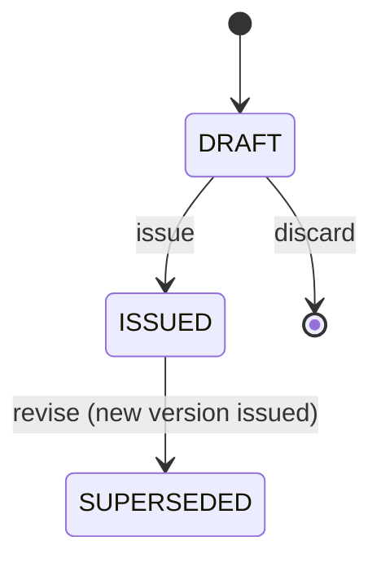

# Spec: Visits and digital prescriptions

| Field | Value |
|---|---|
| Requirements | FR-VIS-01..03, FR-VIS-05, FR-RX-01..10, FR-AUD-01 |
| Milestone / phases | M4 / P1–P6 |
| Status | Draft |
| Last updated | 2026-09-15 |

## 1. Context
Medicine instructions are explained once and lost (A14); parents struggle with dosage, dilution,
storage and feeding (A3); prescription clarity is Radiance's top concern (A6). This is the
product's differentiated wedge.

## 2. Actors and permissions
Doctors write visits and issue prescriptions for their own visits; an owner who is also a doctor
likewise. Front desk sees that a prescription was issued and can resend the link, but not its
content. Patients view via patient link only.

## 3. Domain model
- `Visit` (`OPEN → COMPLETED`; locked 24 h after completion), `VisitAddendum`.
- `Prescription` (`DRAFT → ISSUED → SUPERSEDED`), `PrescriptionItem`, `Advice`,
  `DoctorSnapshot` (captured at issue).
- `PatientLink` (purpose `RX_VIEW`).

Structured instruction vocabulary (rendered in `en` and `hi`):
- `frequency`: `1-0-0`, `0-1-0`, `0-0-1`, `1-0-1`, `1-1-1`, `1-1-1-1`, `SOS`, `ONCE`, `CUSTOM`
- `timing`: `BEFORE_FOOD`, `AFTER_FOOD`, `WITH_FOOD`, `EMPTY_STOMACH`, `BEDTIME`, `ANY`
- `preparation` phrases: `SHAKE_WELL`, `DILUTE_IN_WATER` (+ amount), `DISSOLVE`, `CHEW`,
  `DO_NOT_CRUSH`, `CUSTOM`
- `storage` phrases: `ROOM_TEMP`, `REFRIGERATE`, `AWAY_FROM_LIGHT`, `DISCARD_AFTER_DAYS` (+ n)

These are *formatting* vocabularies chosen by the doctor, not clinical recommendations.

## 4. Behaviour
- **R1** A visit starts from an `IN_CONSULTATION` appointment or directly for a walk-in; one visit
  per appointment (`VIS_ALREADY_EXISTS`).
- **R2** Visit history on the consultation screen shows the last 10 visits with prescriptions,
  newest first, within 1 s.
- **R3** Completing a visit sets `locked_at = completed_at + 24 h`. After lock, edits return
  `VIS_LOCKED`; addenda are allowed.
- **R4** A draft prescription can be edited freely by its doctor. Issuing requires at least one
  item or advice entry (`RX_EMPTY`) and complete doctor details (`RX_DOCTOR_INCOMPLETE`).
- **R5** Issuing is atomic: status `ISSUED`, `issued_at`, `doctor_snapshot`, audit
  `prescription.issued`, jobs `render_prescription_pdf` and (if consented) `send_rx_link`, and a
  `follow_up` reminder if `follow_up_date` is set (M5; stored as pending in M4).
- **R6** Issued prescriptions are immutable (application check + database trigger). Revising creates
  version n+1 as a draft copying the content; issuing it marks the previous version `SUPERSEDED`.
- **R7** Medicine autocomplete returns the doctor's favourites and the clinic's previously used
  medicine names only, ranked by use count. No external drug database, no dose suggestions.
- **R8** The PDF includes clinic name/address/phone, doctor name, qualification, registration
  number and council, patient name/code/age/sex, date, items, advice, follow-up date, and a
  footer "Digitally generated via MediEase". A5 by default, A4 optional. Hindi text renders
  correctly (embedded Devanagari font).
- **R9** Patient links: token = base64url(header.claims.signature), HMAC-SHA256 with a versioned key;
  claims `jti`, `cid`, `pur=RX_VIEW`, `rid`, `exp` (90 days). Server checks signature, expiry,
  revocation and purpose.
- **R10** Opening a link requires the last 4 digits of the patient's contact phone. 5 failures lock
  the link (`LINK_LOCKED`) until staff reset it. Success issues a 30-minute view cookie scoped to
  that link.
- **R11** The patient page shows the **latest issued version** for the prescription chain and a
  banner "Updated by your doctor on <date>" if superseded versions exist.
- **R12** The patient page renders in the patient's language; free text is shown as the doctor wrote
  it. No clinical content appears in the page title, Open Graph tags or URL.
- **R13** Every successful open writes `patient_link.opened`; the analytics event carries only IDs.

## 5. API surface
See API.md "Visits and prescriptions" and "Patient links".

## 6. UI notes
- Consultation screen: left = history timeline; right = notes and Rx builder.
- Rx builder is keyboard-first: type medicine → Tab through dose, frequency, timing, duration →
  Enter adds the line; favourites insert a full line with its instructions.
- "Issue" shows a preview of exactly what the patient will see.
- Patient page: one card per medicine with headings *When to take*, *How much*, *How to give*,
  *For how long*, *Storage*; advice and "Come back immediately if…" below; clinic phone button.
  Works at 360 px, < 200 KB, no web fonts except the Devanagari subset when needed.

## 7. Events and side effects
| Trigger | Audit | Jobs | Analytics |
|---|---|---|---|
| Visit completed | `visit.completed` | — | `visit_completed` |
| Rx issued | `prescription.issued` | render PDF, send link | `prescription_issued` |
| Rx revised | `prescription.revised` | render PDF, send "updated" link | — |
| Link opened / challenge failed | `patient_link.opened` / `patient_link.challenge_failed` | — | `prescription_link_opened` |

## 8. Edge cases
| Case | Expected outcome |
|---|---|
| Patient has no consent | Rx issued; PDF printable; no message sent; staff can show a QR code of the link in clinic |
| Doctor edits an issued Rx | Offered "Revise" → new version |
| Link opened after a newer version issued | Latest version with update banner |
| Hindi selected but free text in English | Structured parts in Hindi, free text as written |
| Very long item list (> 15) | PDF paginates; patient page stays one scroll |

## 9. Acceptance criteria
- **AC1 (FR-RX-09)** Given an issued Rx, when `PUT /prescriptions/{id}` is called, then 409
  `RX_NOT_DRAFT` and a direct SQL `UPDATE` of clinical columns is rejected by the trigger.
- **AC2 (FR-RX-07)** Given the sample Rx in PRD §8.6, when opened on a 360-px viewport, then all
  fields are visible without horizontal scroll and the dilution text is under "How to give".
- **AC3 (FR-RX-08)** Given 5 wrong last-4 attempts, then the 6th attempt with the right digits
  returns 423 `LINK_LOCKED`.
- **AC4 (FR-RX-06)** Given a doctor without a registration number, when issuing, then 422
  `RX_DOCTOR_INCOMPLETE`.
- **AC5 (FR-RX-10)** Given a clinic that never prescribed "Drug Q", when typing "Dru", then
  "Drug Q" is not suggested.
- **AC6 (FR-VIS-05)** Given a visit completed 25 hours ago, when editing notes, then 409
  `VIS_LOCKED`, and adding an addendum succeeds.
- **AC7 (NFR-07)** Given the leakage test, then no item text appears in logs, job payloads or
  message variables.

## 10. Observability
Events: `rx.issued`, `rx.pdf_rendered`, `rx.pdf_failed` (`RX_PDF_FAILED`), `patient_link.opened`,
`patient_link.locked`. Metrics: time from visit start to Rx issue (doctor speed), link open rate.

## 11. Out of scope
Attachments (P1), vaccination schedules (P1), e-signature beyond printed details, ABDM sharing,
drug database or interaction checks (never, per principle 6).

## 12. Open questions
- Exact legal prescription format requirements — counsel (L-04).
- Do pilot doctors want A5 or A4 by default? (L-07)
